# Codebase Map

> The `architect-team` Claude Code plugin (user-facing name CLAUDE TEAM SIX). **v4.1.0 (2026-11-09) — quiet-holds-and-the-users-release** (MINOR; the release cut at this refresh on fa28aa0): a held Stop is hook JSON on stdout with exit 0 — transcript `Stop hook feedback`, never a hook error on the user's screen (`CT6_STOP_HOLD_MODE=block` restores the old shape); releasing a hold is the USER's verb — `/architect-team:unlock <why>` runs `hooks/completion_unlock.py release` under one durable record in `.architect-team/releases/`, sanctioned only inside the user's own command turn by Arm 5 of `hooks/pretool_skill_gate.py`; a satisfied `converge:<kind>` gate's record is READ, not just found; `scripts/converge/record.py` declares and records every reviewer-convergence loop; and the v4.0.0 documentation debt is closed on every surface (reviewer counts per tier everywhere, `superpowers` / `cartographer` conditional everywhere). Inventory **60 skills / 39 agents / 30 commands / 9 hook scripts (10 wired events) / 26 Layer-3 tools**; suite **8932 passing + 2 skipped, 0 failed** across 277 top-level test files (the v4.1.0 CHANGELOG entry's count, bracketed under `docs/measurements/` as the release's closing act; the v4.0.0 bracket was 8874 + 2 across 274). Prior: **v4.0.0 (2026-11-09) — claude-5-modernization** (MAJOR; the pipeline keeps every gate and sheds its instruction weight): the constitution and every heavy lane skill split into a short `SKILL.md` plus `references/` chapters behind STOP pointers, each with its own INDEX of required reads; every agent preloads `skills/ct6-agent-core` instead of carrying compiled blocks; the agent model follows the role (`scripts/setup/set_default_model.py --split role` — 15 fable / 9 opus / 14 sonnet / 1 haiku); reviewer counts follow `skills/team-spawning-and-review-gates/references/review-tiers.md`; `workflows/ct6-converge.js` runs every reviewer-convergence loop (ralph-loop retired); `superpowers` / `cartographer` are conditional with a native fallback; setup writes `CLAUDE_CODE_ENABLE_TODO_TOOLS=1` and the completion lock reads both harness task-dir layouts; plus the deletion guard, project principles, the test index + selector, sample-first data iteration, page publishing, the project homepage + timing log + decisions ledger, and the instruction-budget measurement. Inventory **60 skills / 39 agents / 29 commands / 9 hook scripts (10 wired events) / 26 Layer-3 tools**; suite **8874 passing + 2 skipped, 0 failed** across 274 test files (linux / py3.13; `docs/measurements/2026-11-09-v4.0.0-suite.json`). Prior: **v3.42.1 (2026-07-21) — docs-currency-v3-42-1** (documentation-currency PATCH; docs-only): a full sweep of the 207-doc walked surface — 202 verified current, 4 frozen-feature, exactly ONE updated (`commands/architect-team-setup.md`); zero dead pointers across 500+ citations verified by three independent checkers; independent widened-surface audit PASS with zero findings. Inventory **48 skills / 39 agents / 23 commands**; suite **5891 passing + 16 skipped** across 209 test files (unchanged from v3.42.0). Prior: **v3.42.0 (2026-07-21) — quality-upgrades-v3-42** (twelve self-improvements to CT6's own instruction machinery; NO new skill / agent / command / hook / Layer-3 tool): new `docs/ETHOS.md` (seven operating principles, each with its anti-pattern) compiled into all 39 agents + the 6 pipeline-driving skills via the NEW `scripts/setup/compile_skills.py` marker-fence compiler; a recall data-envelope (`scripts/memory/recall_hygiene.py`) marking every MemPalace-rendered block as data at both render boundaries + an optional allowlist + a budgeted TTL digest cache; generated instruction-surface tooling (`scripts/docs_tooling/` → the freshness-gated `docs/CAPABILITY_INDEX.md` + the `docs/CHANGELOG_RUBRIC.md` version/suite-line gate) plus this map's `## 9. What's intentionally NOT here` non-goals section; opt-in self-removing installer guidance (`scripts/setup/guidance_blocks.py`, the three installers' `--claude-md` flag); and the first opt-in behavioral eval tier (`scripts/evals/` + `tests/evals/`, behind `CT6_EVALS=1`, the default suite key-free — a live 4/4 smoke this release). Inventory **48 skills / 39 agents / 23 commands**; living specs 62 → 68; suite **5891 passing + 16 skipped** across 209 test files (macOS-without-PyYAML basis — 14 PyYAML-gated + 2 archived-coverage-map skips; identical under the default env and `PYTHONUTF8=1`). Prior: **v3.41.1 (2026-07-19) — gateway-activation-drift** (a recorded-consent flag is never ground truth): the `gateway.json.activated` flag is no longer trusted as ground truth for the client-side wiring it merely remembers — `status` names activation drift loudly (summary `activated=False (DRIFTED)` + a dedicated `activation-drift` row + a drifted footer + a first-class `--json` field, with a clean machine's output byte-identical), the install carry-forward VERIFIES `activation_fully_applied` against the SERVED port before trusting the flag and HEALS from the persisted master key (corrupt settings.json aborts first; unhealable emits a FAIL row, never a green carried-forward), and the new `maybe_heal_activation()` in `hooks/sessionstart-run-continuity.py` self-heals at SessionStart behind a TCP liveness guard, never clobbering a user-customized `ANTHROPIC_BASE_URL`. **REQ-004 — the root clobberer was this repo's own test suite**: `tests/test_install_gateway.py::test_uninstall_purge_removes_state_dir` ran a REAL `uninstall` with no `--settings-path`, so every full `pytest` run stripped the env block from the developer's real `~/.claude/settings.json` (a silent no-op on CI, which is why it survived) — the actual cause of BOTH observed drift incidents. Closed in three layers: the leaker now names `--settings-path`; a module-wide autouse `_sandbox_default_settings_path` fixture redirects `_setup.DEFAULT_USER_SETTINGS_PATH` to a per-test sentinel; and a session-scoped `_real_state_tripwire` in `tests/conftest.py` SHA-256-digests the real `settings.json` + `gateway.json` + `gateway.env` and fails the suite LOUDLY on any mutation (verified to actually fire). Inventory **48 skills / 39 agents / 23 commands**; suite **5689 passing + 4 skipped** across 202 test files. Prior: **v3.41.0 (2026-07-18) — glm-secondary-route-fix** (the GLM secondary made real): registry route dialects — each `SECONDARY_PROVIDERS` entry carries the REQUIRED `route_dialect` and the gateway route is derived `<route_dialect>/<model>` (`zai` → `hosted_vllm/glm-5.2`; the hard-coded `openai/` prefix that 404'd every call is gone, `route_model` removed); the role split writes the harness-spawnable `SPAWN_ALIAS_MODEL_ID` `claude-haiku-4-5`, gateway-impersonated to the chosen secondary (disclosed in `gateway.json`/`status`/README; `ct6-secondary` stays served for direct callers); “CONFIRMED live” requires a spawn-alias-MANDATORY `/v1/messages` completion with the serving deployment verified against the registry-derived route via `/model/info` plus an auth-enforcement rung; and the install keeps exactly ONE tree-aware owned instance, judges staleness by served-state route-contradiction, restarts bind-verified through the port-holder stop, and deploys never-dark verify-then-swap with the launcher port guard + masked key log. Inventory **48 skills / 39 agents / 23 commands**; suite **5646 passing + 4 skipped** across 199 test files (+ the pytest-collected replication artifact at `tests/bug-fix-glm-secondary-route-fix/`). Prior: **v3.40.1 (2026-07-17) — context-token-optimization** (instruction-surface token-efficiency PATCH; docs/instruction files only, zero behavior change): CLAUDE.md rewritten 95,221 → 25,331 B (`## Recent releases` bounded to the 3 most recent entries + the CHANGELOG pointer; `What this repo is` + `Stack` rewritten current-state; the Conventions `.mempalace` location corrected to disk truth), the three pipeline `## Dispatch mode` residual digests trimmed to their `common-pipeline-conventions` citations (all pinned anchors retained), two consistency fixes (a data-engineering-exploration Stage 6 CPC citation; the mempalace-integration palace-path sentence), and the new living capability spec `context-surface-efficiency` (59 → 60). Inventory **48 skills / 39 agents / 23 commands**; suite **5542 passing + 4 skipped** across 199 test files (IDENTICAL to v3.40.0). Prior: **v3.40.0 (2026-07-17) — secondary-provider registry** (a selectable secondary API + the provider-neutral alias): the gateway's secondary model slot is selectable — OpenAI Codex (`gpt-5.6-sol`) or Z.ai GLM 5.2 (`glm-5.2`) — via the `SECONDARY_PROVIDERS` registry single-sourced in `scripts/setup/set_default_model.py` (one dict entry per future provider); the choice is asked once (wrapper AskUserQuestion / installer TTY prompt / `--secondary` / `CT6_SECONDARY_PROVIDER`), remembered in `gateway.json` (pre-v3.40 installs grandfathered as openai; `--re-ask-provider` re-opens), and the role split's written id becomes the provider-neutral `ct6-secondary` under policy `secondary-split` (the legacy `codex-5.6-sol` / `codex-split` still read, never written; heal-to-recorded-alias + migration-on-every-config-regenerating-install + provider-switch key retention out of a 3-round adversarial review). Inventory **48 skills / 39 agents / 23 commands**; suite **5542 passing + 4 skipped** across 199 test files. Prior: **v3.39.1 (2026-07-16) — living-docs current-state refresh** (on v3.39.0 — one-call external-LLM setup: runtime split targeting + live /v1/models confirmation + SessionStart self-heal): the living current-state assertions now consistently report the shipped version, inventory, and suite totals — 48 skills / 39 agents / 23 commands; 5494 passing + 4 skipped across 199 test files. Prior: **v3.35.0 (2026-07-14) — Codex 5.6 model role split:** availability-gated — with Codex 5.6 in the harness, `fable` keeps all 18 architecture/control/design agents and `codex-5.6-sol` takes all 21 development/code-checking/testing agents (`scripts/setup/set_default_model.py` `AGENT_ROLES` + `apply_policy` + `--split codex`/`--auto`/policy-state `--check`/`--codex-model`); without it the current operating model stays (uniform fable + the Opus fallback lever). Deploy is ONE flag, managed by setup (`/architect-team:architect-team-setup --codex`, or `CT6_CODEX_56_AVAILABLE=1`; `--no-codex` restores; NO signal leaves the model state untouched; lever failure degrades to a warn row, never gates). Unclassified agents fail safe to fable; availability is an INPUT, never probed; ship state still uniform `model: fable`. Prior: **v3.34.0 (2026-07-13) — informative run notifications:** `scripts/notify/notify.py` `EVENT_TYPES` 6 → 10 — the plan-carrying `run_start` kickoff email (repeatable `--plan-file` embeds proposal/design/tasks in ONE email; 20k-char/file + 8-file caps), the `waiting_on_agents`/`agents_complete` dispatch-wait pair (`--agents` roster: missions when dispatched, outcomes when returned), the final `run_complete`, and universal `--details`/`--progress`/`--next-step` body blocks on every event per the new CPC 'Informative, not just status' content contract — wired into all FOUR pipelines (ux-test-builder previously had ZERO wiring; its `deploy` exclusion documented). Opt-in / best-effort / always-exit-0 / stdlib-only / secrets-via-env preserved verbatim. Prior: **v3.33.0 (2026-07-08) — Claude Design MCP native import:** NEW `claude-design-import` skill + `scripts/claude_design/claude_design_import.py` engine (detect a Claude Design offer via a `claude.ai/design/p/<id>` URL and/or a `claude_design` MCP mention, parse the `?file=`/`Implement:` focus, fetch the whole project through the injected `claude_design` MCP adapter, materialize path-safely, instruct-then-fallback when the MCP is unavailable) wired into the EXISTING `oracle-deriver` `interactive-mockup` path via `intake-and-mapping` + `design-fidelity-mapping` + the 3 design-consuming commands (bodies only). Inventory **48 skills / 39 agents / 23 commands**; tests **5263 passing + 5 skipped** (199 test files). **v3.32.0 (2026-07-06) — Fable 5 default + first-install setup hardening + two SR fixes:** all 39 `agents/*.md` → `model: fable` (Fable 5) with an implemented Opus 4.8 fallback (`services/common/service_config.py::resolve_model` + the new `scripts/setup/set_default_model.py` lever); `scripts/setup/setup.py` first-install hardening (cartographer marketplace provenance `kingbootoshi/cartographer`, npm EACCES `--prefix ~/.local` retry, the PEP-668 `uv`→`pip --user`→`--break-system-packages` ladder + `tiktoken`, `--yes`/`CT6_SETUP_ASSUME_YES` consent); two SR fixes — `hooks/pretool_skill_gate.py` arm-1 worker-session standdown + `<teammate-message>` anchor exclusion (SR-gate-teammate-false-block), `hooks/locks.py` atomic `os.link` publish closing the ~20% multi-winner race (SR-locks-flake). Inventory **47 skills / 39 agents / 23 commands / 7 enforcement hook scripts / 8 wired events / 20 Layer-3 tools**; tests **5212 passing + 5 skipped** (198 test files). **v3.31.0 (2026-07-03) — instruction-compliance standard:** a written rubric (`docs/INSTRUCTION_COMPLIANCE_RUBRIC.md`) + a deterministic lint (`scripts/compliance/instruction_compliance.py`) + an ENFORCED zero-findings suite gate (`tests/test_instruction_compliance.py`, 199 cases) over every AI-facing instruction surface (skills / agents / commands / `CLAUDE.md` / the 2 maps — 112 files); 17 files remediated in place (6 skills / 9 agents / 2 commands, incl. 7 over-cap descriptions rewritten to ≤ 1024); REQ-004 named no text-unenforceable gap → NO new hook; suite 4851 → 5159 passing + 5 skipped (196 files); counts unchanged 47 / 39 / 23. **v3.30.0 (2026-07-03) — run continuity (autonomous continuation + sticky resume-via-Skill):** NEW `hooks/run_continuity.py` (the `active-run.json` lifecycle marker `active`/`complete`/`stood-down` + the progress fingerprint + engagement/teammate transcript analysis + the `--status`/`--engage`/`--set`/`--mark-complete`/`--stand-down` CLI; kill-switch `CT6_RUN_CONTINUITY_DISABLED`) + NEW `hooks/sessionstart-run-continuity.py` (the FIRST `SessionStart` wiring — the resume directive on startup/resume/clear/compact); `pretool_skill_gate.py` gains the sticky run arm (an ACTIVE marker => build/dispatch tools require the pipeline Skill re-engaged) + the `PostToolUse(Skill)` engagement recorder; `pipeline-completion-audit.py` gains the Stop-hook continuation guard (an active marker blocks a clean-worklist Stop; engaged sessions get bounded no-progress persistence + auto-escalation). Inventory **47 skills / 39 agents / 23 commands / 7 enforcement hook scripts / 8 wired events / 20 Layer-3 tools**; tests **5212 passing + 5 skipped** (198 test files, current). The full v3.15.1 → v3.32.0 per-release cascade lives in the frontmatter `note:` ledger. Prior: **v3.8.0 (2026-06-09) — unbounded solving + Code & Data Lineage Graph (CDLG) foundation:** all run / iteration limits removed (the dev loop loops until success; the `pipeline-completion-audit` Stop hook is now a non-halting worklist) + the deterministic CDLG core lands — NEW `hooks/lineage_graph.py` (graph schema + `func://`/`asset://` IDs + runtime-witness reconciliation + freshness + cost), NEW `hooks/run_metrics.py` (per-run instrumentation + frozen-bug benchmark), NEW skills `endpoint-trace-mapping` + `data-lineage-mapping`, NEW agent `endpoint-tracer`, NEW `hooks/locks.py::cdlg_overlap` (shared-hot-callee detection), + `scripts/setup/worktree_lifecycle.py` opt-in squash-merge detection + task-aware heuristic. Honest boundary: P1 live polyglot call-graph extraction is the agent's runtime job, NOT claimed proven (kill-gated); the deterministic pieces are real + unit-tested. Inventory (v3.8.0 era) **41 skills / 37 agents / 20 commands**; tests **4415 passing + 5 skipped** (as of v3.13.2 — the phenotype subsystem now seeds **4** phenotypes: `user-management`, `config-management`, `ai-management`, `code-wiki`). **v3.9.2 (2026-06-10)** wires a deterministic `openspec validate --all --strict` gate into the master-review Stop hook (`hooks/pipeline-completion-audit.py::_audit_openspec_validation`, fired once a `master-review/audit-*.json` verdict exists; blocks the commit on any invalid change), and **v3.9.1** fixed a VAO review-evidence operator-precedence bug + archived 5 orphaned openspec change folders. **v3.1.0 (2026-06-06) — rule-source consolidation + Windows test portability:** NEW `hooks/shared_rule_constants.py` is the single CODE source of truth for `FORBIDDEN_GIT_OPERATIONS` / `TEST_FAILURE_ORIGINS` / `PARITY_VERBS` / `ACTION_KIND_VALUES` (imported by `hooks/vao_tools.py` + `hooks/pipeline-completion-audit.py`); NEW `scripts/setup/agent_boilerplate_blocks.py` + `scripts/setup/sync_agent_boilerplate.py` single-source the 3 byte-identical agent blocks (`## Forbidden git operations` / `## Checkpoint discipline` / `## Operating context`) with a `tests/test_agent_boilerplate_sync.py` drift guard; encoding + `_find_workspace` + `_in_progress_is_fresh` portability fixes make the full suite green under both cp1252 and `PYTHONUTF8=1` (3419 passed + 5 skipped). Additive, zero behavior change. _NOTE: the per-version inventory headers + tables in the sections below were last fully refreshed at v2.8.0 (29 skills / 30 agents / 14 commands) and predate v3.0.0–v3.8.0 — the frontmatter `note:` field is the authoritative running ledger for every release after v2.8.0. The v3.8.0 additions (2 skills, 1 agent, 2 hook modules, `cdlg_overlap`) are documented in §4 below._
>
> _(Historical refresh, v2.8.0, 2026-06-01T18:00 — No standing-red discipline; v2.7.0 pattern propagation / v2.6.0 live-data wiring / v2.5.0 in-flight clarification / v2.4.0 external-state assertion refreshes earlier the same day.)_

## 1. System Overview

The `architect-team` Claude Code plugin (current: v4.1.0 — quiet-holds-and-the-users-release, on the v4.0.0 claude-5-modernization MAJOR) is a spec-to-production multi-agent coding pipeline. It accepts EITHER a requirements folder (OpenSpec, Superpowers, or plain markdown) OR a plain-language requirement typed directly as prose (v0.9.17), and drives it end-to-end through a Phase −2 → 8 sequence: **Phase −2** (Triage & Routing, v0.9.22 — the `bug-classifier` agent dispatches the requirement as `bug` / `feature` / `data-eng` / `mixed` / `unclear` (the fifth `data-eng` kind added in v3.50.0 routes to the `data-eng-pipeline` sibling lane); pure-bug routes to the sibling `bug-fix-pipeline` skill, pure-feature continues to the existing flow, `mixed` spawns BOTH in parallel with a `triage_done` recursion-prevention flag, `unclear` emits a structured question), intake & mapping (Phase −1, with the v0.9.21 sub-section D producing per-frontend `INTERACTION_INTUITION_MAP.md` and firing a bulk-verify gate), detection & normalization (Phase 0), the 100%-coverage planning-validation gate (Phase 1), parallel team decomposition & spawn (Phase 2), hook-enforced per-team review gates (Phase 3), continuous solution-requirement intake (Phase 3b), reconciliation (Phase 4), cross-layer integration (Phase 5), the outer task-group loop (Phase 6), master review (Phase 7), and the final report + auto-commit (Phase 8). The v0.9.20 `## Default mode of operation` rule (gates are opt-in for *process* gates) and the v0.9.21 *domain-gate* carve-out coexist in the same section. **v0.9.23 promoted the Phase 8 documentation-currency update step from "orchestrator performs the updates" to a dedicated `doc-updater` agent** (`sonnet` under the v4.0.0 role split — `fable` before it; bounded `Write` only to the inventory paths, NO `Edit`) — wired into BOTH the main pipeline Phase 8 AND the bug-fix-pipeline Phase B8, so doc currency is structurally automatic for both feature work and bug fixes.

**v0.9.22 ships a sibling `bug-fix-pipeline` skill** with phases B−1 → B8 — replicate-first (Playwright for frontend / backend script for backend / ambiguity-escalation when unclear); reproduction-is-the-regression-test (frontend bugs also author a backend diagnostic); generalized-fix (the `system-architect` Bug-Fix Generalization Audit mode rejects symptom patches unless explicitly authorized); QA-replay-against-live-dev (the `qa-replayer` agent re-runs the reproduction artifacts against the deployed dev fix; pass criterion is symptom-gone-end-to-end); live-dev-environment-by-default (production is an opt-in escalation). Reached via `/architect-team:bug-fix` (explicit) OR the main pipeline's Phase −2 triage. **At Phase B8 the bug-fix pipeline runs the same documentation-currency gate as the main pipeline** (v0.9.23 dispatch parity).

**v4.0.0 (claude-5-modernization) changed where the rules live, not what they are.** The constitution is `skills/common-pipeline-conventions/SKILL.md` (41,510 bytes at the v4.1.2 cut, 64,873 at v4.1.0, from 258,527): the ranked Read-this-first rules (v3.66.0), the compiled operating principles and one STOP-pointer stub per discipline (heading + pointer + first paragraph) stay inline; every discipline's full text is a chapter under `skills/common-pipeline-conventions/references/` (50 chapters) and `skills/common-pipeline-conventions/references/INDEX.md` maps each phase to the chapters it must Read first — depth capped at constitution → index → chapter, and a chapter never names another chapter as a prerequisite. The heavy lane / driver skills (`architect-team-pipeline` 153 KB → 46 KB with per-phase chapters, `bug-fix-pipeline`, `mini-architect-team-pipeline`, `team-spawning-and-review-gates`, `ux-test-builder`, `data-eng-pipeline`, `playwright-user-flows`, `verified-agent-output`, `visual-to-api-design`) carry the same shape with their own INDEX under `references/`. Every agent preloads `skills/ct6-agent-core` — the five canonical boilerplate blocks (operating context, forbidden git operations, checkpoint discipline, operating principles, reporting and escalation) rendered by `scripts/setup/compile_skills.py` from `scripts/setup/agent_boilerplate_blocks.py` — through its `skills:` frontmatter, so no agent body carries a compiled block (`scripts/setup/sync_agent_boilerplate.py --check` guards the inverse). Models follow roles (`scripts/setup/set_default_model.py --split role`); reviewer counts follow `skills/team-spawning-and-review-gates/references/review-tiers.md` (three reviewers + synthesis ONLY for architecture approval, the Phase 7 master review, map convergence, the research panels and the Phase 7 editability / interaction sweeps; the producer + one paired reviewer for every Phase 3 / 5 slice gate — one editability / interaction reviewer, one `flow-explorer` / `flow-executor` / `visual-analyzer` / `reference-tracer` per slice by default, three only when the gate is tier 3; a tool or a `prompt` hook for classification and shape checks); and every "N reviewers loop until all ok" gate runs as code in `workflows/ct6-converge.js` (parallel reviewers with typed verdicts, one fixer per round, a human-only `maxRounds`, silence never read as ok) — `ralph-loop` is retired from every surface. The deterministic half of that loop is `scripts/converge/record.py` (v4.1.0): `declare` appends a `converge:<kind>` gate to `.architect-team/declared-gates.json` BEFORE the loop, the workflow's result carries a `ct6-converge/v1` `record` block, and `record` writes it under `.architect-team/converge/` and satisfies the gate ONLY when every reviewer returned `ok` in the final round — the Stop arm `_audit_declared_gates` holds the run until then (the hold ralph-loop provided, enforced from disk rather than from a typed phrase). A held Stop is hook JSON on stdout with exit 0 — `hookSpecificOutput.additionalContext` carries the directive, shown only as transcript `Stop hook feedback` (v4.1.0; `CT6_STOP_HOLD_MODE=block` restores `decision: block`, `CT6_STOP_USER_NOTICE=1` adds a one-line `systemMessage`) — and releasing a hold is the USER's verb: `/architect-team:unlock <why>` runs `hooks/completion_unlock.py release` under one durable record in `.architect-team/releases/`, sanctioned only inside the user's own command turn (Arm 5 of `hooks/pretool_skill_gate.py`); the agent finishes or reports a held turn, it never releases it. `superpowers` and `cartographer` are CONDITIONAL plugins (`CONDITIONAL_PLUGINS` beside an EMPTY `REQUIRED_PLUGINS`: preferred when installed, reported and remediated when absent, never gating; the lanes record `methodology: native` and follow `skills/common-pipeline-conventions/references/native-methodology.md`). Because a Claude 5 session ships without `TaskCreate` / `TaskUpdate` unless `CLAUDE_CODE_ENABLE_TODO_TOOLS=1` is set, `setup.py` writes that flag with the same consent flow as the Agent Teams flag, the SessionStart hook warns when it is absent, and the completion lock reads both harness task-dir layouts (`~/.claude/tasks/<full session id>/` and the older `session-<first 8>/`) and degrades honestly — a missing DEFAULT task root is an advisory `unavailable` source the lock names, a missing REDIRECTED root still blocks. Two new hooks join the seven: `hooks/deletion_guard.py` (PreToolUse[Bash] — recoverability is the classifier, `trash` is the soft-delete default) and `hooks/timings_log.py` (agent / task / phase / run intervals to `run-history/timings.jsonl`; observability, never a gate). New engines: `scripts/principles/` (codified project principles, `/architect-team:principles`, Layer-3 `verify-principles-respected`, the optional `principles_review` evidence field), `scripts/test_index/` (the test index + impact selector — the selected tests while building, the full suite ONCE at Phase 8, reversing the v3.65.0 whole-dev-suite-at-Phase-5 rule on purpose), `scripts/data_dictionary/sampling.py` (sample-first data iteration; `--full-data` opts out), `scripts/publish/` (private-URL page publishing behind the human-owned `.architect-team-publish.json`, `/architect-team:publish`; default mode `claude`), `scripts/homepage/` (the per-project homepage + timing statistics, `/architect-team:home`), `hooks/decisions_ledger.py` (the append-only decisions ledger), and `scripts/measure/instruction_budget.py` (the instruction weight, RECORDED under `docs/measurements/` — lane start ~45K tokens from ~141K, not yet at the 25K target). `user-invocable: false` hides the 57 internal skills from the `/` menu (their descriptions are still loaded); `disable-model-invocation` is deliberately NOT set on the lane skills; the hooks stay global in `hooks/hooks.json`. The CHANGELOG now carries the ten most recent releases, the rest moved verbatim to `docs/CHANGELOG_ARCHIVE.md`.

As of **v4.1.0** the plugin ships **60 skills + the v2.3.0 phenotype subsystem (now FOUR seeded phenotypes: `user-management`, `config-management`, `ai-management`, `code-wiki`), 39 named agent definitions (each preloading `skills/ct6-agent-core` through its `skills:` frontmatter), 30 slash commands (v4.1.0 adds `unlock`), 9 enforcement hook scripts (across 10 wired hook events — v4.0.0 adds `PreToolUse[Bash]` → `deletion_guard.py` and `SubagentStart` / `TaskCreated` → `timings_log.py`, which also rides `SubagentStop` / `TaskCompleted` / `Stop`; v3.30.0 added the `SessionStart` + `PostToolUse(Skill)` wirings) + the `hooks/vao_tools.py` Layer-3 verification facade (26 CLI tools over 19 `hooks/vao/` modules; v3.47.0 adds `verify-check-can-fail`, v3.55.0 adds `verify-frontend-e2e-loop-exit`, v3.59.0 adds `verify-claim-instrument-binding`, v3.66.0 adds `verify-diagnosis-falsified`, v4.0.0 adds `verify-principles-respected` + `verify-required-reads`) + the `hooks/skill_invocation_audit.py` Layer-6 Stop-hook auditor + the v3.8.0 `hooks/lineage_graph.py` CDLG core + `hooks/run_metrics.py` instrumentation** (plus a shared schema module + the v1.0.0 `hooks/locks.py` cross-session lock layer — extended in v3.8.0 with `cdlg_overlap` — + the `hooks/override_markers.py` helper, + the v3.30.0 `hooks/run_continuity.py` substrate + the v3.56.0 `hooks/open_work.py` open-work substrate behind the turn-boundary completion lock), **15 setup/support scripts** (`setup.py` (v3.32.0 first-install hardening) + `install_mempalace.py` + `install_librarian.py` (v3.29.0) + `install_gateway.py` (v3.36.0 — the external-LLM gateway installer) + `install_knowledge_server.py` (v3.49.0 — the knowledge-server installer + CLI behind `/architect-team:knowledge-install`: provisions `~/.architect-team/knowledge/`, PRINTS the portable `server.py --repo-root <repo>` MCP registration, and confirms serving only after a real `tools/call` round trip) installers, `scripts/notify/notify.py` email notifier from v0.9.18, v1.0.0's `scripts/setup/teams_mode.py` mode-detection helper extended in v1.5.0 with `format_dispatch_banner()`, v1.1.0's `scripts/setup/worktree_paths.py` worktree-aware state-resolution helper, **v1.2.0+v1.3.0's `scripts/setup/worktree_lifecycle.py` worktree-lifecycle helper**, **v1.8.0's `scripts/setup/agent_resume.py` resume + checkpoint helper**, **v3.1.0's `scripts/setup/agent_boilerplate_blocks.py` + `sync_agent_boilerplate.py` canonical-boilerplate pair**, **v3.42.0's `scripts/setup/compile_skills.py` + `guidance_blocks.py`**, and **v3.32.0's `scripts/setup/set_default_model.py` agent-model lever** — the deterministic `--model fable|opus|sonnet|haiku` uniform frontmatter rewrite that is also the implemented Opus fallback for a harness predating the `fable` alias, plus the v3.35.0 availability-gated Codex 5.6 role split: `AGENT_ROLES` classifies all 39 agents, `--split codex` / the tri-state `--auto` on `CT6_CODEX_56_AVAILABLE` put the 21 development/code-checking/testing agents on the secondary alias while the 18 architecture/control/design agents stay on `fable`; v3.40.0 — the split writes the provider-neutral `ct6-secondary` under policy `secondary-split` (legacy `codex-5.6-sol` / `codex-split` still read), `--split secondary` canonical, backed by the `SECONDARY_PROVIDERS` registry — OpenAI Codex `gpt-5.6-sol` or Z.ai GLM 5.2 `glm-5.2`; v3.41.0 — the registry entries carry the REQUIRED `route_dialect` (the gateway route is derived `<route_dialect>/<model>`; `route_model` removed) and the split's written frontmatter id becomes the harness-spawnable spawn alias `claude-haiku-4-5`, gateway-impersonated to the chosen secondary, disclosed), the agent model policy at the v4.0.0 ROLE split (`--split role`, policy `role-split`: `fable` on the 15 judgment seats, `opus` on the 9 delivery / execution seats, `sonnet` on the 14 mechanical verification / extraction / observation / documentation seats, `haiku` on `bug-classifier`; the v3.43.0 delivery-adversarial split stays reproducible via `--split delivery`), and **8932 pytest self-tests + 2 skipped, 0 failed** (the v4.1.0 CHANGELOG entry's count across 277 top-level test files, bracketed under `docs/measurements/` as the release's closing act; the v4.0.0 bracket was 8874 + 2 across 274 files at `docs/measurements/2026-11-09-v4.0.0-suite.json`; see the Tests-section environment note) that validate every structural artifact and guard against cross-component drift. Earlier inventory (when this map was first synthesized at v1.2.0): 26 skills, 27 agents, 12 commands, 1744 tests. **v1.3.0 makes auto-cleanup of merged worktrees the default for every `/architect-team` family invocation** — `/architect-team`, `/architect-team:bug-fix`, and `/architect-team:mini` each fire `cleanup_merged_worktrees()` as their FIRST action (before argument parsing, before refinement, before the v1.2.0 auto-worktree creation). Trigger 1 sweeps merged-and-forgotten worktrees from prior runs at the start of each new run; trigger 2 fires at the end of mini Phase M7 after the auto-merge to main and removes the mini's own worktree. The `exclude_current=True` safeguard means the cwd is never auto-removed (even on re-entry from a merged-branch worktree). The new `/architect-team:cleanup-worktrees` command (12th) exposes the same helper for on-demand invocation with `--dry-run` and `--against <ref>` flags. Merged-branch detection uses `git merge-base --is-ancestor`; squash-merged branches are NOT auto-detected. Best-effort: cleanup failures NEVER block the new run. **v1.2.0 makes auto-worktree creation the default for every `/architect-team` family invocation** — `/architect-team`, `/architect-team:bug-fix`, and `/architect-team:mini` auto-create a fresh worktree at `<parent-of-repo>/<repo-name>-<slug>/` on branch `architect-team/<slug>` before invoking the pipeline skill; the user's main checkout stays on whatever branch they were on; each run is filesystem-isolated; concurrent runs work without any manual `git worktree add` setup. Re-entry detection (`current_worktree_is_run()`) prevents nested worktrees; the `--no-worktree` flag reverts to v1.1.0 single-tree behavior verbatim; cleanup is NOW automatic in v1.3.0 (the v1.2.0 manual recommendation at Phase 8 / B8 / M7 success still appears, but the next run sweeps merged worktrees without user action). **v1.1.0 closes the cross-session coordination gap for git-worktree-based parallel runs** via a 3-layer model: filesystem isolation via git worktrees, architectural coordination via the v1.0.0 lock layer resolved to the main worktree, context sharing via MemPalace resolved to the main worktree. The `scripts/setup/worktree_paths.py` helper exposes `shared_state_dir()` / `run_state_dir()` / `is_worktree()` — used by the lock layer's default resolution and (per skill docs) by the MemPalace integration's palace-path resolution. Single-session users (no worktrees, OR with `--no-worktree`) see ZERO behavior change because both resolvers degenerate to `cwd / '.architect-team'` in non-worktree clones. **v1.0.0 makes Claude Code's experimental Agent Teams primitive the default dispatch mode** — long-lived named teammates with their own 1M context windows, a shared task list, direct `SendMessage`, and a Lead that owns coordination. Teams mode engages when `CLAUDE_CODE_EXPERIMENTAL_AGENT_TEAMS=1` (env or `~/.claude/settings.json`) AND Claude Code ≥ 2.1.32 AND `--no-teams` was not passed; otherwise the pipeline falls back to subagents mode (the v0.10.0 behavior, unchanged). The `hooks/locks.py` primitive lets two concurrent `/architect-team` invocations in separate Claude Code sessions claim disjoint file scopes and run truly parallel — overlapping scopes queue based on a path-glob intersection check (4h TTL stale detection by default). The two evidence hooks now handle both `PostToolUse(TaskUpdate)` / `SubagentStop` AND the teams-mode `TaskCompleted` / `TeammateIdle` triggers, dispatching internally to the same enforcement code path. Its enforcement is layered: Python hooks gate teammate task-completion, teammate idle, and the orchestrator's terminal state; independent verifier agents and teams re-check test-completeness, editability, interactive-element-and-page genuineness, visual fidelity, and (v0.9.23) documentation currency against reality; and the discipline skills are pressure-written to resist rationalization. A run optionally emits per-project email notifications (v0.9.18) when the target project supplies a `.architect-team-notify.json`.

## 2. Architecture Diagram

```mermaid
graph TB
    subgraph "Entry points (30 commands)"
        CMD_AT["/architect-team"]
        CMD_BUG["/architect-team:bug-fix (--full-data, v4.0.0)"]
        CMD_MINI["/architect-team:mini"]
        CMD_DENG["/architect-team:data-eng (--full-data, v4.0.0)"]
        CMD_UX["/architect-team:ux-test"]
        CMD_PWS["/architect-team:playwright-suite (v3.65.0)"]
        CMD_REFINE["/architect-team:refine-prompt"]
        CMD_SETUP["/architect-team:architect-team-setup (--project-root, v4.0.0)"]
        CMD_OPT["/architect-team:optimize-structure (v3.11.0)"]
        CMD_PRIN["/architect-team:principles (v4.0.0)"]
        CMD_PUB["/architect-team:publish (v4.0.0)"]
        CMD_HOME["/architect-team:home (v4.0.0)"]
        CMD_UNLOCK["/architect-team:unlock <why> (v4.1.0 — the USER releases a completion hold)"]
        CMD_MISC["visual-qa / memory / mempalace-install / editability-audit / cleanup-worktrees / status / closeout / logit / inject / ... (17 more)"]
    end

    subgraph "Lane skills (6 lanes + proposal-refiner = the 7 pipeline-driving skills; each lane a short SKILL.md + references/INDEX.md + chapters, proposal-refiner a single SKILL.md)"
        SK_PIPELINE["architect-team-pipeline (Phase -2 -> 8)"]
        SK_BUGFIX["bug-fix-pipeline (B-1 -> B8)"]
        SK_MINI["mini-architect-team-pipeline (M0 -> M8)"]
        SK_DENG["data-eng-pipeline (D-1 -> D8; sample-first)"]
        SK_UXTEST["ux-test-builder (U0 -> U9)"]
        SK_PWS["playwright-suite-builder (P0 -> P9)"]
        SK_REFINE["proposal-refiner (R1 -> R4)"]
    end

    subgraph "Constitution + agent core + convergence (v4.0.0)"
        SK_CONV["common-pipeline-conventions: SKILL.md (ranked rules + compiled principles + STOP stubs) -> references/INDEX.md -> 50 chapters"]
        SK_CORE["ct6-agent-core: the 5 canonical blocks, preloaded by all 39 agents via skills: frontmatter"]
        WF_CONV["workflows/ct6-converge.js + scripts/converge/record.py: declare converge:<kind> -> N reviewers in parallel -> one fixer -> loop until every reviewer returns ok -> record (human-only maxRounds; replaces ralph-loop)"]
    end

    subgraph "Discipline + engine skills (60 total)"
        SK_INTAKE["intake-and-mapping / cartographer-team (cartographer conditional, native fallback)"]
        SK_PLAN["coverage-mapping / reuse-first-design / contract-first-parallelism"]
        SK_MAP["frontend-route-mapping / design-fidelity-mapping / endpoint-trace-mapping / data-lineage-mapping"]
        SK_TEST["playwright-user-flows / dev-api-integration-testing / verification-planning / test-prod-safety-classifier / test-run-monitor"]
        SK_TEAM["team-spawning-and-review-gates (+ references/review-tiers.md)"]
        SK_RCA["root-cause-test-failures / expensive-verification-debugging / diagnostic-research-team"]
        SK_VFR["visual-fidelity-reconciliation / visual-verification-team / interactive-mockup-discovery / claude-design-import"]
        SK_EDIT["editability-completeness / interaction-completeness / interaction-intuition / intuition-map-lifecycle / dynamic-value-discovery"]
        SK_VAO["verified-agent-output (26 Layer-3 tools)"]
        SK_DATA["data-dictionary / data-annotations / warehouse-sql-mining / data-engineering-exploration"]
        SK_NEW["project-principles / page-publishing / project-homepage (v4.0.0)"]
        SK_MEMP["mempalace-integration / closeout / delivery-manifest / documentation-currency / helpdesk"]
        SK_STRUCT["structure-optimization (S0->S8) / phenotypes / phenotype-absorption / visual-to-api-design / api-design-from-frontend / domain-research-team"]
    end

    subgraph "Agents (39; model by role: 15 fable / 9 opus / 14 sonnet / 1 haiku)"
        AG_IMPL["frontend / backend / integration / reconciler (opus implementers)"]
        AG_ARCH["system-architect (fable; 8 audit modes) / adversarial-reviewer / task-reviewer / oracle-deriver (fable)"]
        AG_MAP["codebase-map-reviewer x3 / integration-explorer x3 (fable, tier-3 gates) / master-synthesizer (fable) / route-mapper / interaction-intuiter (sonnet)"]
        AG_VERIF["test-completeness-verifier / editability-reviewer / interaction-reviewer (sonnet; one per slice, three at the Phase 7 sweep) / diagnostic-researcher / domain-researcher (fable, tier-3 panels)"]
        AG_VIS["visual-capture (sonnet) / visual-analyzer (opus)"]
        AG_BUG["bug-classifier (haiku) / bug-replicator / qa-replayer (opus) / fix-sensibility-checker (fable)"]
        AG_UX["flow-explorer (sonnet) / flow-executor (opus) / mini-qa (opus)"]
        AG_DOC["doc-updater / closeout-agent / test-run-watcher / monitor-synthesizer (sonnet) / prompt-refiner / scaffold-agent / mcp-design-agent (fable)"]
        AG_STRUCT["structure-analyst / structure-adversary (fable) / reference-tracer / endpoint-tracer (sonnet)"]
    end

    subgraph "Hooks (9 scripts, 10 wired events) + shared substrates"
        H_SKILLGATE["PreToolUse(*) + PostToolUse(Skill) -> pretool_skill_gate.py (skill gate + sticky run + task-deletion + commit-identity + v4.1.0 unlock-release arms)"]
        H_OVERRIDE["PreToolUse(Edit/Write/NotebookEdit) -> pretool_unilateral_override_guard.py (+ deploy / publish / principles / measurements immutability)"]
        H_DEL["PreToolUse(Bash) -> deletion_guard.py (v4.0.0; allow / ask / deny, always exit 0)"]
        H_GATE["PostToolUse(TaskUpdate) / TaskCompleted -> review-gate-task.py (schema v7: 17 required + 6 optional)"]
        H_IDLE["SubagentStop / TeammateIdle -> teammate-idle-check.py"]
        H_TIME["SubagentStart / SubagentStop / TaskCreated / TaskCompleted / Stop -> timings_log.py (v4.0.0)"]
        H_STOP["Stop -> pipeline-completion-audit.py (completion lock + continuation guard + audit arms incl. _audit_required_reads; a hold is exit 0 + hook JSON, v4.1.0)"]
        H_COMPACT["PreCompact -> precompact-closeout.py"]
        H_SESS["SessionStart -> sessionstart-run-continuity.py (+ task-tools warning, v4.0.0)"]
        H_SUBSTRATE["review_evidence_schema / open_work (both task-dir layouts) / run_continuity / locks / git_identity / deploy_config / publish_config / decisions_ledger / completion_unlock (v4.1.0) / spec_fingerprint / frontend_impact (NOT wired)"]
        H_VAO["hooks/vao/ (19 modules, 26 verify-* tools) behind hooks/vao_tools.py"]
    end

    subgraph "Engines (scripts/, stdlib-only)"
        ENG_SETUP["setup/ (setup.py, set_default_model.py --split role, compile_skills.py, sync_agent_boilerplate.py, installers, worktrees)"]
        ENG_NEW["test_index/ / principles/ / publish/ + adapters/ / homepage/ / measure/instruction_budget.py / data_dictionary/sampling.py (v4.0.0) / converge/record.py (v4.1.0)"]
        ENG_OLD["measure/suite_measurement.py / data_dictionary/ / sql_mining/ / intuition_lifecycle/ / playwright_suite/ / bauplan/ / compliance/ / docs_tooling/ / notify/ / phenotypes/ / ..."]
    end

    subgraph "External (conditional / optional)"
        EXT["superpowers + cartographer (CONDITIONAL, native fallback) / openspec CLI / pytest+httpx / Playwright+chromium / MemPalace (optional) / Gmail SMTP + SendGrid API (opt-in notifier) / gcloud + ssh (publish adapters; reported, never gating)"]
    end

    CMD_AT --> SK_PIPELINE
    CMD_BUG --> SK_BUGFIX
    CMD_MINI --> SK_MINI
    CMD_DENG --> SK_DENG
    CMD_UX --> SK_UXTEST
    CMD_PWS --> SK_PWS
    CMD_REFINE --> SK_REFINE
    CMD_OPT --> SK_STRUCT
    CMD_PRIN --> SK_NEW
    CMD_PUB --> SK_NEW
    CMD_HOME --> SK_NEW
    CMD_UNLOCK --> H_SUBSTRATE
    SK_PIPELINE & SK_BUGFIX & SK_MINI & SK_DENG & SK_UXTEST & SK_PWS --> SK_CONV
    SK_CONV --> WF_CONV
    SK_PIPELINE --> SK_INTAKE & SK_PLAN & SK_TEAM & SK_RCA & SK_VFR & SK_EDIT & SK_VAO & SK_NEW & SK_MEMP & SK_TEST
    SK_DENG --> SK_DATA
    SK_INTAKE --> AG_MAP
    SK_PIPELINE --> AG_IMPL & AG_ARCH & AG_VERIF & AG_VIS & AG_DOC
    SK_BUGFIX --> AG_BUG & AG_ARCH
    SK_UXTEST --> AG_UX
    SK_STRUCT --> AG_STRUCT & AG_ARCH
    SK_CORE -. preloaded by .-> AG_IMPL & AG_ARCH & AG_MAP & AG_VERIF & AG_VIS & AG_BUG & AG_UX & AG_DOC & AG_STRUCT
    WF_CONV --> AG_MAP & AG_VERIF
    AG_IMPL --> H_GATE & H_IDLE & H_DEL & H_TIME
    SK_PIPELINE --> H_STOP
    H_GATE --> H_SUBSTRATE
    H_STOP --> H_SUBSTRATE & H_VAO
    SK_NEW --> ENG_NEW
    ENG_SETUP --> SK_CORE
    SK_PIPELINE --> EXT
```



## 3. Directory Structure

```
claude_skill_lib/
├── .claude/                 # OpenSpec-installed workspace commands + skills (opsx/* commands + openspec-* skills; tracked)
├── .claude-plugin/          # Plugin identity: plugin.json + marketplace.json (version 4.1.0)
├── agents/                  # 39 named subagent definitions (.md with frontmatter: name / description / tools / model / color + skills: [ct6-agent-core]; NO compiled boilerplate blocks since v4.0.0; model by role — 15 fable / 9 opus / 14 sonnet / 1 haiku)
├── commands/                # 30 slash-command bodies (.md with frontmatter; v4.0.0 adds home / principles / publish; v4.1.0 adds unlock — the USER's hold-release verb, disable-model-invocation: true)
├── workflows/               # (v4.0.0) Workflow-tool scripts
│   └── ct6-converge.js      #   N reviewers in parallel -> one fixer per round -> loop until every reviewer returns ok; human-only maxRounds; replaces the ralph-loop plugin
├── hooks/                   # hooks.json wiring + 9 enforcement scripts + shared substrates + the vao/ package
│   ├── hooks.json           #   wires 10 events -> 9 scripts: PreToolUse[*] (skill gate) / PreToolUse[Edit|Write|NotebookEdit] (override guard) / PreToolUse[Bash] (deletion guard, v4.0.0) / PostToolUse[TaskUpdate] + TaskCompleted (review gate) / PostToolUse[Skill] (engagement recorder) / SubagentStop + TeammateIdle (idle check) / Stop (completion audit) / PreCompact (closeout) / SessionStart (run continuity) / SubagentStart + SubagentStop + TaskCreated + TaskCompleted + Stop (timings_log, v4.0.0) — detect-once command strings (v3.9.3)
│   ├── pretool_skill_gate.py        # PreToolUse[*] + PostToolUse[Skill]: the skill-invocation hard-gate (v3.15.0) + Arm 2 sticky run (v3.30.0) + Arm 3 task-deletion refusal (v3.61.0) + Arm 4 commit identity (v3.67.0) + Arm 5 unlock-release only inside the user's /architect-team:unlock turn (v4.1.0)
│   ├── pretool_unilateral_override_guard.py # PreToolUse(Edit/Write/NotebookEdit): the unilateral-override guard + the human-owned immutables (deploy config v3.44.0, completion-lock ground truth v3.56.0, docs/measurements/ v3.60.0, publish config + the rendered PROJECT_PRINCIPLES.md v4.0.0, .architect-team/releases/ v4.1.0)
│   ├── deletion_guard.py    #   (v4.0.0) PreToolUse(Bash): recoverability-classified deletion guard (allow / ask / deny via hookSpecificOutput; ALWAYS exit 0) + the trash / prune / classify / check verbs
│   ├── completion_unlock.py #   (v4.1.0) NOT a wired hook — the engine behind /architect-team:unlock: inspect (read-only) / release (retire tasks, resolve asks, waive gates, stand the marker down — under ONE release record in .architect-team/releases/) / status; the release verb is Arm-5-gated to the user's own command turn
│   ├── review-gate-task.py         # PostToolUse(TaskUpdate) OR TaskCompleted gate (v1.0.0 trigger split; v3.47.0 active-run unmanifested-task gate; v4.0.0 resolves the task dir via open_work.session_task_dir)
│   ├── teammate-idle-check.py      # SubagentStop OR TeammateIdle gate (v1.0.0 trigger split)
│   ├── pipeline-completion-audit.py # Stop gate + standalone --check + the completion lock (v3.56.0) + the continuation guard (v3.30.0) + the audit arms (evidence integrity v3.47.0, _audit_frontend_e2e v3.55.0, _audit_release_backing v3.61.0, _audit_diagnosis_falsified v3.66.0, _audit_required_reads v4.0.0; _audit_declared_gates also holds the converge:<kind> gates and READS a cited record, v4.1.0); a hold is hook JSON on stdout with exit 0 — transcript Stop hook feedback, never a hook error on the user's screen (v4.1.0; CT6_STOP_HOLD_MODE=block restores decision: block)
│   ├── timings_log.py       #   (v4.0.0) SubagentStart/Stop + TaskCreated/Completed + Stop: agent / task / phase / run intervals -> .architect-team/run-history/timings.jsonl (observability, never a gate; also a library for notify.py + scripts/homepage/)
│   ├── precompact-closeout.py       # PreCompact closeout doc-currency reminder (v3.18.0); runs closeout_check.py
│   ├── sessionstart-run-continuity.py # SessionStart resume directive (v3.30.0) + the model-split / activation self-heals (v3.39.0–v3.41.1) + the credit-failover path (v3.58.0) + the task-tools warning (v4.0.0)
│   ├── review_evidence_schema.py   # shared single-source-of-truth evidence schema v7: 17 required + 6 optional fields (v3.59.0 claim_instrument_binding_review, v4.0.0 principles_review) + _detect_trigger_mode (v1.0.0)
│   ├── open_work.py         #   (v3.56.0) the completion-lock substrate: the harness task list (BOTH layouts — <root>/<full session id>/ and session-<first 8>/, v4.0.0) + the transcript-DERIVED ask-ledger + classify_turn_output -> evaluate_completion_lock; v3.64.0 abandonment; v4.0.0 advisory `unavailable` DEFAULT root + task_tools_opted_in; operator list / resolve / retire CLI; NOT a wired hook
│   ├── run_continuity.py    #   run-continuity substrate (v3.30.0): active-run.json lifecycle marker + progress fingerprint + engagement / teammate transcript analysis + CLI
│   ├── git_identity.py      #   (v3.67.0) NOT a hook — per-checkout commit identity: resolve / set / status / args / the `git --` wrapper over <main-worktree>/.architect-team/git-identity.json; read by pretool_skill_gate.py Arm 4 and worktree_lifecycle's auto-merge
│   ├── deploy_config.py     #   (v3.44.0) fail-safe READ-ONLY reader for .architect-team-deploy.json; v4.0.0 adds tests.always_run / tests.full_suite_at (the human test-selection pins)
│   ├── publish_config.py    #   (v4.0.0) fail-safe READ-ONLY reader for the page-publishing opt-in (user ~/.architect-team/publish.json under the project .architect-team-publish.json); a broken config means mode claude
│   ├── decisions_ledger.py  #   (v4.0.0) NOT a hook — the append-only .architect-team/decisions.jsonl (decision/v1) + the add / list CLI; rendered as the homepage's Decisions panel
│   ├── frontend_impact.py   #   (v3.44.0) canonical frontend-file extensions + detect_frontend_impact; feeds the review gate, _audit_frontend_e2e, the suite builder and (v4.0.0) the test-index selector
│   ├── spec_fingerprint.py  #   (v3.47.0) SHA-256 spec fingerprint of the active openspec change dir; audited by _audit_spec_currency
│   ├── closeout_check.py    #   deterministic closeout staleness engine (v3.18.0)
│   ├── locks.py             # cross-session lock layer (v1.0.0) — acquire_lock / release_lock / detect_stale / globs_intersect (+ cdlg_overlap, v3.8.0)
│   ├── override_markers.py  # marker constants + detection helpers for the unilateral-override guard
│   ├── skill_invocation_audit.py / discipline_registry.py / inflight_inbox.py / lineage_graph.py / run_metrics.py / shared_rule_constants.py / shared_util.py   # stdlib-only support modules (each described in the Hooks section)
│   ├── vao/                 #   the 26 Layer-3 verification tools across 19 modules (v3.10.0 R2; v3.47.0 check_integrity.py + deferral_b.py / mention_context.py; v3.55.0 frontend_e2e.py; v3.59.0 claim_binding.py; v3.66.0 diagnosis.py; v4.0.0 principles.py — verify-principles-respected — and required_reads.py — verify-required-reads)
│   └── vao_tools.py         #   the facade over hooks/vao/ (the 26 verify-* CLI subcommands; 190 re-exports)
├── scripts/
│   ├── setup/               # setup.py (one-call setup; v4.0.0: REQUIRED_PLUGINS EMPTY, CONDITIONAL_PLUGINS = superpowers / cartographer / bauplan, check_task_tools writes CLAUDE_CODE_ENABLE_TODO_TOOLS=1, --project-root -> check_publish_config + build_first_homepage) + set_default_model.py (uniform / --split secondary / --split delivery / --split role — the v4.0.0 shipped state) + install_gateway.py / install_librarian.py / install_mempalace.py / install_knowledge_server.py (installers; ask-then-apply key prompting, never gating) + worktree_paths.py / worktree_lifecycle.py + agent_resume.py + teams_mode.py + agent_boilerplate_blocks.py (the FIVE canonical blocks) + sync_agent_boilerplate.py (the v4.0.0 INVERSE contract: no block in an agent body, every agent preloads ct6-agent-core) + compile_skills.py (renders the blocks into ct6-agent-core + the principles block into the 7 pipeline skills) + guidance_blocks.py
│   ├── measure/             # suite_measurement.py (v3.60.0 bracketed suite count) + instruction_budget.py (v4.0.0: bytes/4 tokens per surface / lane start / always-loaded / agent dispatch; --check / --write -> docs/measurements/<date>-<label>-instruction-budget.json)
│   ├── converge/            # (v4.1.0) record.py — declare / evaluate / record / status over the converge:<kind> declared gates; the deterministic half of ct6-converge (workflows/ct6-converge.js is the orchestration half)
│   ├── test_index/          # (v4.0.0) engine.py (the test-index/v1 build + impact selector) + cli.py (build / select / stats / pins) + pytest_witness.py (the runtime-witness pytest plugin)
│   ├── principles/          # (v4.0.0) principles.py (the project-principles/v1 register engine + the markdown twin renderer) + cli.py (show / propose / confirm / add / retire / default-set / render / brief / extract-candidates / check)
│   ├── publish/             # (v4.0.0) publish.py (publish / revoke / list / serve-status / serve-stop / check) + setup_question.py (the one setup question) + adapters/ (local_port.py / gcp_signed_url.py / gcp_cloud_run.py / nominated_host.py)
│   ├── homepage/            # (v4.0.0) build.py (the seven-panel project homepage) + timings.py (stats / estimate over the timing log)
│   ├── data_dictionary/     # data_dictionary.py (v3.17.0; v3.53.0 usage + review round-trip) + annotations.py (v3.52.0) + jsonld_export.py (v3.54.0) + sampling.py (v4.0.0 sample-first: plan / render_sql / diff_report / should_sample)
│   ├── compliance/          # instruction_compliance.py (v3.31.0; v4.0.0 dead-pointer / dead-heading / chapter-over-budget) + pointer_allowlist.txt (the ONLY suppression, each entry classified)
│   ├── docs_tooling/        # capability_index.py (generates docs/CAPABILITY_INDEX.md) + changelog_check.py (the docs/CHANGELOG_RUBRIC.md gate; --require-measurements is the release gate)
│   ├── notify/              # notify.py — best-effort per-project email notifier (v0.9.18; v4.0.0 also writes phase / run intervals through timings_log.py)
│   ├── phenotypes/          # phenotypes.py — the deterministic phenotype engine (v2.3.0)
│   ├── claude_md/           # claude_md_efficiency.py — the Claude.md-efficiency engine (v3.19.0)
│   ├── mcp_design/          # output_contract.py — the MCP output-contract engine (v3.20.0)
│   ├── helpdesk/            # logit.py — the Logit / Helpdesk triage-submission engine (v3.21.0)
│   ├── token_compression/   # caveman.py — the "caveman" token-compression engine (v3.22.0)
│   ├── claude_design/       # claude_design_import.py — the Claude Design import engine (v3.33.0)
│   ├── memory/              # recall_hygiene.py — the recall-hygiene engine (v3.42.0)
│   ├── evals/               # the opt-in behavioral eval tier — runner.py / judge.py / collector.py / budget.py (behind CT6_EVALS=1, v3.42.0)
│   ├── delivery/            # delivery_manifest.py — the delivery-manifest engine (v3.46.0; v3.47.0 citation findings)
│   ├── contract/            # interface_contract.py — the interface-contract engine (v3.48.0, hardened v3.48.1)
│   ├── sql_mining/          # sql_mining.py — the T-SQL shape-mining engine (v3.51.0; NO sqlglot)
│   ├── bauplan/             # arming.py + dispatch_record.py — conditional-plugin arming + dispatch evidence (v3.63.0)
│   ├── intuition_lifecycle/ # engine.py + cli.py — the INTERACTION_INTUITION_MAP lifecycle engine (v3.65.0)
│   └── playwright_suite/    # manifest.py — the suite-manifest engine (v3.65.0)
├── skills/                  # 60 skill directories, each containing SKILL.md (57 carry user-invocable: false); 14 carry references/ chapters:
│   ├── common-pipeline-conventions/   # the CONSTITUTION: SKILL.md (ranked rules + compiled principles + STOP stubs; 41,510 B at the v4.1.2 cut; 64,873 B at v4.1.0, 258,527 before v4.0.0) + references/INDEX.md + 50 chapters (v4.0.0 adds deletion-discipline / converge-workflows / native-methodology / test-selection; v4.1.0 adds completion-unlock)
│   ├── architect-team-pipeline/       # SKILL.md (18 KB spine at v4.1.2; 46 KB at v4.0.0) + references/INDEX.md + 26 chapters (phase--2 … phase-8, phase-8-commit, phase-boundary-inbox-check, plugin-prerequisites, default-mode-of-operation, inputs, run-state, operating-rules, the notifications and MemPalace chapters, the data-eng front-door precedence note)
│   ├── bug-fix-pipeline/ mini-architect-team-pipeline/ data-eng-pipeline/ ux-test-builder/   # lane skills: SKILL.md + references/INDEX.md + per-phase chapters (21 / 15 / 12 incl. sample-first.md / 16 at v4.1.2)
│   ├── playwright-suite-builder/   # lane skill: SKILL.md + references/INDEX.md + 10 chapters (phase-p0/p2/p3/p4/p5/p6/p8/p9, running-the-suite, suite-manifest)
│   ├── intake-and-mapping/   # (v4.1.2) SKILL.md + references/INDEX.md + 6 chapters (claude-design-offer-detection, per-codebase-mapping, phase--1d-interaction-intuition, integration-mapping, re-entry-state, anti-patterns-to-reject)
│   ├── team-spawning-and-review-gates/ playwright-user-flows/ verified-agent-output/ visual-to-api-design/   # SKILL.md + references/INDEX.md + chapters (14 incl. review-tiers.md and anti-patterns-to-reject.md / 4 / 5 / 6)
│   ├── page-publishing/ project-principles/   # (v4.0.0) SKILL.md + one schema chapter each (references/page-contract.md, references/principles-schema.md; each with references/INDEX.md)
│   ├── ct6-agent-core/      # (v4.0.0) the five canonical agent blocks between ct6:block fences, preloaded by every agent
│   └── <the other 46>/      # one SKILL.md each (the discipline skills, the phenotype subsystem, the data-eng skills, project-homepage, verification-planning, intuition-map-lifecycle, playwright-suite-builder, …)
├── services/                # CT6-6 service/server tier (v3.23.0+, separable per REPO-3; the CT6-6 program is COMPLETE as of v3.28.0): common/ (Ed25519 SEC handshake + BG runtime + same-Anthropic-key config) / librarian/ (installable v3.29.0) / triage/ / session_review/ / seeded_mempalace/ / knowledge_server/ (v3.49.0; freshness.py now also read by scripts/homepage/build.py) / separation.py + SEPARATION_MANIFEST.md (REPO-1…4; check_separation asserts all 26 modules import-clean) — stdlib-only core; DESIGN + tests, NOT live-deployed
├── openspec/                # OpenSpec workspace (tracked); config.yaml + changes/ (archive/ nested inside) + specs/
├── docs/
│   ├── CODEBASE_MAP.md      # this file
│   ├── CAPABILITY_INDEX.md  # GENERATED one-line catalog of every skill / command / agent (scripts/docs_tooling/capability_index.py --write; never hand-edited)
│   ├── INTEGRATION_MAP.md   # external-integration synthesis (single-codebase degenerate)
│   ├── ETHOS.md             # the eight operating principles compiled into every agent (via ct6-agent-core) + the 7 pipeline-driving skills
│   ├── INSTRUCTION_COMPLIANCE_RUBRIC.md  # the v3.31.0 instruction-compliance standard (contract for scripts/compliance/instruction_compliance.py)
│   ├── CHANGELOG_RUBRIC.md  # the CHANGELOG contract mechanized by scripts/docs_tooling/changelog_check.py
│   ├── CHANGELOG_ARCHIVE.md # (v4.0.0) every CHANGELOG entry older than the ten most recent, moved verbatim; append-only
│   ├── RELEASE_HISTORY.md   # the complete per-release narrative (v3.47.1 — the README keeps one spotlight + a pointer; pinned by tests/test_release_history.py)
│   ├── LINEAGE_UPGRADE_REQUIREMENTS.md  # the v3.8.0 CDLG requirements source (REQ-*)
│   ├── measurements/        # the recorded suite brackets <date>-v<version>-suite.json (one per release since v3.60.0; v4.0.0 = 2026-11-09-v4.0.0-suite.json) + the v4.0.0 instruction-budget artifacts <date>-<label>-instruction-budget.json; immutable to agents (the override guard)
│   ├── proposals/           # design proposals (CT6_MODERNIZATION_PLAN.html — the v4.0.0 driver; DATA_ENG_LANE_AND_CROSS_POLLINATION.md; PLAYWRIGHT_SUITE_AND_INTUITION_LIFECYCLE.md; DEBUGGING_MULTI_BUG_ENHANCEMENT.md; COMPLETION_LOCK_FOLLOWUPS.md; WRONG_INSTRUMENT_FOLLOWUPS.md)
│   ├── analysis/            # standing architectural analyses (the deng-toolkit vs CT6 comparison feeding the data-eng proposal)
│   ├── archive/             # archive/INDEX.md — the never-delete registry for docs dispositioned out of the living set (created v3.31.1)
│   └── superpowers/         # design docs + plans (incl. the v3.11.0 structure-optimization spec + plan)
├── tests/                   # 8932 pytest self-tests + 2 skipped, 0 failed (v4.1.0; 277 top-level test files + conftest + helpers/ + fixtures/ + evals/; linux / py3.13 — v4.1.0 adds test_completion_unlock / test_converge_gate / test_stop_hold_channel; the v4.0.0 bracket was 8874 + 2 across 274 files; see the Tests section)
│   ├── helpers/             #   frontmatter.py / hook_runner.py / module_loader.py / pins.py / qa_guidance.py / mini_run_trailer.py + (v4.0.0) surfaces.py — skill_surface / agent_surface / command_surface: tests pin the SURFACE an agent receives, never the raw file
│   └── fixtures/            #   vao/ + the engine fixtures (data_annotations / homepage / instruction_budget / intuition_lifecycle / jsonld / knowledge_server / monitor / playwright_suite / principles / publish / required_reads / sampling / sql_mining / test_index); test-shaped fixture files are stored as .tmpl so pytest never collects them
├── phenotypes/              # the seeded phenotype store (user-management / config-management / ai-management / code-wiki)
├── .architect-team-notify.example.json   # template per-project email-notification config (v0.9.18)
├── .architect-team-deploy.example.json   # template per-project dev -> test-on-dev -> prod opt-in (v3.44.0; v4.0.0 adds tests.always_run / tests.full_suite_at)
├── .architect-team-publish.example.json  # (v4.0.0) template per-project page-publishing config (mode claude | private-url; the four adapters; the security notes said out loud)
├── CLAUDE.md  CHANGELOG.md (the ten most recent releases)  README.md  LICENSE  pytest.ini  .gitignore
```

Runtime state is written under `<workspace>/.architect-team/` (gitignored) and `<workspace>/.mempalace/` (gitignored) — see §6.

## 4. Module Guide

> **Currency note (2026-08-09):** the inventory tables below were authored at v2.8.0 (29 skills / 30 agents / 14 commands / 2635 tests — per this map's intro blockquote). Subsequent v2.9.0 → v3.31.0 disciplines have shipped additional skills, commands, agents, `hooks/` modules, the `services/` server tier, and the v3.31.0 instruction-compliance lint engine (`scripts/compliance/instruction_compliance.py` + `docs/INSTRUCTION_COMPLIANCE_RUBRIC.md`). **As of v4.1.0 (fa28aa0) the live inventory is 60 skills / 39 agents / 30 commands / 9 enforcement hook scripts + 10 wired events / 26 Layer-3 verification tools / 8932 tests + 2 skipped, 0 failed across 277 top-level test files (disk-anchored via `git ls-files 'tests/test_*.py'`; linux / py3.13; the v4.0.0 bracket was 8874 + 2 across 274 — see the Tests-section environment note); the agent model policy is the v4.0.0 role split (15 `model: fable` / 9 `model: opus` / 14 `model: sonnet` / 1 `model: haiku`; `scripts/setup/set_default_model.py --split role`, policy `role-split`); every agent preloads `skills/ct6-agent-core`; every heavy skill's disciplines live in `references/` chapters behind STOP pointers with a per-skill INDEX of required reads. The per-section tables below were rewritten to this tree in the v4.0.0 refresh.** **Post-v3.49.0 the data-engineering lane shipped end-to-end (Runs A–F, v3.49.0–v3.54.0) and v3.55.0 added the frontend-E2E loop-exit gate: the `data-eng-pipeline` skill + the 25th command `data-eng` (v3.50.0, Run B), the `warehouse-sql-mining` skill + the `scripts/sql_mining/sql_mining.py` engine (v3.51.0, Run C), the `data-annotations` skill + `scripts/data_dictionary/annotations.py` (v3.52.0, Run D), the usage/review round-trip inside `scripts/data_dictionary/data_dictionary.py` (v3.53.0, Run E), the JSON-LD emitter `scripts/data_dictionary/jsonld_export.py` (v3.54.0, Run F), and the 22nd Layer-3 tool `verify-frontend-e2e-loop-exit` (`hooks/vao/frontend_e2e.py`) + the `_audit_frontend_e2e` completion-audit arm (v3.55.0) — the three post-v3.49.0 skills are rowed below.** **v3.49.0 adds the `services/knowledge_server/` server-tier member (6 modules — the stdlib-only MCP knowledge server over the run-produced sidecars) + `scripts/setup/install_knowledge_server.py` + the 24th command `knowledge-install` + 8 new test files — NO new skill / agent / hook / Layer-3 tool.** **v3.36.0 adds `scripts/setup/install_gateway.py` (the external-LLM gateway installer — LiteLLM proxy, the codex-5.6-sol → OpenAI route, api-key vs subscription auth modes) + the setup.py `--external-llm` wiring + `tests/test_install_gateway.py` (35 offline tests) — NO new skill / agent / command / hook / Layer-3 tool.** **v3.33.0 adds the `claude-design-import` skill (the 48th) + the `scripts/claude_design/claude_design_import.py` engine + `tests/test_claude_design_import.py` (47 offline tests); a Claude Design link is materialized and fed into the EXISTING interactive-mockup oracle path — NO new agent / command / hook / Layer-3 tool.** The v3.11.0 additions explicitly rowed below: skill `structure-optimization`; agents `structure-analyst` / `reference-tracer` / `structure-adversary`; command `optimize-structure`; the `system-architect` eighth audit mode (ninth mode overall, counting the default architectural-recommendation mode) (Restructure Plan Audit). The cascading `note:` field in the frontmatter is the authoritative running ledger for every shipped release after v2.8.0. **Affordance inventory (v2.13.0 discipline): none detected** — this is a no-UI plugin repo; the only `_AFFORDANCE_SIGNATURES` occurrences on disk are the detector's own pattern definitions (`hooks/vao/persona.py`) and the canonical test fixtures, which are signature SOURCES, not affordances of this codebase. The v3.8.0 additions explicitly documented in the tables below: skills `endpoint-trace-mapping` + `data-lineage-mapping`; agent `endpoint-tracer`; hook modules `lineage_graph.py` + `run_metrics.py`; the `cdlg_overlap` function added to `hooks/locks.py`; and the iteration-limit removal in `hooks/pipeline-completion-audit.py`. (Other post-v2.8.0 additions are now each individually rowed / bulleted in their subsections below — the `visual-to-api-design`, `test-prod-safety-classifier`, `test-run-monitor`, `cartographer-team`, `domain-research-team`, `api-design-from-frontend`, `data-engineering-exploration` skills; the `visual-to-api`, `classify-test-prod-safety`, `discipline-status`, `inject`, `monitor-tests` commands; and the `discipline_registry.py`, `inflight_inbox.py`, `shared_rule_constants.py` hook modules — while the `domain-researcher`, `test-run-watcher`, `monitor-synthesizer` agents are disclosed in the Agents note below; all of them also remain tracked in the frontmatter ledger.)

### Skills (60)

> Every one of the **60** skills is rowed below — no skill is disclosed-only. The table is the v2.8.0 snapshot (its original rows) + the v3.8.0 lineage skills (`endpoint-trace-mapping` + `data-lineage-mapping`) + the 10 skills that were previously disclosed only in the ledger / footnotes, now promoted to first-class rows: `common-pipeline-conventions`, `verified-agent-output`, `interactive-mockup-discovery`, `visual-to-api-design`, `test-prod-safety-classifier`, `test-run-monitor`, `cartographer-team`, `domain-research-team`, `api-design-from-frontend`, `data-engineering-exploration` — plus the v3.46.0 `delivery-manifest`, promoted to its first-class row in the v3.47.0 refresh, the v3.52.0 `data-annotations` (rowed at its release), and the v3.48.0 `contract-first-parallelism` + v3.50.0 `data-eng-pipeline` + v3.51.0 `warehouse-sql-mining`, promoted to first-class rows in the v3.55.1 doc-currency sweep (they had been ledger-disclosed only) — plus the v3.65.0 `intuition-map-lifecycle` + `playwright-suite-builder`, rowed at their release, the v3.66.0 `verification-planning` (rowed in the v4.0.0 refresh — it had been ledger-disclosed only), and the four v4.0.0 skills `ct6-agent-core` / `project-principles` / `page-publishing` / `project-homepage`. **Arithmetic: 60 rows + 0 disclosed-not-rowed = 60.** Where a skill carries `references/` chapters (14 do), its row names the INDEX under `references/` that says what to Read before each phase (v4.0.0) and the chapter count.

**v2.1.0 — `interactive-mockup-discovery` joins**: the canonical home of the two-pass mechanism for interactive HTML mockup oracles (Pass 1 = observation via `interaction-observer`; Pass 2 = intent inference via `interaction-intuiter`'s INTENT-INFERENCE mode; Layer 3 = `verify-interactions-honored`). Documents the 7-value `action_kind` vocabulary and the 10-pattern semantic-vs-observed mismatch matrix. v2.0.0 added `verified-agent-output`.

| Skill | Role |
|---|---|
| `phenotypes` | (v2.3.0) Discover/match/emit pre-made generalized deployable architectures (blueprint + scaffold + metadata under `phenotypes/`); proposed reuse-first or via `--phenotype`, never silent. Engine: `scripts/phenotypes/phenotypes.py`. Seeded with `user-management` + `config-management` + `ai-management` + `code-wiki` (v3.13.0; a self-hosted Next.js documentation wiki absorbed from deepwiki-open, LLM-stripped, ingesting `*_MAP.md`). |
| `phenotype-absorption` | (v2.3.0) The absorb playbook — ingest any arbitrary codebase into a new labeled phenotype (analyze → generalize → scaffold → validate → index). Reached via `/architect-team:absorb-phenotype <path> --label <name>`. |
| `architect-team-pipeline` | The orchestrator playbook — Phase −2 → 8. **v4.0.0:** `SKILL.md` is the spine (153 KB before v4.0.0, 46 KB at v4.0.0, 18 KB at v4.1.2 with 26 chapters); each phase's full procedure is a chapter under `skills/architect-team-pipeline/references/` (`phase--2.md` … `phase-8.md`, `phase-8-commit.md`, `phase-boundary-inbox-check.md`, the data-eng front-door precedence note — 18 chapters) and `skills/architect-team-pipeline/references/INDEX.md` says which to Read before each phase. Run-state rules: unbounded solving (loop until success — no iteration ceiling as of v3.8.0; oscillation continues from a different angle rather than aborting), the shared-state concurrency model, the required-input escalation marker. Phase 3 runs the SELECTED tests per slice and Phase 8 the full suite once (v4.0.0 test selection); Phase 8 commits as the checkout's recorded identity (v3.67.0); the −1B / −1C convergence loops run as `workflows/ct6-converge.js`. |
| `intake-and-mapping` | Phase −1 codebase discovery + the per-codebase / integration convergence loops — since v4.0.0 each runs as `workflows/ct6-converge.js` (three reviewers in parallel, one fixer per round, a human-only `maxRounds`; `ralph-loop` retired), declared before the loop and recorded after it through `scripts/converge/record.py` (the `converge:<kind>` gate the Stop audit holds until every reviewer returned `ok`), with `cartographer` CONDITIONAL and the native mapping form in `skills/common-pipeline-conventions/references/native-methodology.md` when it is absent. Map-invalidation flag forces re-validation of a wrong-but-fresh map. |
| `reuse-first-design` | The extend > compose > reuse > build-new ladder; the Reuse Decision Log. |
| `frontend-route-mapping` | ROUTE_MAP.md schema + completeness rubric. |
| `design-fidelity-mapping` | Conditional DESIGN_MAP.md (design tokens, asset registry, per-screen specs). `design_baseline` frontmatter; a baseline migration forces a full re-derive. |
| `visual-fidelity-reconciliation` | Strict QA vs DESIGN_MAP. Phase 0 live-app precondition; zero-tolerance; the design-migration "unchanged inverts" rule; verify-against-the-Oracle-not-a-classification. |
| `visual-verification-team` | Independent live-app verification — `visual-capture` → `visual-analyzer` → `system-architect` synthesis; a tier-2 shape since v4.0.0 (capture is the producer, ONE `visual-analyzer` per capture set its paired independent checker; three only when the gate is tier 3). The verdict is measured data, not eyeballed images. |
| `playwright-user-flows` | White-box Playwright methodology; real-backend-by-default for `both`-layer features. **v4.0.0:** Phase A (examination before any test code) / B (authoring from the inventory) / C (coverage verification) and the anti-pattern rationalizations are 4 chapters under `skills/playwright-user-flows/references/` with `skills/playwright-user-flows/references/INDEX.md`; Phase 5 enumerates a suite THROUGH the test-index selector (impacted flows + pins), not the entire dev project. |
| `dev-api-integration-testing` | Live-dev-API testing — real DB / queue / cache, side-effect verification. |
| `coverage-mapping` | `coverage-map.json` schema + lifecycle (Phase 1 / 3 / 7 / 8). |
| `team-spawning-and-review-gates` | Teammate manifests; the v7 review-gate evidence schema (17 required fields = 12 base self-review incl. `ui_interaction_review` + the 5 VAO fields `oracle_match_review` / `baseline_clean_review` / `no_fake_data_review` / `adversarial_review` / `skill_invocation_audit`, plus the 6 optional `interactions_honored_review` / `live_verification_review` / `appearance_scope_review` / `check_integrity_review` (v3.47.0) / `claim_instrument_binding_review` (v3.59.0) / `principles_review` (v4.0.0), and the independent `task-reviewer` verdict); the independent-review dispatch; the SR schema; **v3.47.0** adds the `spec_fingerprint` manifest field, the `spec-drift` SR origin (direct-dispatch), red-first's three sources, and the reading-teammate-state chapter (the three knowable states). **v4.0.0:** 13 chapters under `skills/team-spawning-and-review-gates/references/` with `skills/team-spawning-and-review-gates/references/INDEX.md`; `skills/team-spawning-and-review-gates/references/review-tiers.md` makes the reviewer count a per-gate decision — tier 3 (three independent reviewers + synthesis, the loop owned by a Workflow script) for architecture approval, the Phase 7 master review and map convergence; tier 2 (the producer + ONE paired adversary, a third verdict only on disagreement) for every Phase 3 task gate, slice-level editability / interaction completeness and bug-fix sensibility; tier 1 (a Layer-3 tool or a `prompt` hook) for classification and shape checks — so three reviewers is no longer the universal default; the tier and the models used are written into the evidence file. Source of truth for the schema: `hooks/review_evidence_schema.py`. |
| `root-cause-test-failures` | Predict → 3-pass RCA (forward / backward / falsify) → evidence-backed verdict; multiple-simultaneous-causes. |
| `diagnostic-research-team` | A tier-3 panel of three `diagnostic-researcher` agents (a judgment gate by design — declare → `ct6-converge` → record) + `system-architect` robustness review before a test-failure fix team spawns; since v3.66.0 every falsification test is EXECUTED and ranking is by executed evidence. |
| `expensive-verification-debugging` | When a verify cycle is expensive (deploy / rebuild / slow CI), audit the whole failure pathway and batch the fixes. |
| `editability-completeness` | `editability-reviewer` agents at the gate's review tier (v4.0.0 — ONE paired reviewer for a slice at Phase 3 / 5, tier 2, a second independent reviewer only on disagreement; three in parallel via `ct6-converge` for the Phase 7 sweep and `/architect-team:editability-audit`, tier 3) enumerate every attribute, classify editability, trace UI→DB; architect robustness review; multi-pass until the panel agrees on an empty `gaps[]` (no fixed pass cap). |
| `interaction-completeness` | The judgment-heavy VERIFICATION gate that `playwright-user-flows` was followed (v0.9.19) — `interaction-reviewer` agents at the gate's review tier (v4.0.0 — ONE paired reviewer for a slice at Phase 3 / 5, tier 2, a tie-breaking third only when the two disagree; three in parallel via `ct6-converge` for the Phase 7 sweep, tier 3) independently re-enumerate every interactive element AND every page/screen/route, classify element wiring + page `live`/`placeholder`/`confirmed-stub`, audit Playwright test authenticity, trace element→endpoint, flag hardcoded-should-be-dynamic values; architect Round-3; multi-pass to convergence (no self-imposed pass cap since v3.66.0); gaps → SRs. The sibling of `editability-completeness` at the granularity of controls and pages. |
| `dynamic-value-discovery` | A cross-role discipline (v0.9.19) for telling a genuine static literal from sample data standing in for a dynamic, data-bound value — classify every displayed value `static`/`dynamic` FROM CONTEXT, bind every dynamic one to a named data source, escalate genuine ambiguity. Modeled on `reuse-first-design`; consulted by the architect, the developers, and the evaluator. |
| `mempalace-integration` | Per-workspace MemPalace store — `--wing` mining (rooms are `init`-detected from directory structure, not a `mine` flag), auto-mine on artifact write, search before output. |
| `readme-styling` | The bitmap house style for READMEs — canvas/centering, pipe-table + ASCII-graph alignment, banner / dividers / panels / flowcharts / logic maps, the GitHub-safe + ANSI color model, and the theming engine (6 preset themes + an interactive picker + the `readme-theme` marker). |
| `documentation-currency` | The Phase 8 docs-reflect-the-code gate — the doc inventory (maps + README + CHANGELOG + CLAUDE.md), what "current" means, the orchestrator-updates-then-system-architect-audits flow. |
| `bug-fix-pipeline` | The sibling `Phase B−1 → B8` pipeline — replicate-first, reproduction-is-the-regression-test, generalized-fix, QA-replay-against-live-dev. Reached via `/architect-team:bug-fix` or the main pipeline's Phase −2 triage. (v0.9.22) **v4.0.0:** 21 chapters at v4.1.2 (`phase-b-1.md`, `phase-b1.md` … `phase-b8.md`, the five non-negotiable disciplines, structured bug isolation, the anti-patterns to reject, augment-never-replace precedence, …) under `skills/bug-fix-pipeline/references/` with `skills/bug-fix-pipeline/references/INDEX.md`; B3 labels an unfalsified cause a hypothesis (v3.66.0); `--full-data` opts out of sample-first iteration on a data change. |
| `interaction-intuition` | Per-frontend codebase intuition map — enumerates every interactive element, intuits each element's action and candidate endpoints, assigns confidence, authors ambiguity questions for low-confidence items. Produces `INTERACTION_INTUITION_MAP.md`. (v0.9.21) |
| `ux-test-builder` | UX test builder pipeline `Phase U0 → U9` — persona + objectives + target site → literal flow → `flow-explorer` agents per the review tier (one by default, three only at tier 3) propose 10-15 adjacent flows each → distilled → one `.spec.ts` per flow → `flow-executor` agents per the review tier (one runs every flow against the live target by default, a second re-runs disputed flows, three only at tier 3) → consensus → bug routing. Reached via `/architect-team:ux-test`. (v0.9.29) **v4.0.0:** 16 chapters at v4.1.2 (`phase-u0.md` … `phase-u9.md`, the five disciplines, notifications) under `skills/ux-test-builder/references/` with `skills/ux-test-builder/references/INDEX.md`. |
| `proposal-refiner` | Conversational pre-pipeline prompt refinement — grades a free-text prompt on 6 axes (clarity, scope, acceptance, grounding, conflict, scope-fidelity), asks clarifying questions, and iterates until the grade clears — no default iteration ceiling since v3.66.0 (a cap only when the user sets one). Runs BEFORE Phase −2 when input is prose. Reached standalone via `/architect-team:refine-prompt`. (v0.9.33) |
| `email-testing` | Cross-cutting email-testing discipline — 4 phases (E1 detect, E2 Mailpit provision, E3 capture+analyze, E4 link-follow+flow-complete). Consumed by `bug-replicator`, `flow-executor`, `integration` agents. Mailpit by default; template-first analysis; every link tested; mandatory teardown. (v0.9.34) |
| `mini-architect-team-pipeline` | Mini variant orchestrator (Phase M0 → M8) — single architect, single `mini-qa` agent, working branch `mini/<slug>`, auto-merge to main on green; M8 cycle 4 (three red verdicts on the same proposal) writes `.architect-team/mini/<slug>/escalation/` and re-spawns `/architect-team` with that folder as REQ_DIR. Heavyweight review is batched via the `Mini-Run:` trailer + the `/architect-team:mini-review-sweep` command. Reached via `/architect-team:mini`. (v0.10.0) **v4.0.0:** 15 chapters at v4.1.2 (`phase-m0.md`, `phase-m1.md`, `phase-m2.md`, `phase-m3.md` … `phase-m8.md`, `qa-guidance.md`, …) under `skills/mini-architect-team-pipeline/references/` with `skills/mini-architect-team-pipeline/references/INDEX.md`; M7 commits as the recorded identity (v3.67.0 — the hardcoded maintainer override REMOVED). |
| `endpoint-trace-mapping` | **(v3.8.0 — lineage P1)** Per-endpoint internal call-trace mapping that produces the Code & Data Lineage Graph (CDLG). The agent does the live, polyglot, LLM-and-LSP-driven extraction at runtime; the deterministic core (schema + validator, `func://`/`asset://` IDs, runtime-witness reconciliation, freshness, cost ceiling) lives in `hooks/lineage_graph.py`. Two-layer extraction contract + witness-verification (every asserted edge is reconciled against the existing `code-path-witness.json` ground truth via `witness_gate`). Dispatches the `endpoint-tracer` agent. |
| `structure-optimization` | **(v3.11.0)** Codebase-restructure PLANNING pipeline (stages S0-S8): maps via `cartographer-team` (freshness-checked; produced when missing), `structure-analyst` ×3 drafts (S2 is a tier-3 judgment panel by design — the converged proposal is the map the plan rests on) converge under a deterministic every-file partition check (git ls-files = movement table ∪ stays; zero orphans/duplicates), sharded `reference-tracer` closure (one tracer per shard by default; file:line evidence + mandatory search_log) assembled into `movements.json` v1.0, `structure-adversary` rounds — tier 2 per attack round (ONE adversary paired against the closure, a second verdict on disagreement) and a tier-3 panel of three on the two confirming clean rounds — until two consecutive all-clean, `system-architect` Restructure Plan Audit, then `RESTRUCTURE_PLAN.md` + an `openspec-propose`-authored strict-validated change. Plan-only — execution is `/architect-team` driving the produced change. |
| `data-lineage-mapping` | **(v3.8.0 — lineage P3)** Asset-lineage mapping over the CDLG `asset://` nodes (`reads` / `writes` / `modifies` / `originates` edges). Carries an explicit Reuse Decision vs `data-engineering-exploration` (lineage-mapping is the per-asset trace; data-engineering-exploration is the 7-stage data-plane design pipeline). |
| `data-dictionary` | **(v3.17.0 — CT6-6 component 1, DD-1…DD-18)** Self-contextualizing data-dictionary builder: derive the data model from code/docs/direct input, define every field, record provenance (`direct-user-input`/`direct-code-comment`/`inference`/`live-data`) + value-level corroboration against live data. Engine: `scripts/data_dictionary/data_dictionary.py` (SQLite introspect + ~100-row sample + grain/field inference + reference/relational maps + `DATA_DICTIONARY_MAP.md` serializer). Complementary to `data-lineage-mapping` (this defines the FIELDS + provenance; that traces who reads/writes the assets). Sequenced after codebase+integration mapping; honest no-DB path (never fabricates `live-data`). |
| `data-annotations` | **(v3.52.0 — Run D, the data-eng lane's team memory)** A per-user, git-shared annotation store on data objects: `scripts/data_dictionary/annotations.py` manages `docs/data-annotations/<user>.json` (note/quality_flag/deprecation vocab anchored to table/table.field; validate-on-write + atomic; injective username validation). Corroborate-on-ingest PER-FIELD — factual claims route through `data_dictionary.py::corroborate_definition` and a field absent from every source is served `uncorroborated`, never truth (opinions stored as-authored). Gate-integrity: annotation memory INFORMS a per-run gate, never skips/auto-satisfies it. The knowledge server merges annotations at query time (ADDITIVE in `services/knowledge_server/dictionary_source.py`; a no-annotations response is byte-unchanged). Complementary to `data-dictionary` (that defines the fields; this is the team's durable notes on them). |
| `warehouse-sql-mining` | **(v3.51.0 — Run C, the data-eng lane's evidence miner)** T-SQL shape mining over stored-procedure / view TEXT — joins / filters / aggregate-ratio metrics + table read/write relationships — via the vendored stdlib extractor `scripts/sql_mining/sql_mining.py` (NO sqlglot, decision D6). Parse-coverage-honest (`{parsed, skipped, failed}` with reasons; undecodable / malformed land in failed, never dropped, never crash); corroboration-gated (candidates enter at provenance `inference` and pass `corroborate_definition`; relationships emitted as lineage `data_asset`/`reads`/`writes`, existing kinds only). Mines SQL TEXT, not a live warehouse. Feeds the dictionary / lineage maps / `data-engineering-exploration`. |
| `data-eng-pipeline` | **(v3.50.0 — Run B, the data-engineering lane)** The lane orchestrator (phases D−1…D8 on the bug-fix-pipeline structure), reached via `/architect-team:data-eng` / the `--data-eng` flag / the Phase −2 classifier's fifth kind `data-eng`. D0 dispatches `data-engineering-exploration` VERBATIM (the lane is its third caller — compose-not-fork); D1/D2–D6/D8 reuse Phases 1/2–6/8; two knowledge-server-wired disciplines — D−1 warm-catalog-first (query `get_dictionary_status` BEFORE a rebuild; the server informs, the per-run gate decides) + D7 catalog-refresh (rebuild the dictionary → re-index the knowledge server → mine to MemPalace). **v4.0.0:** 12 chapters at v4.1.2 under `skills/data-eng-pipeline/references/` with `skills/data-eng-pipeline/references/INDEX.md`, incl. `skills/data-eng-pipeline/references/sample-first.md` — before a change that targets a subset of a big table runs against full data, the lane profiles the subset from the dictionary, stratifies on the dimension the change depends on, sizes the smallest covering sample, iterates with a per-stratum before/after diff, then scales (engine `scripts/data_dictionary/sampling.py`; `--full-data` opts out). |
| `closeout` | **(v3.18.0 — CT6-6 component 2, CO-1…CO-3)** Session-end documentation-currency double-check: fires before compaction (the `PreCompact` hook), reviews the changes against the requirement, and updates any stale doc itself rather than flagging it. Engine: `hooks/closeout_check.py` (deterministic staleness signals over the working-tree diff); worker: `agents/closeout-agent`; manual trigger: `/architect-team:closeout`. Reuses `documentation-currency` + the `doc-updater` whole-file pattern; works OUTSIDE a pipeline run (no coverage-map needed). |
| `claude-md-efficiency` | **(v3.19.0 — CT6-6 component 3, CMD-1…CMD-4)** When (and only when) MemPalace is installed, `CLAUDE.md` becomes a thin POINTER (tells the agent where to find things, loaded on demand) not a container, kept very small, with standards→reference-MemPalace + toggleable customizations. Engine: `scripts/claude_md/claude_md_efficiency.py` (pointer-shape + byte-budget assessor + minimal-pointer generator). Reuses `mempalace-integration` (the availability check + the mine/wake-up flow it points INTO). |
| `mcp-output-contract-design` | **(v3.20.0 — CT6-6 component 4, MCP-1…MCP-3)** Best-in-class output standardization for an LLM agent embedded in an application: a closed output contract (JSON Schema) + a forced structured-output mechanism + validation + retry-on-mismatch, so the agent's output is guaranteed consistent to parse. Engine: `scripts/mcp_design/output_contract.py` (`build_output_contract` + `validate_against_contract` + `assess_contract`); worker: `agents/mcp-design-agent`. Outward-facing counterpart to `verified-agent-output` (which verifies CT6's own agents). |
| `helpdesk` | **(v3.21.0 — CT6-6 component 5, HD-1…HD-3)** Logit — the user-run MANUAL counterpart to the automatic issue logging: after a bad session, file a triage report with consent + a privacy level (`full` / `summary` allow-list / `off`); the submission carries the version + `source: manual-helpdesk` so the same triage process consumes it. Engine: `scripts/helpdesk/logit.py` (consent-gated builder + privacy redaction + validator); command: `/architect-team:logit`. Honest boundary — the actual send to the triage server is the server-tier (SEC + EVAL), not in-repo. |
| `token-compression` | **(v3.22.0 — CT6-6 component 6, TC-1…TC-3)** "Caveman" compression of agents' INTERNAL communication to lower token cost, WITHOUT touching external output (hard internal-only boundary). Engine: `scripts/token_compression/caveman.py` (`compress` drops filler + wordy phrases, preserves content/identifiers/numbers/line-structure/code verbatim; `compression_stats` measures the saving). A lossy-of-filler stdlib floor; a heavier ML package (LLMLingua-style) is a documented 3rd-party app-layer option. |
| `claude-design-import` | **(v3.33.0)** Native ingestion of a Claude Design project offered via a LINK (`claude.ai/design/p/<id>` and/or the `claude_design` MCP) instead of a downloaded zip: `detect_claude_design_offer` (both trigger forms + the `?file=` / `Implement:` focus) then `materialize_project` (path-safe; `_safe_relpath` rejects absolute paths + `..`) writes the WHOLE project to `<workspace>/.architect-team/claude-design/<project-id>/`, handed to the EXISTING `oracle-deriver` `interactive-mockup` oracle path (then `interactive-mockup-discovery` then `visual-to-api-design`) — NO new downstream consumer. Engine: `scripts/claude_design/claude_design_import.py` (stdlib, offline; the real MCP fetch is an injected `ClaudeDesignSource` runtime adapter, no tokens persisted; `plan_when_unavailable` = instruct-then-fallback to the zip/local design path). |
| `delivery-manifest` | **(v3.46.0)** The end-of-run bill of sale — at every pipeline close-out (Phase 8 / B8 / M7 / U9, and on demand) produce a stakeholder-readable DELIVERY MANIFEST: the problem in plain speak, validation steps a non-builder can execute EACH with an expected result, and for a feature the location / name / functionality of every new element; a user-provided example document drives vocabulary + layout (`template_source` recorded). Engine: `scripts/delivery/delivery_manifest.py` (`validate_manifest` zero-error gate + placeholder rejection; **v3.47.0** adds the ERROR-severity citation findings `uncited-verified-claim` / `uncited-element-claim` — evidence must NAME an artifact). Embedded into every `run_complete` email via `--plan-file`. |
| `contract-first-parallelism` | **(v3.48.0, hardened v3.48.1)** The architect's mock-first full-stack parallelism protocol (CFP-1…6): settle the inbound-surface CONTRACT first (architect-approved, binding), the backend provisions the endpoint at its REAL path with a contract-conforming provisional payload, and the frontend builds its complete integration against that live surface while the backend builds the internals underneath. Every mock is ledger-tracked (`proposed → approved → mock-serving → live`) and the run is non-closable until `live` — retirement registers `cfp-retirement-<contract-id>` in the v3.47.0 declared-gates registry so the EXISTING Stop-hook `_audit_declared_gates` arm enforces the claim; the ledger reader is FAIL-CLOSED (v3.48.1). Engine: `scripts/contract/interface_contract.py`. |
| `common-pipeline-conventions` | The CONSTITUTION — the canonical HOME of the cross-pipeline disciplines every lane references (not a phase — a shared rulebook). **v4.0.0 shape (v4.1.0 size):** `SKILL.md` is 64,873 bytes at fa28aa0 (the v4.1.0 code commit) (from 258,527) and carries ONLY what every agent must always hold — the ranked Read-this-first rules (v3.66.0), the compiled operating principles, the no-self-imposed-limits rule, and one STOP-pointer stub (heading + pointer + first paragraph) per discipline; every discipline's full text is a chapter under `skills/common-pipeline-conventions/references/` (50 chapters — scope / appearance-change policy / unbounded solving / run continuity / in-flight clarification + its injection mechanism / prod-safe test classification / the codebase discipline registry / the Layer-3 gate-invocation table / declared gates / deploy mandate / git commit identity / contract-first parallelism / local-dev-test / verified-live / live-data wiring / no standing red / …, plus the v4.0.0 `deletion-discipline.md`, `converge-workflows.md`, `native-methodology.md`, `test-selection.md` and the v4.1.0 `completion-unlock.md` — a held turn is finished or reported, never released by the agent; the user's unlock command is the release) and `skills/common-pipeline-conventions/references/INDEX.md` maps each phase to the chapters it must Read first (`always` → skill-invocation, unbounded solving, run continuity, no-pipeline-bypass, in-flight clarification, deletion, converge workflows, completion-unlock). Depth is capped at constitution → index → chapter; the Layer-3 tool `verify-required-reads` reports a phase that started without its reads. |
| `verified-agent-output` | (v2.0.0) The Verified Agent Output (VAO) framework contract — Layer 1 `oracle-deriver` (the frozen oracle spec) + Layer 2 `adversarial-reviewer` (paired producer≠checker) + the 26 deterministic Layer-3 `verify-*` tools (v3.47.0 adds `verify-check-can-fail` — falsifiability: zero-work signatures, red-run-first, region-aware scanning; v3.55.0 `verify-frontend-e2e-loop-exit`; v3.59.0 `verify-claim-instrument-binding`; v3.66.0 `verify-diagnosis-falsified`; v4.0.0 `verify-principles-respected` + `verify-required-reads`) + the 5 VAO evidence fields in schema v7 (+ the 6 optional incl. `check_integrity_review` / `claim_instrument_binding_review` / `principles_review`). **v4.0.0:** the six-layer walkthrough, the schema-v7 breaking change, the failure-mode mapping and the composition notes are 5 chapters under `skills/verified-agent-output/references/` with `skills/verified-agent-output/references/INDEX.md`. The inward-facing counterpart to `mcp-output-contract-design`. |
| `interactive-mockup-discovery` | (v2.1.0) The two-pass mechanism for interactive HTML mockup oracles — Pass 1 observe (via `interaction-observer` in headless Chrome) → Pass 2 intent-infer (via `interaction-intuiter`'s INTENT-INFERENCE mode); the 7-value `action_kind` vocabulary + the 10-pattern semantic-vs-observed mismatch matrix; Layer 3 `verify-interactions-honored`. |
| `visual-to-api-design` | The visual-to-API design pipeline for a visual codebase (UI present, requirements absent/partial) — 4 stages (context discovery → per-persona research → page catalog → backend design) with tier-3 3-reviewer convergence per stage (each declared, run as a `ct6-converge` workflow, recorded), each stage frozen to a structured JSON artifact. Reached via `/architect-team:visual-to-api`. **v4.0.0:** 6 chapters (when it runs, the 4 stages, the 7-stage exploration pipeline, the failure shape, cross-references) under `skills/visual-to-api-design/references/` with `skills/visual-to-api-design/references/INDEX.md`. |
| `test-prod-safety-classifier` | (v2.17.0) Mass-classifies every Playwright/QA test `@prod-safe` (read-only) or `@not-prod-safe` (contains a mutation) — Mode 1 codebase-wide (`--write-annotations`), Mode 2 the Phase-3 gate that SR-escalates ambiguous cases. Command: `/architect-team:classify-test-prod-safety`. |
| `test-run-monitor` | (v3.3.0) The passive test-run monitor team (`test-run-watcher` → `monitor-synthesizer`) over LocalAdapter / CIAdapter / ProductionQAAdapter — classifies each finding flake/regression/environmental/new into a per-run report. Strictly log-only — no interrupts, no SR filing, no gating. Command: `/architect-team:monitor-tests`. |
| `cartographer-team` | The 3-analyst codebase-mapping team that produces / refreshes `CODEBASE_MAP.md` (freshness-checked), wrapping the external `cartographer` plugin when it is installed — since v4.0.0 `cartographer` is a CONDITIONAL plugin, so an absent install is reported and the native mapping form in `skills/common-pipeline-conventions/references/native-methodology.md` runs instead (never an abort); the three-reviewer `codebase-map-reviewer` convergence is a tier-3 gate run by `workflows/ct6-converge.js`. Consumed by `intake-and-mapping` and by `structure-optimization` (stage S1). |
| `domain-research-team` | (v3.4.0) Persona + objectives research (Phases R2-R4) — a tier-3 panel of three `domain-researcher` agents (a research panel producing a map is a judgment gate; declared before and recorded after the `ct6-converge` loop) parse the provided inputs AND perform mandatory outside industry/market/competitor research, then converge + master-synthesize a personas map; rounds until agreement (v3.66.0). |
| `api-design-from-frontend` | Backend API-surface design derived from an existing frontend codebase — enumerates the frontend's data needs + call sites and designs the matching endpoint / contract surface. Sibling of `visual-to-api-design`. |
| `data-engineering-exploration` | The 7-stage data-plane design / exploration pipeline (the data-engineering counterpart to the app pipeline). Carries the explicit Reuse Decision vs `data-lineage-mapping` (this designs the data plane; that traces per-asset lineage). |
| `intuition-map-lifecycle` | **(v3.65.0)** Lane-callable lifecycle for a frontend codebase's `INTERACTION_INTUITION_MAP.md` — three verbs: `ensure` (absent → produce; presence alone does not satisfy — the engine reports `action_required` ∈ none / produce-map / repair-map / populate, and a zero-element scaffold returns `populate`, never `none`), `grow` (user-specified flows upsert as `user_verdict: confirmed` / `source: user-flow`, deliberately bypassing the −1D bulk-verify — the user specifying the flow IS the confirmation; a contradiction with a confirmed entry leaves it byte-identical and emits a targeted question QUOTING both readings; a caller-marked `ambiguous: true` element is never upserted), `bug-path-upsert` (`source: bug-path` + `regression_refs[]` {test, ref}, the same shared contradiction guard). Additive schema (absent fields ⇒ intuiter-produced, no migration). Engine: `scripts/intuition_lifecycle/` (CRLF-preserving byte-fidelity rewrites; casefold + whitespace-collapsed matching per the v3.62.0 lesson). Mirrors `interaction-intuition` — deliberately NOT compiled with the principles block (pinned). |
| `playwright-suite-builder` | **(v3.65.0 — the 7th pipeline-driving skill; compiled principles block; registered in `_PIPELINE_SKILLS` / `_PIPELINE_COMMAND_SKILLS` + the frozen fallback / `RUN_DRIVING_SKILLS`)** The P0–P9 durable-suite orchestrator behind `/architect-team:playwright-suite` (v4.1.2: SKILL.md + `skills/playwright-suite-builder/references/INDEX.md` + 10 chapters — P0, P2, P3, P4, P5, P6, P8, P9, running-the-suite and suite-manifest): e2e-dir resolution per the target repo's own convention; inventory reconciled against the committed `<e2e-dir>/suite-manifest.json`; map freshness via `hooks/frontend_impact.py`; existing-test review DISPATCHES `test-completeness-verifier` + `interaction-completeness` (never duplicates them); suite-wide gap analysis per `playwright-user-flows` Phase C (unknown personas escalate, never guessed); gap-fill per the full authoring discipline; debug-flow registration from resolved bug artifacts; persona grouping into Playwright `dev`/`prod` projects; dev/prod classification via `test-prod-safety-classifier` (P8 default-deny — a mutating prod test needs a fully-authorized exception). Engine: `scripts/playwright_suite/manifest.py` (`verify-suite-manifest` — the P9 ship check). |
| `verification-planning` | **(v3.66.0)** Use BEFORE verifying any claim — a fix, a feature, a deploy, a diagnosis — to choose HOW: enumerate the venues (local run / dev environment / replay / seeded fixture / a stratified sample (v4.0.0) / production), prove which one each claim depends on, run the cheapest faithful one first, and record a `verification_plan` (`claim`, `venues_considered[{venue, unique_provides, faithful, why_not}]`, `chosen_venue`, `why_cheaper_venues_cannot_exhibit`, `recorded_at`); the `cheaper-faithful-method-found` counterpart verdict; PROVIDING the venue is the run's job. Enforced by `verify-target-element-measured`'s `stuck-without-verification-plan` gap (a `cannot-verify-without-deploy` verdict with no plan naming ≥ 2 venues and a `chosen_venue`). Pointed at from `integration` / `qa-replayer` / `expensive-verification-debugging` / `dev-api-integration-testing` / `playwright-user-flows` / bug-fix B5. |
| `ct6-agent-core` | **(v4.0.0)** The rules every CT6 agent carries, preloaded into each of the 39 agents through its `skills:` frontmatter (never invoked by hand; `user-invocable: false`): the five canonical boilerplate blocks — operating context, forbidden git operations, checkpoint discipline, operating principles (the eight ETHOS principles), reporting and escalation — rendered between `<!-- ct6:block:<id>:begin/end -->` fences by `scripts/setup/compile_skills.py` from `scripts/setup/agent_boilerplate_blocks.py`, plus the deletion-discipline and project-principles pointers. No agent body carries a compiled block any more (192 removed across 39 files); `scripts/setup/sync_agent_boilerplate.py --check` guards the inverse contract. Tests read the agent SURFACE (agent file + preloaded skills) via `tests/helpers/surfaces.py`. |
| `project-principles` | **(v4.0.0)** Lane-callable discipline for a project's codified principles — the rules that outlive any one run ("every service owns its own tables", "no new ORM"). The register `<workspace>/.architect-team/principles.json` (schema `project-principles/v1`; `proposed` / `confirmed` / `retired`; a document or extracted source needs its file AND verbatim quote; soft cap 15; retirement is a verb) is rendered deterministically to `<workspace>/docs/PROJECT_PRINCIPLES.md` (never hand-edited — the override guard refuses agent edits). Every option presented to a user is tagged `fits` / `violates P-xx (why)`; an autonomous run picks a fitting option and stops (writes `escalation-pending.md`) only when every option violates; precedence user instruction > confirmed principles > CT6 defaults. Engine `scripts/principles/` (`show` / `propose` / `confirm` / `add` / `retire` / `default-set` / `render` / `brief` / `extract-candidates` / `check`); command `/architect-team:principles`; Layer-3 `verify-principles-respected` over a `principles-verdicts/v1` sidecar; optional evidence field `principles_review`. Schema chapter: `skills/project-principles/references/principles-schema.md`. |
| `page-publishing` | **(v4.0.0)** Use whenever a run or a user wants a PAGE rather than terminal text — a report, dashboard, explainer, the project homepage. Two modes read from the human-owned config (`hooks/publish_config.py`; template `.architect-team-publish.example.json`): `claude` (default — the page is copied to `.architect-team/publish/outbox/` and handed to the Claude Artifact tool; no URL, no port, no upload) and `private-url` (a `secrets.token_urlsafe(24)` token; the configured adapter places the page at `<base_url>/<slug>/p/<token>/<name>`; the link + expiry recorded in `~/.architect-team/publish/registry.json`; every link printed WITH its honest boundary — no comments routed to Claude, no shared database, and over plain HTTP the token travels in clear text). Adapters under `scripts/publish/adapters/`: `local-port` (a stdlib token-checking detached server; TLS when a cert is given), `gcp-signed-url` (`gcloud storage cp` + a time-limited signed URL), `gcp-cloud-run` (GENERATES a Dockerfile + `deploy.sh`; deploys nothing — a human runs it), `nominated-host` (scp into the user's own web root). The page contract (`skills/page-publishing/references/page-contract.md`: one self-contained HTML file under 16 MB, pinned cdnjs / jsdelivr / unpkg libraries only, no secret-shaped strings) is machine-checked by `check_page` before any publish. Engine `scripts/publish/publish.py`; the one setup question in `scripts/publish/setup_question.py` (`setup.py --project-root`); command `/architect-team:publish`. |
| `project-homepage` | **(v4.0.0)** Lane-callable discipline for the per-project CT6 homepage — one self-contained static HTML page at `.architect-team/homepage/index.html` built from the files that already exist: structure (intake state, codebases, lanes), settings (every `.architect-team-*.json` at the root — KEYS and set / unset only; a key whose name contains `token` / `secret` / `key` / `password` / `api` / `auth` is never rendered), decisions (`hooks/decisions_ledger.py`), maps with freshness from `services/knowledge_server/freshness.py` (`unknowable` with the reason when the import fails, never a fabricated `current`), functions (the lineage graph), tests (the test index, the last selection, every `suite-manifest.json`) and performance (run metrics + the timing log via `scripts/homepage/timings.py` — "history, not a promise"). Records `built_at` + source hashes and reports "stale since" per source. Engine `scripts/homepage/build.py`; command `/architect-team:home` (`--rebuild` / `--stale` / `--publish` via `page-publishing`); `setup.py --project-root` builds the first page. |

### Agents (39)

**v2.1.0 — `interaction-observer` joins** (`sonnet` under the v4.0.0 role split — `fable` at the v3.32.0 uniform default; color: green): dispatched by oracle-deriver when `spec_shape: interactive-mockup` triggers; runs the mockup in headless Chrome (or reads a pre-captured snapshot for stdlib-only contexts); enumerates every interactive element; simulates each interaction; records observed_effect into the oracle spec's `interactions[]`. Bounded Write to `.architect-team/oracle-spec/<change>/interaction-evidence/`. v2.0.0 added `oracle-deriver` (Layer 1 — spec_shape walks; v2.1.0 extends with the 6th `interactive-mockup` shape and the dispatch contract for the observer) and `adversarial-reviewer` (Layer 2 — 5 role-paired shapes). The `interaction-intuiter` agent body (existing) gains the new INTENT-INFERENCE mode + the canonical 10-pattern mismatch matrix in v2.1.0.

| Agent | Model | Color | One-line purpose |
|---|---|---|---|
| system-architect | fable | blue | On-demand architecture; + 8 audit modes (Diagnostic Plan — criterion 8 executed falsification, no cycle cap (v3.66.0), Editability Map, Interaction Map, Visual Gap Synthesis, Master Review Audit, Documentation Currency Audit, Bug-Fix Generalization, Restructure Plan Audit — v3.11.0) + Interface Contract Approval (v3.48.0, a tier-3 gate). Analysis-only. |
| frontend | opus | cyan | Phase 2 frontend implementer; Playwright + visual-fidelity workflow; runs the SELECTED tests per slice (v4.0.0). |
| backend | opus | green | Phase 2 backend implementer; live dev-API integration tests; runs the SELECTED tests per slice (v4.0.0). |
| reconciler | opus | orange | Phase 4 conflict resolution; no feature code. |
| integration | opus | pink | Phase 5 cross-layer; live dev API + Playwright + the visual-fidelity sweep; enumerates a suite THROUGH the test-index selector — impacted flows + pins, not the entire dev project (v4.0.0); `blocked` only for a genuine external blocker WITH a verification plan (v3.66.0). (v3.10.0 R4d: magenta→pink.) |
| scaffold-agent | fable | purple | **On-demand utility (not pipeline-dispatched).** Generates new role-specialized agent `.md` files into `agents/` (e.g. `ml-engineer`, `mobile-ios`, `data-pipeline`) — reads existing agents as templates, validates the generated frontmatter (valid tools per the R4a vocabulary: no retired `LS`/`NotebookRead`/`Task`, `TaskList, TaskUpdate` never `TodoWrite`; valid colours; valid model incl. `inherit`; a `skills:` preload of `ct6-agent-core`). Invoke it when you need a new domain agent; it is never spawned automatically by a pipeline phase. |
| codebase-map-reviewer | fable | red | Spawned ×3 per codebase in Phase −1B — a tier-3 gate, the loop run by `workflows/ct6-converge.js`; read-only verdict over every claim in its partition (the full `git ls-files`, v3.66.0). |
| integration-explorer | fable | blue | Spawned ×3 in Phase −1C (tier 3); round-robin convergence. |
| master-synthesizer | fable | purple | Phase −1C final; merges the 3 integration drafts. |
| route-mapper | sonnet | cyan | Per frontend codebase in Phase −1B; ROUTE_MAP.md always, DESIGN_MAP.md conditionally. |
| test-completeness-verifier | sonnet | red | Phase 3 + 5; confirms unit/integration/Playwright kinds ran + the real-backend audit (the tier-2 mechanical verifier beside the adversary). |
| task-reviewer | fable | red | Phase 3; independent per-task review of a teammate's diff vs the acceptance criteria; writes the `independent_review` block — the ONE paired independent verdict of a tier-2 task gate (a third verdict only on disagreement). Read-only on source. |
| adversarial-reviewer | fable | orange | (v2.0.0) VAO Layer 2 — the paired producer≠checker adversary in 5 role-paired shapes; attacks the claim, never confirms it; writes `adversarial_review`. |
| oracle-deriver | fable | cyan | (v2.0.0) VAO Layer 1 — derives the frozen oracle spec by `spec_shape` walk (6 shapes incl. the v2.1.0 `interactive-mockup`, dispatching `interaction-observer`; v3.33.0 consumes a materialized Claude Design project); retries until accepted, no fixed cycle cap (v3.66.0). |
| interaction-observer | sonnet | green | (v2.1.0) Pass 1 of interactive-mockup discovery — runs the mockup in headless Chrome (or reads a pre-captured snapshot), enumerates every interactive element, simulates each, records `observed_effect` into the oracle spec's `interactions[]`; bounded Write to the oracle-spec interaction-evidence dir. |
| diagnostic-researcher | fable | red | Dispatched as a tier-3 panel of three via `ct6-converge` for a test-failure SR (a judgment gate by design); full-pathway trace + ranked hypotheses — since v3.66.0 EXECUTES every falsification test it authors (`falsification_executed` / `observed_output` / `status` survived, refuted or not-executable; probes under `.architect-team/diagnostic-research/<test-id>/probes/`); read-only on SOURCE only. |
| domain-researcher | fable | yellow | (v3.4.0) Dispatched by `domain-research-team` at Phase R2 — the skill runs its research panel at tier 3 (three researchers; declare → `ct6-converge` → record); parses the provided inputs AND performs mandatory outside industry / market / competitor research (`WebFetch` + `WebSearch`); rounds until agreement, owner-only escalation (v3.66.0). |
| editability-reviewer | sonnet | yellow | Dispatched per the review tier (v4.0.0): ONE paired reviewer for a slice at Phase 3 / 5 (tier 2; a second independent reviewer only on disagreement), three in parallel via `ct6-converge` for the Phase 7 sweep (tier 3). Enumerate + classify + trace every attribute UI→DB. |
| visual-capture | sonnet | cyan | Dispatched per screen-group slice under `visual-verification-team` (one by default, three only at tier 3); starts the live app, captures screenshots + computed-style data. Mechanical; no verdicts. |
| visual-analyzer | opus | red | Dispatched per capture set — the visual-verification team is a tier-2 shape (capture is the producer, ONE analyzer its paired independent checker; three only at tier 3); the objective data diff + pixel diff + code cross-check. |
| interaction-reviewer | sonnet | yellow | Dispatched per the review tier (v4.0.0; v0.9.19 origin): ONE paired reviewer for a slice at Phase 3 / 5 (tier 2; a tie-breaking third only when the two disagree), three in parallel via `ct6-converge` for the Phase 7 sweep (tier 3). Independently enumerates every interactive element AND page, classifies element wiring + page genuineness, traces element→endpoint, audits Playwright test authenticity, flags hardcoded-dynamic values. Analysis-only — read-only on source, no `Edit` of feature code. |
| interaction-intuiter | sonnet | cyan | Spawned per frontend codebase at Phase −1B (v0.9.21). Reads route + design + integration maps, enumerates interactive elements, intuits actions + candidate endpoints, assigns confidence, authors ambiguity questions. Produces `INTERACTION_INTUITION_MAP.md`; the v2.1.0 INTENT-INFERENCE mode (the 10-pattern mismatch matrix) is Pass 2 of interactive-mockup discovery. |
| bug-classifier | haiku | blue | Spawned at Phase −2 (v0.9.22). Triages the incoming requirement as `bug` / `feature` / `data-eng` (v3.50.0) / `mixed` / `unclear`. Lightweight analysis-only — the tier-1 classification seat and the one `haiku` agent. |
| bug-replicator | opus | red | Spawned per affected codebase at Phase B1 (v0.9.22). Writes + runs Playwright or backend scripts that reproduce the bug against live dev. The artifact IS the regression test. |
| qa-replayer | opus | green | Spawned at Phase B6 (v0.9.22). Re-runs reproduction artifacts against live dev after the fix is deployed. Returns `bug-resolved` / `bug-still-present` / `test-did-not-exercise-fix` (v0.9.31) / `env-failure`; a `cannot-verify-without-deploy` verdict needs a recorded verification plan (v3.66.0). |
| doc-updater | sonnet | orange | Spawned at Phase 8 / Phase B8 (v0.9.23). Reads git diff + coverage map + doc inventory, updates all stale docs. Bounded Write to inventory paths only. |
| closeout-agent | sonnet | cyan | **(v3.18.0 — CT6-6 closeout)** Session-end doc-currency worker. Reviews the working-tree diff against the requirement, runs `hooks/closeout_check.py`, and updates any stale doc itself (whole-file rewrites; bounded Write to the inventory; no Edit). Works OUTSIDE a pipeline run (no coverage-map/run-ledger), unlike doc-updater. Spawned by the `closeout` skill / PreCompact reminder / `/architect-team:closeout`. |
| mcp-design-agent | fable | purple | **(v3.20.0 — CT6-6 MCP design)** Designs a best-in-class output contract for an LLM agent embedded in an application (MCP-1…3). Enumerates the app's producer points; builds a closed contract per point via `scripts/mcp_design/output_contract.py`; binds a forced structured-output mechanism + validate-and-retry. Bounded Write to `.architect-team/mcp-design/`; never writes the app's code. |
| fix-sensibility-checker | fable | orange | Spawned at Phase B6b (v0.9.29). Computes impact set from fix's git diff, authors + runs minimal Playwright sensibility flows, routes nonsensical items as fresh SRs with `origin.kind: fix-regression`; repeated fix-regressions are an observability signal answered from a different angle, never a count (v3.66.0). |
| flow-explorer | sonnet | cyan | Dispatched at Phase U3 (v0.9.29) per the review tier — one by default, three only when the gate is tier 3. Reads persona + site maps + literal flow, proposes 10-15 additional Playwright user-flow specs exercising adjacent capabilities. |
| flow-executor | opus | green | Dispatched at Phase U6 (v0.9.29) per the review tier — one runs every distilled Playwright flow against the live target by default (the authored flow's expected effect is the producer side, the executor its paired independent check), a second re-runs disputed flows, three only when the gate is tier 3; documents per-flow outcome. |
| prompt-refiner | fable | orange | Spawned at Phase R2 (v0.9.33). Grades a free-text prompt on 6 axes (incl. `scope-fidelity`, v1.4.0), generates codebase-grounded clarifying questions as a batch — never a cap (v3.66.0). |
| mini-qa | opus | cyan | Single QA agent for the mini variant (v0.10.0). Spawned at Phase M5; reads the architect's `## QA Guidance` contract; runs unit + integration + ≤3 Playwright on the live dev URL; emits a `qa-verdict.json` with green/red and a per-criterion table. Read-only on source. |
| test-run-watcher | sonnet | cyan | (v3.3.0) The passive test-run watcher over a Local / CI / production-QA adapter (`test-run-monitor`); log-only — no interrupts, no SR filing, no gating; no default budget (v3.66.0). |
| monitor-synthesizer | sonnet | cyan | (v3.3.0) Synthesizes the watchers' findings into the per-run monitor report (flake / regression / environmental / new); never files SRs, never gates. |
| structure-analyst | fable | blue | **(v3.11.0)** Dispatched at structure-optimization S2 — a tier-3 judgment panel of three by design (the converged proposal is the map the whole plan rests on); independent restructure drafts carrying a FULL file partition (movement table + stays, self-checked vs git ls-files). Bounded Write to the run drafts dir. |
| reference-tracer | sonnet | orange | **(v3.11.0)** Dispatched at S4 per the review tier — one tracer per non-overlapping shard by default, three only at tier 3; mechanically closes each movement's reference set (imports/config/build/ci/docs/string-path/test + outbound relative imports + forced refactors) with file:line evidence + a mandatory search_log. |
| structure-adversary | fable | red | **(v3.11.0)** Dispatched per S5 round — tier 2 on each attack round (ONE adversary paired against the closure, a second independent verdict on disagreement) and a tier-3 panel of three via `ct6-converge` on the two confirming clean rounds that end S5; refutation-only (modalities the tracers did not log, partition re-run from scratch, migration-order/tooling/runtime-reference attacks, delete-dead alive-checks). |
| endpoint-tracer | sonnet | cyan | **(v3.8.0 — lineage P1)** Spawned by `endpoint-trace-mapping`. Produces the per-endpoint internal call-trace + the CDLG via a two-layer extraction contract; reconciles every asserted edge against the existing `code-path-witness.json` runtime witness (`witness_gate`). Emits the graph that `hooks/lineage_graph.py` validates. The live polyglot extraction is the runtime job (kill-gated, NOT claimed proven); the deterministic schema/ID/witness/freshness/cost machinery it targets is unit-tested; the depth cap is a RENDERING cap only (v3.66.0). |

> **Model (v4.0.0 — the ROLE split; every Model cell above is read from the agent's frontmatter):** the shipped state is `scripts/setup/set_default_model.py --split role` (policy `role-split`, the `ROLE_SPLIT_MODELS` table; an unclassified stem fails safe to `fable`): **`fable` on the 15 judgment seats** (`system-architect`, `adversarial-reviewer`, `task-reviewer`, `oracle-deriver`, `master-synthesizer`, `codebase-map-reviewer`, `integration-explorer`, `diagnostic-researcher`, `domain-researcher`, `fix-sensibility-checker`, `structure-analyst`, `structure-adversary`, `prompt-refiner`, `scaffold-agent`, `mcp-design-agent`), **`opus` on the 9 delivery / execution seats** (`backend`, `frontend`, `integration`, `reconciler`, `mini-qa`, `bug-replicator`, `qa-replayer`, `flow-executor`, `visual-analyzer`), **`sonnet` on the 14 mechanical verification / extraction / observation / documentation seats** (`test-completeness-verifier`, `editability-reviewer`, `interaction-reviewer`, `interaction-observer`, `interaction-intuiter`, `visual-capture`, `test-run-watcher`, `monitor-synthesizer`, `reference-tracer`, `route-mapper`, `endpoint-tracer`, `flow-explorer`, `doc-updater`, `closeout-agent`), and **`haiku` on `bug-classifier`**. Every agent additionally preloads `skills/ct6-agent-core` through its `skills:` frontmatter (the five canonical boilerplate blocks — no agent body carries a compiled block; `scripts/setup/sync_agent_boilerplate.py --check` guards it) and its `tools:` list names `TaskList, TaskUpdate` (never `TodoWrite`, which Claude 5 ships disabled). How many of a reviewer run per gate is decided by `skills/team-spawning-and-review-gates/references/review-tiers.md`, not by the agent: the ×3 / panel-of-three in the rows above marks the tier-3 gates — map convergence, architecture approval, the master review, the research panels, the structure-optimization S2 drafts and confirming S5 rounds, and the Phase 7 editability / interaction sweeps — while every Phase 3 / 5 slice gate is tier 2 (the producer + ONE paired reviewer; a third verdict only on disagreement) and the UX explorers / executors, visual capture / analysis and reference tracers run one per slice by default. History: v3.32.0 pinned all 39 to uniform `fable`; v3.43.0 put the 12 delivery + adversarial agents on `opus` (`DELIVERY_ADVERSARIAL_AGENTS`, still reproducible via `--split delivery`, policy `deliver-opus-split`); the v4.0.0 role split then moved 18 agents — 14 fable → sonnet, `bug-classifier` fable → haiku, and `adversarial-reviewer` / `fix-sensibility-checker` / `structure-adversary` opus → fable. The uniform Opus fallback for a harness that predates the `fable` alias remains `python3 scripts/setup/set_default_model.py --model opus`; the service tier resolves fable→opus via `service_config.resolve_model`. **Gateway secondary role split (v3.35.0 — a DIFFERENT axis, independent of the above):** when the external-LLM gateway has a secondary provider available, the same lever's `--split secondary` (or `setup.py --codex` / `CT6_CODEX_56_AVAILABLE=1`) moves the 21 development/code-checking/testing agents (`AGENT_ROLES`) to the gateway-served secondary while the 18 architecture/control/design agents stay on `fable`; **v3.40.0** writes the spawn-compatible id `claude-haiku-4-5` (gateway-impersonated to the chosen secondary — `openai` → `gpt-5.6-sol`; `zai` → `glm-5.2` via `https://api.z.ai/api/paas/v4`) under policy `secondary-split`. That split is install-time policy applied to the INSTALLED plugin copy and never rewrites the committed tree.

> **Note (v4.0.0):** all 39 agents are rowed above — the six that earlier editions disclosed only in prose (`adversarial-reviewer`, `oracle-deriver`, `interaction-observer`, `domain-researcher`, `test-run-watcher`, `monitor-synthesizer`) gained rows in this refresh, and every Model cell was re-read from the agent's frontmatter after the role split. The live agent count is **39** (v3.11.0 added `structure-analyst` / `reference-tracer` / `structure-adversary`; v3.8.0 added `endpoint-tracer`; v3.4.0 `domain-researcher`; v3.3.0 `test-run-watcher` + `monitor-synthesizer`).

### Commands (30)

- `architect-team` — runs the Phase −2 → 8 pipeline against EITHER a requirements folder OR a plain-language requirement typed directly as prose (v0.9.17). Flags: `--no-commit` / `--no-push` / `--no-compact` / `--allow-push-to-default` / `--proposal-first` / `--bug-fix` / `--feature-only` / `--no-refine`.
- `bug-fix` — faster bug-focused variant (v0.9.22). Drives through replicate → reproduce-test → propose → fix → QA-replay loop. Equivalent to `--bug-fix` flag on the main command. **(v4.0.0)** `--full-data` opts out of sample-first iteration when the fix targets a subset of a big table (default: profile → stratify → sample → iterate → scale, per `skills/data-eng-pipeline/references/sample-first.md`).
- `data-eng` — **(v3.50.0)** entry point for the data-engineering lane (Run B). On the bug-fix.md template (dispatch banner / merged-worktree cleanup / auto-worktree), invokes the `data-eng-pipeline` skill (phases D−1…D8). Equivalent to the `--data-eng` flag on the main command; the Phase −2 classifier's fifth kind `data-eng` routes here from the front door. **(v4.0.0)** `--full-data` opts out of sample-first iteration (a D-phase change to a subset of a big table otherwise runs against a stratified sample first; engine `scripts/data_dictionary/sampling.py`).
- `ux-test` — UX test builder (v0.9.29). Takes persona + objectives + target site + credentials env-var. Drives through site mapping → literal flow → flow-explorer agents per the review tier (one by default, three only at tier 3) → distillation → flow-executor agents per the tier → consensus → bug routing.
- `refine-prompt` — standalone prompt refinement (v0.9.33). Grades and iteratively refines a free-text prompt without running the pipeline.
- `architect-team-setup` — installs openspec CLI, pytest+httpx, Playwright+chromium; checks Claude Code ≥ 2.1.32 + the Agent Teams flag. **(v4.0.0)** `REQUIRED_PLUGINS` is EMPTY — `superpowers` / `cartographer` / `bauplan` are CONDITIONAL (reported + remediated, never gating; `ralph-loop` retired); `check_task_tools` writes `CLAUDE_CODE_ENABLE_TODO_TOOLS=1` into `~/.claude/settings.json` with the same consent flow as the Teams flag (a Claude 5 session ships without `TaskCreate` / `TaskUpdate` otherwise); `--project-root <path>` runs the per-project steps — `check_publish_config` asks the one page-publishing question (`scripts/publish/setup_question.py`; writes `.architect-team-publish.json` once, never overwriting an existing one) and `build_first_homepage` renders `.architect-team/homepage/index.html`. **(v3.38.0)** carries the `Ask for missing keys — never punt` wrapper section — on an absent-key state from the external-LLM path the executing agent asks in-session via AskUserQuestion (capture-and-apply, with a prior `--yes` carrying over as `--activate` consent) or records an explicit decline via the installer's `decline` subcommand; never the bare script remediation as the only path.
- `visual-qa` — on-demand visual-fidelity audit → the visual-verification-team gate.
- `mempalace-install` — installs the MemPalace CLI + prints the MCP wire-up.
- `memory` — ad-hoc MemPalace `search` / `mine` / `status` / `wake-up` / `sweep`.
- `editability-audit` — on-demand editability-completeness audit.
- `mini` — entry point for the mini variant (v0.10.0). Runs `mini-architect-team-pipeline` (Phase M0 → M8) on the live dev environment with a single architect, a single `mini-qa` agent, and auto-merge to main on green.
- `mini-review-sweep` — batched heavyweight review (v0.10.0). Consumes commit messages tagged with the `Mini-Run:` trailer and dispatches the full architect-team review surface (visual / editability / interaction / docs-currency) across the batch, decoupled from the inner mini loop.
- `optimize-structure` — **(v3.11.0)** produce an adversarially-verified codebase-restructure PLAN via the `structure-optimization` skill (`[codebase-path | --all] [--objective] [--execute] [--no-commit] [--no-push] [--no-compact]`); plan-only (never moves a source file); `--execute` hands the strict-validated change to the implementing pipeline.
- `cleanup-worktrees` — explicit on-demand cleanup of merged `architect-team/*` worktrees (v1.3.0). Walks `git worktree list`, identifies any whose branch is merged into `origin/main`, and removes them (worktree + branch). Excludes the current worktree by default (safety). Flags: `--dry-run` (preview without filesystem changes), `--against <ref>` (override the default `origin/main` comparison). Invokes the same `cleanup_merged_worktrees()` helper that the six lane commands (`architect-team` / `bug-fix` / `mini` / `data-eng` / `ux-test` / `playwright-suite`) auto-fire as their first action.
- `absorb-phenotype` — (v2.3.0) absorb any arbitrary codebase into a new labeled phenotype via the `phenotype-absorption` skill (`<path> --label <name>`); analyze read-only → generalize a blueprint + parameterized scaffold → validate the phenotype.json → index it.
- `visual-to-api` — force the visual-to-API design pipeline against a visual codebase (UI present, requirements absent/partial); drives context discovery → per-persona research → page catalog → backend design with 3-reviewer convergence per stage.
- `classify-test-prod-safety` — (v2.17.0) mass-classify every Playwright/QA test file as `@prod-safe` or `@not-prod-safe`; default `--dry-run`, `--write-annotations` injects the annotations; ambiguous cases escalate.
- `discipline-status` — (v2.18.0) report which CT6 codebase disciplines are applied/stale for the current codebase (the discipline registry); read-only, `--apply` auto-runs auto-apply-safe disciplines. The same logic Phase 0.1 fires at run start.
- `inject` — (v2.19.0) inject an in-flight clarification / scope amendment / separable parallel problem into the running pipeline; lands in the per-run inbox and is picked up on the orchestrator's next wake (v3.16.0 adds the `parallel-problem` concurrent-lane classification).
- `monitor-tests` — (v3.3.0) run the passive test-run monitor team (local / CI / production-APM adapters); log-only, no mid-run interrupts, no auto-SR filing, no gating.
- `closeout` — **(v3.18.0)** run the end-of-session closeout double-check (CO-1…CO-3) — review what changed vs the requirement, confirm the documentation-currency inventory is current, and update any stale doc; `--check` is read-only. The same check the PreCompact hook fires automatically.
- `logit` — **(v3.21.0)** the manual Logit / Helpdesk triage report after a bad session (HD-1…3); consent + privacy level (full/summary/off), captures the issues agents couldn't solve, and builds a privacy-applied triage submission via `scripts/helpdesk/logit.py` (the actual send is the server tier).
- `librarian-install` — **(v3.29.0)** full-lifecycle installer/CLI for the CT6 Librarian topic-research curation daemon (install / status / add-topic / list-topics / remove-topic / run-once / uninstall); provisions state under `~/.architect-team/librarian/`, wires the real Anthropic LLM when a key resolves (else provisioned-but-disabled + `--enable`), and PRINTS the per-OS boot descriptor. **(v3.38.0)** gains the `Ask for missing keys — never punt` section (capture-and-apply via the env-scoped `--enable` run, or an explicit recorded decline) + the `decline [--clear]` subcommand and the `--interactive-prompts` / `--re-ask-keys` flags.
- `knowledge-install` — **(v3.49.0)** installer/CLI for the standing repo-knowledge MCP server (`services/knowledge_server/`) via `scripts/setup/install_knowledge_server.py` on the librarian-install template: provisions `~/.architect-team/knowledge/`, GENERATES + PRINTS the portable `python <repo>/services/knowledge_server/server.py --repo-root <repo>` MCP registration (never auto-edits the user's MCP config), `--check-only` / `--json` / `status` / `print-registration` / `uninstall --purge` parity, and a confirm-serving step in the `confirm_gateway_serving` mold — "serving on this machine" ONLY after a real `tools/call` round trip against the actually-started server, never "deployed". A repo without generated sidecars yields a DORMANT (not false) registration, reported honestly.
- `playwright-suite` — **(v3.65.0)** build or refresh a frontend codebase's durable, persona-grouped Playwright suite via the `playwright-suite-builder` skill (P0–P9): inventory vs the committed `suite-manifest.json`, existing-test review through the standing verification gates, suite-wide gap analysis + gap-fill, debug-flow registration, `dev`/`prod` project grouping under default-deny prod safety, and an engine-validated manifest write. Flags: `--no-commit` / `--no-push` / `--no-compact` / `--allow-push-to-default` / `--proposal-first` / `--no-worktree`. Auto-commits + pushes on a clean P9 pass.
- `status` — read-only "where am I": current dispatch mode (Agent Teams vs subagents fallback), active `architect-team` worktrees, open solution requirements, last completed run.
- `principles` — **(v4.0.0)** show / add / retire / extract the project's codified principles through `scripts/principles/cli.py` (`show` | `add "<statement>" --scope <scope>` | `retire P-xx --reason "..."` | `extract <file>`; `--workspace <path>`): the register `.architect-team/principles.json` and its rendered twin `<workspace>/docs/PROJECT_PRINCIPLES.md` are written together, never by hand; read-only by default; `extract` proposes candidates from a document with file + verbatim quote for the user to confirm.
- `publish` — **(v4.0.0)** publish a self-contained HTML page where the project's human-owned publish config says pages live (`<file.html> [--name <page-name>] [--slug <project-slug>] [--force] | --revoke <token> | --list | --status | --check <file.html>`): `claude` mode (default) hands the file to the Claude Artifact tool; `private-url` mode mints a tokened link through the configured adapter (`local-port` / `gcp-signed-url` / `gcp-cloud-run` / `nominated-host`) and prints it WITH its honest boundary; `--check` runs the page contract alone; `--force` overrides contract findings but never the secret finding. Engine `scripts/publish/publish.py`.
- `home` — **(v4.0.0)** build, inspect or publish the per-project CT6 homepage (`.architect-team/homepage/index.html` — structure, settings, decisions, map freshness, functions, tests and performance in one static page): `--stale` reports staleness per source (`built_at` + source hashes) without rebuilding, `--rebuild` forces a rebuild, `--publish` hands the page to `page-publishing`. Engine `scripts/homepage/build.py`; the timing panel's numbers come from `scripts/homepage/timings.py` ("history, not a promise").
- `unlock` — **(v4.1.0)** the USER's verb for releasing a completion hold (`/architect-team:unlock <why, in your own words>`; `disable-model-invocation: true`, so the model cannot invoke it). Inspects what holds the turn (open harness tasks, unresolved asks, declared and `converge:<kind>` gates, the active run marker), then — under ONE durable record `.architect-team/releases/unlock-<ts>.json` carrying the user's words, the session, what held and what was done — retires the session's open tasks through `open_work.py retire --force` (every task carrying the reason), resolves the open asks with the record as evidence, WAIVES every unsatisfied declared gate (`waived_at` / `waived_by: user` / `evidence_path` → the record; never faked as satisfied), stands the run marker down (`pipeline-stand-down.md` with the user's words) and appends one decisions-ledger line. Engine `hooks/completion_unlock.py` (`inspect` / `release` / `status`); the release verb is sanctioned only inside this command's own turn (Arm 5 of `hooks/pretool_skill_gate.py`), so an agent held by the lock can never reach for it.

### Hooks (9 enforcement scripts + 10 wired events) + the shared substrates (evidence schema / lock layer / run continuity / open work / completion unlock / git identity / deploy + publish config / timings + decisions ledgers) + the `hooks/vao/` package

- **`hooks/hooks.json`** — wires **10 hook events across 9 enforcement scripts**: `PreToolUse[*]` → `pretool_skill_gate.py` (v3.15.0), `PreToolUse[Edit|Write|NotebookEdit]` → `pretool_unilateral_override_guard.py`, `PreToolUse[Bash]` → `deletion_guard.py` (**v4.0.0**), `PostToolUse[TaskUpdate]` → `review-gate-task.py`, `PostToolUse[Skill]` → `pretool_skill_gate.py` (v3.30.0 — the engagement recorder that arms the sticky run marker when a run-driving Skill fires), `TaskCompleted[*]` → `review-gate-task.py` + `timings_log.py`, `SubagentStop[*]` → `teammate-idle-check.py` + `timings_log.py`, `TeammateIdle[*]` → `teammate-idle-check.py`, `Stop[*]` → `pipeline-completion-audit.py` + `timings_log.py`, `PreCompact[*]` → `precompact-closeout.py` (v3.18.0 — the first `PreCompact` wiring), `SessionStart[*]` → `sessionstart-run-continuity.py` (v3.30.0 — the first `SessionStart` wiring), `SubagentStart[*]` → `timings_log.py` (**v4.0.0**), `TaskCreated[*]` → `timings_log.py` (**v4.0.0**). (**v1.0.0** added `TaskCompleted` / `TeammateIdle` for teams-mode dispatch.) All `async: false`. Every command string uses the v2.16.0 detect-once form `$(command -v python3 || command -v python) "…"` (v3.9.3 — A1: the interpreter is selected once so a BLOCKing hook runs exactly once and a `python3`-only host never drops the block). Both evidence hooks branch internally on payload shape. The hooks stay GLOBAL here rather than in skill frontmatter (a v4.0.0 decision): the completion lock must survive a session boundary where no skill has been invoked yet; the per-call cost measured 50–75 ms and is not the problem the proposal thought it might be.
- **`hooks/review_evidence_schema.py`** — NOT a hook; the shared single source of truth for the evidence contract (`SCHEMA_VERSION` = 7, `REQUIRED_EVIDENCE_FIELDS` = the 17 teammate self-review fields incl. `ui_interaction_review` (v0.9.19) + the 5 v2.0.0 Verified Agent Output fields, `OPTIONAL_VAO_FIELDS` (6 — `interactions_honored_review` (v2.1.0) + `live_verification_review` (v2.2.0) + `appearance_scope_review` (v3.14.0) + `check_integrity_review` (v3.47.0) + `claim_instrument_binding_review` (v3.59.0) + `principles_review` (v4.0.0; like `check_integrity_review`, a passing value MUST cite the Layer-3 verdict it derived from)), `REQUIRED_INDEPENDENT_REVIEW_FIELDS` for the v5 `independent_review` block, the `VALID_*` value sets incl. `VALID_UI_INTERACTION_VALUES`, `safe_id()`, `validate_evidence()`, plus **v1.0.0's `_detect_trigger_mode(payload)`** that classifies an incoming hook payload as `"subagents"` (PostToolUse(TaskUpdate) / SubagentStop) or `"teams"` (TaskCompleted / TeammateIdle) by event-type / tool-name inspection). `validate_evidence()` rejects evidence missing the `independent_review` block or whose `independent_review.reviewer == teammate`, blocks a `*_review` field set to `fail`, and requires the `_note` on an `n/a`. Both evidence hooks import it (added v0.9.9 — before that the two hooks carried drifted copies). **v3.47.0** adds `normalize_task_id` + isinstance guards, and the gate hook wraps validation fail-closed — a validator crash blocks rather than tracebacks-and-allows. **v3.44.0** adds the conditionally-required `frontend_impact_e2e_review` (a frontend-impact diff can't be marked done on a unit test alone; `hooks/frontend_impact.py` supplies the detector); **v3.55.0** scopes its note-escape to no-runnable-UI-only — the run-level `_audit_frontend_e2e` Stop-hook arm is the backstop no per-task note can escape.
- **`hooks/locks.py`** — NOT a hook; the **v1.0.0 cross-session lock layer**. Four stdlib-only functions: `acquire_lock(scope_glob, ttl_seconds, run_id)` writes a `{holder, scope_glob, acquired_at, ttl_seconds, run_id}` JSON lock at `.architect-team/locks/<scope-hash>.json` (returns the lock id, or `blocked: <existing-lock-id>` when an existing non-stale lock's scope intersects the requested one); `release_lock(lock_id)` removes the lock file (idempotent); `detect_stale()` returns the ids of locks whose `acquired_at + ttl_seconds` is in the past or whose JSON is malformed / missing required fields (auto-released on the next intersecting acquire); `globs_intersect(a, b)` returns True when two path-globs could match a common path. Used by every pipeline Lead to claim its file scope before dispatching teammates — two concurrent `/architect-team` invocations in separate Claude Code sessions queue (overlapping scope) or proceed truly parallel (disjoint scope). **v3.8.0 (lineage P4)** adds `cdlg_overlap(...)` — a call-graph-closure-intersection check that flags two slices touching a shared HOT CALLEE (a function both call-closures reach), not just a shared file; the parallel-dispatch decision can now serialize work that collides at the function level even when the edited file sets are disjoint.
- **`hooks/review-gate-task.py`** — `PostToolUse(TaskUpdate)` (subagents mode) OR `TaskCompleted` (teams mode, **v1.0.0**). Blocks a teammate task flipping to `completed` without valid review-gate evidence. Reads the same `.architect-team/reviews/<task-id>.json` path in both modes; same v7 validation; same exit 0 = allow / 2 = block semantics. **v3.9.3 (A8/A9):** decodes stdin via `sys.stdin.buffer.read().decode("utf-8","replace")` (UTF-8-safe on cp1252) and treats an `OSError` on the evidence read as a blocking gap (fails closed, never tracebacks-and-skips). **v3.47.0 (the active-run unmanifested-task completion gate):** during an ACTIVE run, the run's own session flipping a task to `completed` when NO teammate manifest registers it (`expected_review_evidence` / `shared_task_id` / `task_ids`) is BLOCKED with remediation — run-session scoped via the session id `run_continuity.py` records at engagement (teams mode shares ONE session id); kill-switch `CT6_TASK_GATE_DISABLED`; fail-open outside active runs and for teammate sessions; a non-dict manifest skips-with-warn; a path-shaped evidence id is flagged as an unusable entry rather than silently matched. **v4.0.0:** `_completing_task_subject` resolves the harness task dir through `open_work.session_task_dir` — `<tasks-root>/<full session id>/` (the layout Claude Code writes today) else the legacy `session-<sid8>/` — so the active-run task gate reads the directory that actually exists; every infrastructure failure returns None and falls back to legacy behaviour (fail-open on infrastructure, never a new block).
- **`hooks/teammate-idle-check.py`** — `SubagentStop` (subagents mode) OR `TeammateIdle` (teams mode, **v1.0.0**). On a teammate going idle, validates every `expected_review_evidence` task. Same enforcement in both modes. Blocks on a corrupt matched manifest (v0.9.9 — was fail-open).
- **`hooks/pipeline-completion-audit.py`** — `Stop` hook + standalone `--check`. Trigger is unchanged in v1.0.0 — same Stop event in both modes. Gates the orchestrator's terminal state: blocks a stop while `.architect-team/` shows an incomplete run (open SRs, a test-failure SR with no diagnostic plan, an unsatisfied editability loop, a test-completeness debt, an unverified visual reconciliation, a failing Phase 7 master-review audit verdict, a failing Phase 8 documentation-currency audit verdict). Escalation-marker- and `stop_hook_active`-aware; fails open on any error. **v3.8.0 (unbounded solving):** the global iteration ceiling (`ITERATION_CEILING` / `_audit_iteration_ceiling`) was REMOVED — the audit no longer halts a run for exceeding a loop count. Its remaining checks now act as a **non-halting worklist**: they still define "not yet success" (so the run keeps iterating until everything is green), but they never abort. The ONLY terminal pause is the `escalation-pending.md` marker, written exclusively for required owner-input. **v3.9.2 (deterministic openspec gate):** NEW `_audit_openspec_validation(root, at)` — once a Phase-7 `master-review/audit-*.json` verdict exists, the hook **independently re-runs** `openspec validate --all --strict --json` from the repo root and BLOCKS the commit on any invalid active change (the gate no longer trusts the orchestrator's self-reported `openspec_validate` field); best-effort no-op when there is no `openspec/` workspace, no `openspec` CLI on `PATH`, or on subprocess error. Wired into `audit()`. **v3.9.3 (A8):** decodes stdin via `sys.stdin.buffer.read().decode("utf-8","replace")` (UTF-8-safe on cp1252); **A7:** every text-mode subprocess call carries `encoding="utf-8", errors="replace"`. **v3.30.0 (continuation guard):** an ACTIVE `active-run.json` marker (via `run_continuity.py`) now blocks a Stop even when the worklist is momentarily clean — an ENGAGED session stays blocked while the run makes progress (unbounded) and auto-escalates (writes `escalation-pending.md` + allows) after `CT6_MAX_NO_PROGRESS_STOPS` (default 3) consecutive no-progress blocks; a non-engaged session keeps the legacy one-nudge semantics + a resume-via-Skill directive. Kill-switch `CT6_RUN_CONTINUITY_DISABLED`; fails open. `--check` unchanged. **v3.47.0 (three evidence-integrity arms):** `_audit_check_integrity` — when the run's diff adds test files, EVERY `verify-check-can-fail` verdict in the verdict directory must pass (latest-wins removed; notes surface informationally); `_audit_declared_gates` — every entry in `.architect-team/declared-gates.json` must be satisfied with contained, non-whitespace evidence or the stop BLOCKS quoting the gate's `declaration_text`; `_audit_spec_currency` — every in-flight teammate manifest's `spec_fingerprint` must match the active change dir's current fingerprint or carry a re-brief record (explicit `teammate` field; token-boundary attribution), with `_audit_manifest_id_hygiene` flagging malformed manifest ids; all three fail open when their artifacts are absent. **v3.55.0 (`_audit_frontend_e2e` — the frontend-E2E loop-exit arm):** aggregates `files_changed` across `.architect-team/reviews/*.json`, runs the EXISTING `frontend_impact.changed_files_touch_frontend`, and for a frontend-impacting run REQUIRES a genuine passing E2E verdict per slice at `.architect-team/frontend-e2e/<slice>-verdict.json` — a missing / non-passing verdict, or a slice that touched a real UI file but produced only a review-gate note, BLOCKS completion; genuineness enforced by CALLING `verify-frontend-e2e-loop-exit` (a populated-but-fake verdict is caught, not just a missing one); kill-switch `CT6_FRONTEND_E2E_GATE_DISABLED`; no-op for a no-frontend run / outside a run. **v3.56.0 (the turn-boundary COMPLETION LOCK):** a new `_completion_lock` evaluation in `main()` — the FIRST arm that is deliberately NOT gated behind `_is_real_run`, so it reaches plain Agent Teams sessions that never invoke `/architect-team` (the reported failure). It delegates to `hooks/open_work.py::evaluate_completion_lock` and BLOCKS the stop while the harness task list, the derived ask-ledger, or the one-line-of-state turn-output rule shows open work. **Placement is the requirement, not an implementation detail** — the lock is evaluated ABOVE the non-engaged early return, above the `CT6_MAX_NO_PROGRESS_STOPS` budget's `return 0`, above the escalation-marker return, and above `_in_progress_is_fresh`; each of those is a file the AGENT writes, so honouring any of them as a bypass would restore exactly the self-asserted exit the lock removes (pinned by tests that fail when the lock is moved). It COMPOSES the v3.30.0 continuation guard's block text (`CONTINUE`, the worklist, the post-compact skill-reload directive) and heartbeats the run marker, so an engaged run loses nothing, while deliberately NOT calling `note_continuation_block` — advancing that counter would burn the guard's auto-escalation budget on a run that was in fact progressing. Four per-source kill-switches (`CT6_COMPLETION_LOCK_DISABLED` master / `CT6_TASK_LIST_GATE_DISABLED` / `CT6_ASK_LEDGER_GATE_DISABLED` / `CT6_TURN_OUTPUT_GATE_DISABLED`); a missing `open_work.py` fails open but emits a LOUD stderr warning on every Stop (a gate that disappears silently is worse than no gate), and the import site catches `Exception`, not just `ImportError`, so a `SyntaxError` in the substrate cannot take the other audit arms down with it. Split failure semantics: the lock's own code raising fails OPEN; an unreadable SOURCE blocks and names the file. HONEST BOUNDARY — `TaskUpdate(status="deleted")` unlinks the task file, so the lock then reads a clean-empty directory and releases; the ask-ledger mitigates only partially (deleting lanes does not erase the user's asks). **v3.64.0 (inherited-task-debt):** the lock blocks on LIVE open tasks only — open tasks whose file mtime has aged past the abandonment window surface in an inherited-stale FYI section (store dir named; the substrate path still never printed, per F-A) instead of wedging sessions that inherited a terminated run's list; the kill-switch section states the launch-env fact and names both staleness windows; and the marker heartbeat on a lock block fires only for ENGAGED sessions, so an abandoned run's marker can actually cross `marker_is_stale`. **v3.61.0 (`_audit_release_backing`):** a release run (one that touched `.claude-plugin/plugin.json` and whose CHANGELOG top entry matches the plugin version) cannot close while `scripts/docs_tooling/changelog_check.py --require-measurements` fails — the published suite count must have a recorded bracket under `docs/measurements/`; silent on ordinary work and in the authoring window. **v3.66.0 (`_audit_diagnosis_falsified`):** an open diagnostic-research SR holds the run until the architect's `diagnostic-plan-<ts>.json` sidecar exists and validates under `verify-diagnosis-falsified` (resolved SRs never retro-gated; tool unimportable ⇒ fail-open; kill-switch `CT6_DIAGNOSIS_GATE_DISABLED`). **v4.0.0 (`_audit_required_reads` — the referencing mandate's hall monitor):** runs the 26th Layer-3 tool `verify-required-reads` over the active run's tool-call ledger and the per-skill INDEX declarations; a `required-read-skipped` is a MEASURED GAP printed with chapter + phase, blocking only under `CT6_REQUIRED_READS_BLOCKING=1` (the tool proves a file was opened, not understood — blocking on that would be the overclaim); kill-switch `CT6_REQUIRED_READS_GATE_DISABLED`; fail-open without a run id or when the tool is unimportable. **v4.0.0 (the task-tool floor):** the completion lock reads whichever harness task-dir layout exists (`<root>/<full session id>/` first, then `session-<first 8>/`) and treats a missing DEFAULT task root as an advisory `unavailable` source — the stop is then decided on the ask-ledger + the run marker and the block text says so — while a REDIRECTED `CT6_TASKS_ROOT` that is missing still blocks (the v3.60.0 F13 contract). **v4.1.0 (quiet holds — the channel changed, not the hold):** every hold is delivered as hook JSON on stdout with exit 0 through `_emit_hold` — `hookSpecificOutput.additionalContext` carries the agent's directive (the worklist, the CONTINUE text, the post-compact reload directive), Claude Code keeps the turn open through the same loop protections (the `stop_hook_active` input and the consecutive-continuation cap) and labels it `Stop hook feedback` in the transcript, so the user's screen stays clean; `CT6_STOP_HOLD_MODE=block` restores `decision: block` for a harness that does not honour `additionalContext` on Stop, `CT6_STOP_USER_NOTICE=1` adds a one-line `systemMessage`. `_audit_declared_gates` also holds on the `converge:<kind>` gates `scripts/converge/record.py` declares before a reviewer loop, and READS a cited `ct6-converge/v1` record rather than just finding it (`_converge_record_problem`): a `satisfied_at` whose record says `converged: false` can only be a hand-edited registry and is refused with the record's own reasons. A gate the USER waived through `/architect-team:unlock` (`waived_at` / `waived_by: user` / `evidence_path` → a release record under `.architect-team/releases/`) is accepted only when that record really exists. `tests/test_stop_hold_channel.py` + `tests/test_converge_gate.py`.
- **`hooks/pretool_unilateral_override_guard.py`** — the **PreToolUse** hook (fires on `Edit` / `Write` / `NotebookEdit`). Guards against a teammate unilaterally overriding a marker / protected file without the sanctioned override path. **v3.56.0 (ADV-3 / ADV-5 — completion-lock ground-truth immutability):** `_targets_completion_lock_ground_truth()` additionally refuses any agent `Edit` / `Write` / `NotebookEdit` whose target is the ask-ledger (`ask-ledger.json` under a `.architect-team/` parent — matched on name AND parent so an unrelated same-named file is not caught) or any path under the resolved harness task root (via `open_work.tasks_root()`, with a `~/.claude/tasks` fallback). It fires UNCONDITIONALLY, like the deploy-config rule and for the same reason: the reported failure happens in sessions with no CT6 run at all, so a run-gated check would miss exactly the case that matters. Closing a task through the `TaskUpdate` tool stays entirely legitimate — what is forbidden is reaching around the harness to rewrite the record, which would also bypass `review-gate-task.py` (a `PostToolUse(TaskUpdate)` hook that only ever sees the TOOL, never a filesystem write). The block message names which source was targeted and points the HUMAN at the four kill-switches. HONEST BOUNDARY: this raises the cost and makes a bypass deliberate and visible; an agent with unrestricted `Bash` can still write these files by other means, and no hook-tier guard can prevent that. Decodes stdin via `sys.stdin.buffer.read().decode("utf-8","replace")` (v3.9.3 A8). Exit 0 = allow / 2 = block. Exercised by `tests/test_pretool_unilateral_override_guard.py`. **v3.60.0 / v4.0.0 — more human-owned ground truth, each refused UNCONDITIONALLY like the v3.44.0 `.architect-team-deploy.json` rule:** `_targets_measurement_artifact` refuses any agent write under a `docs/measurements/` parent pair (the suite brackets and the v4.0.0 instruction-budget artifacts are the durable evidence a release count rests on; the backslash spelling was normalized in v3.64.0); **v4.0.0** adds `_targets_existing_publish_config` (an EXISTING `.architect-team-publish.json` — the page-publishing opt-in is written once by the setup question, by a human) and `_targets_project_principles` (the rendered `PROJECT_PRINCIPLES.md` under a target project's `docs/` comes from `.architect-team/principles.json` through `scripts/principles/` and is never hand-edited). The block text names the owner of each file and the sanctioned path to change it. **v4.1.0:** `_targets_release_record` refuses agent writes under a `.architect-team/releases/` parent pair (keyed like the measurements arm, so a project's own `releases/` dir stays out of scope) — the release records only the user's `/architect-team:unlock` command writes.
- **`hooks/pretool_skill_gate.py`** — the **PreToolUse[*]** hook (v3.15.0, narrowed v3.15.1), fires before EVERY tool call. Real-time skill-invocation hard-gate: when the session transcript's most-recent GENUINE user prompt is an unsatisfied pipeline-command request (a `/architect-team:<pipeline-cmd>` slash invocation or prose), it BLOCKS (exit 2) the first BUILD/DISPATCH tool call (`_BLOCKED_TOOLS` = `Edit`/`Write`/`NotebookEdit`/`Agent`/`Task`/`TaskCreate`/`TaskUpdate`/`TaskStop`) until a pipeline skill is engaged — read-only investigation + the command wrapper's own `Bash` setup (banner/cleanup/worktree) are NOT blocked (the v3.15.1 narrowing, after the v3.15.0 all-non-`Skill` block over-fired on the wrapper) — converting the after-the-fact Layer-6 `skill_invocation_audit.py` from DETECTION to PREVENTION. Reuses `find_skill_requests` + `COMMAND_TO_SKILLS` from `skill_invocation_audit.py` (dual-form import); scoped to the 7 pipeline-driving commands (v3.65.0 adds `playwright-suite-builder`; v3.55.2 added `data-eng-pipeline` to `_PIPELINE_SKILLS`, real-time gating the data-eng lane the v3.50.0 lane addition had left covered only by the Stop-time auditor); anchor excludes injected/meta records (`isMeta` body-echoes, `promptSource:"system"`, `isSidechain`); satisfaction = engaging ANY pipeline skill (ts-ordered for user-precedence); the `Skill` tool is always allowed; fails open on any error; tail-capped transcript read for latency. Universal — no codebase-specific strings. **v3.30.0 (sticky run arm):** while an `active-run.json` marker is ACTIVE, a user-facing session that has not invoked a pipeline skill SINCE ITS LAST COMPACT BOUNDARY is blocked from build/dispatch tools (never `Read`/`Bash`) until it re-invokes the Skill; stands down for teammate sessions (recognized by the mandatory `[CT6-TEAMMATE <name> RUN <id>]` spawn-brief first line + a fail-open brief-shape fallback), sidechains, and `complete`/`stood-down` markers. The engagement itself is recorded at the NEW `PostToolUse(Skill)` wiring (a DENIED Skill call never engages). Exercised by `tests/test_pretool_skill_gate.py` (incl. an end-to-end subprocess run + cp1252 fail-open + the v3.30.0 sticky-arm/engagement cases). **v3.61.0 (Arm 3 — task deletion, `_task_delete_check`):** during an ACTIVE run a `TaskUpdate(status="deleted")` is refused, so deleting a task no longer releases the completion lock. **v3.67.0 (Arm 4 — commit identity, `_git_identity_check`):** a Bash command whose git subcommand authors a commit (`commit` / `merge` / `revert`; `--abort` / `--no-commit` / `--dry-run` author nothing) in an active, non-stale run is refused when the checkout has no `.architect-team/git-identity.json` record, carries no `-c user.name= / -c user.email=` pair (the `hooks/git_identity.py git --` wrapper counts as carrying it), or carries a DIFFERENT identity — with the exact wrapper command in the block; payload-only, marker-scoped, `escalation-pending.md` does not stand it down, kill-switch `CT6_GIT_IDENTITY_GATE_DISABLED`. **v4.1.0 (Arm 5 — the hold release is the USER's verb):** a Bash command running `hooks/completion_unlock.py release` is refused unless the LATEST genuine user prompt in the session's transcript carries the `/architect-team:unlock` command marker — an agent held by the lock cannot reach for it as a way out, and a worker / sidechain session can never release the Lead's hold; `inspect` and `status` are read-only and never gated; unlike arms 3 and 4 this arm DOES consult the transcript (the whole question is who asked) and fails CLOSED on a missing transcript, fail-open only on an internal error; kill-switch `CT6_UNLOCK_GATE_DISABLED` (launch environment).
- **`hooks/precompact-closeout.py`** — the **`PreCompact`** hook (v3.18.0 — the first `PreCompact` wiring). Before context is compacted it runs the deterministic staleness engine `closeout_check.py` against the working tree and, when docs look stale, injects a non-blocking, fail-open closeout reminder (CO-1). The review-and-update is the `closeout` skill + `closeout-agent`.
- **`hooks/closeout_check.py`** — NOT a hook; the **v3.18.0 deterministic closeout staleness engine** backing `precompact-closeout.py` + `/architect-team:closeout --check`. Mirrors the `documentation-currency` inventory (pinned against drift by a test); the `new-surface-undocumented` signal keys off the specific inventory-count docs (README / CLAUDE / CODEBASE_MAP) so a lone CHANGELOG touch can't mask a stale grid; parses `git status --porcelain` with rename/copy detection.
- **`hooks/hold_channel.py`** — NOT a hook; the **v4.1.1 hold-channel harness pin**: `HOLD_CHANNEL_VERIFIED_MIN = (2, 1, 319)` + `HOLD_CHANNEL_VERIFIED_LINE = (2, 1)` name the Claude Code range the quiet Stop-hold channel (`additionalContext` on Stop) was verified on; `detect_version` (`claude --version`, else the `version` stamp on transcript records), `hold_channel_verdict` (`verified` / `older-than-verified` / `newer-line-unverified` / `unknown`), `hold_channel_warning` (the one line; silent when unknown, under `CT6_HOLD_CHANNEL_PIN_DISABLED`, or when `CT6_STOP_HOLD_MODE=block`). Consumed by the SessionStart hook. Stdlib-only.
- **`hooks/sessionstart-run-continuity.py`** — the **`SessionStart`** hook (v3.30.0 — the first `SessionStart` wiring). **v4.1.1:** `maybe_warn_hold_channel` prints one line when the running Claude Code is outside the range the quiet Stop-hold channel was verified on (see `hooks/hold_channel.py` below). On startup / resume / clear / compact, an ACTIVE `active-run.json` marker injects a resume directive ("invoke `Skill(<skill>)` FIRST, then resume the run") so a resumed session re-loads the pipeline skill instead of solving by hand. Fails open; honors `CT6_RUN_CONTINUITY_DISABLED`. **(v3.39.0)** gains `maybe_heal_model_split()` — re-applies the role split to an INSTALLED plugin copy (under `~/.claude/plugins/` only; a dev checkout is never rewritten) whose agents drifted after a plugin update, from `gateway.json`'s recorded `model_policy`; fail-open, no new wiring. **(v3.40.0, ADV3-1)** the heal is heal-to-RECORDED-alias: it restores the alias the gateway state records as actually served (`secondary_alias`, else the legacy `codex_alias`) and never writes an alias the running config doesn't route; no recorded alias ⇒ no-op (never guess). **(v3.41.0)** the heal priority is `spawn_alias` > `secondary_alias` > legacy `codex_alias` — a pre-spawn-alias state still heals to the alias its config actually routes (with an upgrade note), and the serving-consistency check extends to the spawn generation. **(v3.41.1)** gains a SECOND, symmetric heal — `maybe_heal_activation()` — which re-applies the settings.json gateway env block when `gateway.json` records `activated` + `enabled` + `auth_mode: api-key` but settings.json has lost `ANTHROPIC_BASE_URL` (or has it with the token missing — half-drift). Guards in order: the installed-copy guard with an explicit-injection bypass (passing BOTH `gateway_state_path` and `settings_path` is programmatic consent to sandbox paths; the real `main()` never injects); the STATE guards; then a TCP liveness probe of `127.0.0.1:<port>` via an injectable `port_probe` seam (the recorded `enabled` flag is never trusted bare — re-pointing sessions at a dead gateway would convert silent drift into hard-broken sessions). A present-but-DIFFERENT `ANTHROPIC_BASE_URL` is never clobbered; a corrupt settings.json aborts fail-open; every failure path returns `""`. The state guards are read BEFORE the probe and that ordering is LOAD-BEARING and test-pinned: recorded consent is the single suppression seam, so a future credit-exhaustion failover that un-points Claude Code suppresses this heal by flipping recorded state with zero guard-logic change. Note the liveness probe is explicitly NOT an upstream-health or credit signal — a credit-dead gateway still binds its port. `main()` runs the activation heal FIRST, then the split heal. **(v4.0.0)** `maybe_warn_task_tools()` prints one warning line in a CT6 workspace (an `.architect-team/` dir) when `CLAUDE_CODE_ENABLE_TODO_TOOLS=1` is not configured and the harness task root does not exist — a Claude 5 session ships without the Task tools the Phase 3 gate and the completion lock read; pure read, never raises; the fix is `setup.py` (which writes the flag with consent).
- **`hooks/open_work.py`** — **v3.56.0 (NEW)**: the stdlib-only substrate behind the turn-boundary COMPLETION LOCK — the module that lets a Stop hook decide "is work still open" from files the HARNESS writes instead of from what the agent claims. Not itself a wired hook (like `run_continuity.py`): `pipeline-completion-audit.py` imports it, and it also exposes an operator CLI. Surface: `read_harness_tasks` (loads the harness task list via `session_task_dir(root, session_id)` — `<root>/<full session id>/<taskId>.json`, the layout Claude Code writes today, else the older `<root>/session-<first 8>/`, whichever exists (v4.0.0); `tasks_root` honours `CT6_TASKS_ROOT`, and `tasks_root_is_default` carries the v4.0.0 floor rule — a missing DEFAULT root comes back as an advisory `unavailable` source the lock proceeds past and names in its block text, a missing REDIRECTED root blocks; `task_tools_opted_in` reads the `CLAUDE_CODE_ENABLE_TODO_TOOLS` opt-in from env or settings — partitioning into open / terminal / **`unreadable[]`** — read failures are returned as DATA, never raised, which is the property the block-vs-fail-open split rests on; sidecars are skipped BY NAME, never via a silent parse failure); `open_task_items` (only `completed` is terminal — a missing, empty, or unrecognized `status` counts as OPEN, the asymmetry failing safe); `ledger_path` / `read_ledger` / `derive_ledger_entries` / `accumulate_ledger` / `open_ledger_entries` / `resolve_ledger_entry` (the ask-ledger at `<root>/.architect-team/ask-ledger.json`, DERIVED from the harness-written transcript via `run_continuity`'s readers so an agent cannot decline to register an ask — accumulation is load-bearing because that reader is tail-capped, so re-derivation only ever ADDS and ambiguous stays open; the harness's `<command-name>` marker is stripped while the user's PROSE is kept, a bare invocation deriving nothing); `classify_turn_output` (the pure one-line-of-state predicate — Trips on a structural marker (heading, bullet — ASCII **or** Unicode, numbered item, `**Label:**` block, table row) at `>= 2` lines, on `>= 6` report-length lines, on `>= 12` lines of any length, or on `> 600` raw chars of unbroken prose. NEVER on a one-line turn whatever markers it carries, and it measures ALL assistant text since the last genuine user prompt — not the last block, which is what closes the summary-then-sign-off evasion. Kill-switches `CT6_COMPLETION_LOCK_DISABLED` (master) / `CT6_TASK_LIST_GATE_DISABLED` / `CT6_ASK_LEDGER_GATE_DISABLED` / `CT6_TURN_OUTPUT_GATE_DISABLED`; `CT6_TASKS_ROOT` is the test seam so no test can reach a developer's real task store. The `list` / `resolve --evidence` CLI is deliberately the HUMAN's release valve and is NOT advertised to the agent in the block message. Reuses `run_continuity` for transcript reading, the `CT6-TEAMMATE` token, and the atomic-write pattern; stdlib-only, no import-time I/O. Exercised by `tests/test_open_work.py` + `tests/test_completion_lock.py`.
- **`hooks/run_continuity.py`** — NOT a hook; the **v3.30.0 run-continuity substrate** shared by the continuation guard, the sticky run arm, and the SessionStart directive. Owns the `active-run.json` lifecycle marker (`active` / `complete` / `stood-down` — ENGAGED deterministically the moment a run-driving Skill fires, kept current via `--set phase=/slug=`, completed ONLY by `--mark-complete` (the documented last state action of Phase 8 / B8 / M8 / U9), stood down ONLY on the user's explicit `--stand-down`), the progress fingerprint (`.architect-team/**` stats + git HEAD/index + `git status --porcelain`), and compact-boundary-aware engagement/teammate transcript analysis. CLI: `--status` / `--engage <skill> [--session-id <id>]` / `--set` / `--mark-complete` / `--stand-down`. **v3.47.0:** engagement records the session id (precedence: the `CT6_SESSION_ID` operator override, then the primary `CLAUDE_CODE_SESSION_ID`) so the review-gate's unmanifested-task arm can scope to the run's own session. **v3.55.4:** `RUN_DRIVING_SKILLS` gains `data-eng-pipeline` (4 → 5 members; `ENGAGEMENT_SKILLS` = the union with `proposal-refiner` → 6) — RESTORING `_PIPELINE_SKILLS == ENGAGEMENT_SKILLS` at 6 (both 7 since v3.65.0, when `playwright-suite-builder` joined; `RUN_DRIVING_SKILLS` stays 6), so a `/architect-team:data-eng` run engages the marker + counts as engaged (the v3.55.2 KNOWN FOLLOW-UP closed; the v3.50.0 omission). Kill-switch `CT6_RUN_CONTINUITY_DISABLED`; budget `CT6_MAX_NO_PROGRESS_STOPS`. Exercised by `tests/test_run_continuity.py`.
- **`hooks/override_markers.py`** — NOT a hook; the stdlib-only helper module backing the unilateral-override guard (the marker constants + detection helpers `pretool_unilateral_override_guard.py` and `vao_tools.py::verify-no-unilateral-override` both consume). Exercised by `tests/test_override_markers.py`.
- **`hooks/spec_fingerprint.py`** — NOT a hook; the **v3.47.0 spec-currency substrate**: `spec_files` (sorted posix relpaths under the active openspec change dir, reparse-point-safe) + `compute_spec_fingerprint` (SHA-256 over relpath + content) + `fingerprints_match`. Stamped into every teammate manifest at dispatch (per `team-spawning-and-review-gates`), audited at Stop by `_audit_spec_currency` — a mid-run spec amendment with no re-brief record is the failure it exists to catch. Exercised by `tests/test_spec_fingerprint.py`.
- **`hooks/deletion_guard.py`** — **v4.0.0 (NEW enforcement script)**: the **`PreToolUse[Bash]`** deletion-recoverability guard + the soft-delete verbs. **v4.1.3:** `strip_heredocs` removes here-document bodies before segmenting (a commit message is data, not a command) and a segment that cannot be tokenized asks only when `_DELETION_SHAPED_RE` says it is deletion-shaped. **v4.1.4:** `_record_assignments` / `_expand_known_vars` expand `NAME=value` assignments made earlier in the same command, so `git -C $W` and `$W/path` targets resolve. Before a deletion-shaped Bash command runs (`rm` / `rmdir` / `git clean` / `git checkout --` / `git reset --hard` / `find … -delete` / `xargs rm` / Python `os.remove`-style literals / the Windows spellings), every target path is classified by what git knows about it and RECOVERABILITY is the classifier: temp / cache / run-state scratch → allow; gitignored → allow; tracked AND clean → allow, naming the restore command; tracked WITH uncommitted changes → ask (those lines exist nowhere else); untracked and not ignored → ask (the only copy); outside any repo / unparsable → ask; a shared-state git operation (the teammate rules) → deny inside an ACTIVE run, ask outside. Most restrictive wins across a command's targets. Emits ONE `hookSpecificOutput` JSON (`permissionDecision: allow | ask | deny` + the reason + an `additionalContext` soft-delete hint) only when a decision is needed — NOTHING for a non-Bash tool or a non-deletion command, so ordinary commands are never slowed — and ALWAYS exits 0 (an internal exception emits an `ask` whose reason says the guard could not classify: fail-SAFE, never a crash, never a silent allow). CLI verbs `trash <path>` (moves into `<workspace>/.architect-team/trash/<run-id>/<rel>` — per-run scratch the guard itself classifies as deletable, so "delete" becomes "recoverable until prune"), `prune`, `classify`, `check`. Kill-switch `CT6_DELETION_GUARD_DISABLED`. Honest boundary: it reads command TEXT, not the scripts a command invokes. Rule text: `skills/common-pipeline-conventions/references/deletion-discipline.md`; also carried by `skills/ct6-agent-core`. `tests/test_deletion_guard.py`.
- **`hooks/timings_log.py`** — **v4.0.0 (NEW enforcement-slot script; observability, never a gate)**: library AND hook entry. Wired on `SubagentStart` / `SubagentStop` / `TaskCreated` / `TaskCompleted` / `Stop`; imported by `scripts/notify/notify.py` (phase / run intervals from the notifier's phase events) and `scripts/homepage/`. Appends one `timing/v1` line per closed interval to `<workspace>/.architect-team/run-history/timings.jsonl` (`run_id` / `lane` / `phase` / `task_id` / `agent` / `model` / `dispatch_mode` / `kind: agent | task | phase | run` / `started_at` / `ended_at` / `duration_s` / `outcome` / `size_bucket`), with the still-open intervals beside it in `timings-open.json`. Exits 0 on EVERY path (exceptions swallowed; stderr only under `CT6_TIMINGS_DEBUG=1`); agent / task intervals are recorded only while a CT6 run is ACTIVE in the workspace (the `run_continuity` marker) so an ad-hoc dispatch in an unrelated project never lands in the estimate basis; `Stop` closes the run interval ONLY once the marker is no longer active (the completion lock holds a run open across many Stops) and closes every other open interval as `outcome: "unknown"` — recorded as unknown, never guessed; every line is enriched best-effort from `intake-state.json` + the marker; `CT6_TIMINGS_USER_MIRROR=1` additionally mirrors closed lines to `~/.architect-team/timings.jsonl` (`CT6_TIMINGS_USER_MIRROR_PATH` overrides). Kill-switch `CT6_TIMINGS_DISABLED`. Read by `scripts/homepage/timings.py`. `tests/test_timings_log.py`.
- **`hooks/decisions_ledger.py`** — **v4.0.0 (NEW)**: NOT a hook; the single append-only record of what a run decided — `<workspace>/.architect-team/decisions.jsonl`, one `decision/v1` line per decision (`kind: triage | reuse | contract-approval | appearance | principles | sr-routing | option-choice | other`, `summary`, `chosen`, `rejected[{label, why}]`, `refs[]`; `run_id` / `phase` defaulted from `intake-state.json`). Triage verdicts, reuse decisions, contract approvals, appearance-mode bindings, principle verdicts, SR routing and option choices already happen in their own phases and artifacts — each deciding phase now ALSO appends one line here, and nothing is ever edited or removed (a reversed decision is a NEW line whose summary says so). CLI `add` / `list` (`--kind` / `--limit` / `--json`); an unknown kind is refused (exit 2), never coerced to `other`. Rendered as the homepage's Decisions panel. `tests/test_decisions_ledger.py`.
- **`hooks/completion_unlock.py`** — **v4.1.0 (NEW)**: NOT a wired hook; the engine behind `/architect-team:unlock`. `inspect` (read-only — what holds the turn right now: the session's open harness tasks, unresolved ask-ledger entries, declared gates incl. `converge:<kind>` with no satisfying record, the active run marker), `release` (closes every source the Stop hook reads under ONE durable record `.architect-team/releases/unlock-<ts>.json` carrying the user's words, the session, what held and what was done: the open tasks are RETIRED through `open_work.py`'s operator verb with `--force` so the store stays registered and every task carries the reason, the open asks are RESOLVED with the record as evidence, unsatisfied declared gates are WAIVED — `waived_at` / `waived_by: user` / `evidence_path` → the record, never faked as satisfied — the run marker is STOOD DOWN via `run_continuity.stand_down` (`pipeline-stand-down.md` with the user's words) with the guard state cleared, and one line goes to the decisions ledger), `status` (lists the release records). Not a kill-switch and not an exit an agent may reach for: the verb is sanctioned ONLY inside the user's own command turn (Arm 5 of `pretool_skill_gate.py`; the command is `disable-model-invocation: true`; no hold text names it). HONEST BOUNDARY: Bash can reach the module in forms the arm's command-text match does not see, and a hand-written release record is indistinguishable from a real one on disk — the same named residual every filesystem gate in this repo carries; the record, the ledger line and the stand-down artifact make a misuse a deliberate act on a named surface, visible after the fact. Rule text: `skills/common-pipeline-conventions/references/completion-unlock.md`. `tests/test_completion_unlock.py`.
- **`hooks/publish_config.py`** — **v4.0.0 (NEW)**: NOT a hook; the READ-ONLY reader for the page-publishing opt-in (the `deploy_config.py` shape). Merges the USER-level `~/.architect-team/publish.json` (machine-wide defaults — a `base_url` the user owns, adapter defaults, the GCP project) under the PROJECT-level `<project>/.architect-team-publish.json` (gitignored, local per checkout; the committed `.architect-team-publish.example.json` is the schema template), the project file winning key by key over the user file over the built-in defaults; schema `architect-team-publish/v1` (`mode: claude | private-url`, `adapter: local-port | gcp-signed-url | gcp-cloud-run | nominated-host`, `project_slug` (defaults to the repo directory name), `token_ttl_hours` 72, `bind` {host, port 8787, external_ip, tls_cert, tls_key}, `gcp` {project, bucket, service, region}, `nominated_host` {ssh, web_root, public_base_url}, `base_url`). Fail-safe by construction: an absent, unreadable, malformed or unknown-valued config resolves to `mode == "claude"` — a broken config can never open a port, upload a file or mint a URL. This module never writes (only `scripts/publish/setup_question.py` writes the file, once, with the human's recorded answer); the override guard refuses agent edits once it exists.
- **`hooks/git_identity.py`** — **v3.67.0**: NOT a hook; the per-checkout commit-identity substrate + CLI — `resolve` (recorded → a candidate from the repo's LOCAL git config → a candidate from the GLOBAL config → missing; exits 0 with the status in its output so the polyglot `||` form is safe), `set` (refuses a blank name, a newline, an email without `@` / with whitespace or angle brackets, an unknown `source`; atomic write), `status`, `args`, and the **`git -- <args>` wrapper** that injects `-c user.name= -c user.email=` from `<main-worktree>/.architect-team/git-identity.json` (`{name, email, source, recorded_at}`) and REFUSES (exit 2) when there is no record. Resolved via `git rev-parse --git-common-dir` so every run worktree of a checkout shares one record; gitignored with the rest of `.architect-team/` (identity is per PERSON, never committed); git config is read only to PROPOSE a candidate and is never written; console ASCII-only. Read by `pretool_skill_gate.py` Arm 4 and by `scripts/setup/worktree_lifecycle.py::merge_branch_to_main_and_prune` (`_commit_identity_args`). Rule text: `skills/common-pipeline-conventions/references/git-commit-identity.md`. `tests/test_git_identity.py`.
- **`hooks/deploy_config.py`** — **v3.44.0**: NOT a hook; the fail-safe READ-ONLY reader for `.architect-team-deploy.json` (human-authored, gitignored, local per checkout; the committed `.architect-team-deploy.example.json` is the template): `prod_deploy.enabled` gates the dev → test-on-dev → prod discipline, `always_merge_to_prod_on_complete`, `prod_branch` (default `main`), `deploy_command`; **v4.0.0** adds the human test-selection pins `tests.always_run` (test ids or fnmatch globs — "always run the billing suite") and `tests.full_suite_at` (phases; default `["phase-8"]`, the one scheduled full-suite moment before the merge — a project may add Phase 5), read by `scripts/test_index/` through `tests_always_run` / `tests_full_suite_at`; no agent may lower either. An absent / malformed config resolves to "prod deploy NOT enabled"; once the file exists the override guard blocks any agent edit.
- **`hooks/frontend_impact.py`** — **v3.44.0**: NOT a hook; the canonical frontend-file extensions + `detect_frontend_impact` / `changed_files_touch_frontend` (either-signal: frontend files changed OR a changed backend endpoint consumed by a frontend route). Feeds the review gate's conditionally-required `frontend_impact_e2e_review`, the `_audit_frontend_e2e` Stop arm, the playwright-suite builder's map-freshness check and (v4.0.0) the test-index selector's impacted-flows join.

**v3.10.0 — the Layer 3 verification surface is now a package behind a facade (R2):**

- **`hooks/vao/`** — NOT a hook; the **`hooks/vao/` package (v3.10.0 R2)** holding the 26 deterministic Layer 3 verification tools, split by discipline family into **19 modules** (disk-counted at v4.0.0, `__init__.py` excluded): `core.py` (verdict-write + the shared `{tool, valid, gaps, verdict_at}` output helpers + `_is_test_path` / `_looks_like_test_path`; 185 lines), `oracle.py` (4 tools), `fake_data.py` (2), `live_verification.py` (2 — incl. `verify-target-element-measured` with the v3.66.0 `stuck-without-verification-plan` gap), `persona.py` (2), `scope.py` (2), `prod_safety.py` (1), `registry_inflight.py` (2), `deploy_pipeline.py` (2) + its `deploy_pipeline_b.py` split (1), the claims-citation family `deferral.py` (2) / `deferral_b.py` (v3.47.0) / `mention_context.py` (v3.47.0 — the per-occurrence mention-vs-use guard), the v3.47.0 `check_integrity.py` (`verify-check-can-fail`), the v3.55.0 `frontend_e2e.py` (`verify-frontend-e2e-loop-exit` — the run-level loop-exit genuineness check the `_audit_frontend_e2e` arm calls), the v3.59.0 `claim_binding.py` (`verify-claim-instrument-binding` — a claim must name the instrument that measured it), the v3.66.0 `diagnosis.py` (`verify-diagnosis-falsified` — the executed-falsification check over the architect's `diagnostic-plan-<ts>.json` sidecar that `_audit_diagnosis_falsified` calls; six `diagnosis-*` severities), and the two **v4.0.0** modules: `principles.py` (`verify-principles-respected` — reads the `.architect-team/principles.json` register + a `principles-verdicts/v1` sidecar and returns `{valid, gaps[], warnings[]}`; hard gaps `principle-without-verdict` ("not considered" is not a verdict) / `violated-without-cause` / `principle-violated` (no `user_override` quoting the user) / `chosen-option-violates` (auto mode, a fitting option existed) / `chosen-option-missing` / `all-options-violate` (the hard stop — the run writes `escalation-pending.md` and asks which principle to relax) / the sidecar-shape gaps; warnings `principles-cap-exceeded` / `no-confirmed-principles` / `verdict-for-inactive-principle` / `principle-overridden-by-user`) and `required_reads.py` (`verify-required-reads` — parses every `INDEX.md` under the plugin root (the Required-reads table — `Before` = phases or `always`, `Read` = backticked paths — or the frontmatter shape; the walk skips `.git` / `.architect-team` / `tests` / `openspec` / …), reads the run's tool-call ledger, and reports `required-read-skipped` / `index-path-missing` when a phase started without its declared Reads; it proves the file was OPENED, not understood — the Stop arm reports, it does not block by default). Each module uses the dual-form `try: from hooks.vao.X / except ImportError: from vao.X` import so it runs both as a package and as a bare-module script.
- **`hooks/vao_tools.py`** — NOT a hook; the **facade (v3.10.0 R2; 472 lines at v4.0.0)** over the `hooks/vao/` package. Re-exports every test-referenced name (190 names in `_REEXPORT_MAP` at v4.0.0 — the 26 `verify_*` functions + the underscore helpers + `detect_deploy_mandate_in_prompt`) so `vao_tools.<name>` / `from hooks.vao_tools import <name>` resolve unchanged, and keeps the `if __name__ == "__main__":` argparse dispatch stable — the **26 `verify-*` subcommands**: `verify-oracle-match`, `verify-baseline-clean`, `verify-no-fake-data`, `verify-every-element`, `verify-rendered-parity`, `verify-interactions-honored`, `verify-live-verification-claim`, `verify-live-data-wiring`, `verify-no-standing-red`, `verify-no-end-of-run-deferral`, `verify-per-persona-path-coverage`, `verify-affordance-coverage`, `verify-no-implementation-scope-cut`, `verify-test-prod-safety-classification`, `verify-discipline-registry-current`, `verify-inflight-clarifications-processed`, `verify-deploy-mandate-satisfied`, `verify-target-element-measured`, `verify-no-pipeline-bypass`, `verify-no-unilateral-override`, `verify-check-can-fail` (v3.47.0), `verify-frontend-e2e-loop-exit` (v3.55.0), `verify-claim-instrument-binding` (v3.59.0), `verify-diagnosis-falsified` (v3.66.0), `verify-principles-respected` (v4.0.0), `verify-required-reads` (v4.0.0) — exit codes (0 valid / 2 invalid) and verdict-file writes unchanged. Every VAO fixture + the real-subprocess `tests/test_vao_glue_execution.py` stay green; `tests/test_vao_facade_reexports.py` is the mechanical safety net (identity-checks every re-export).
- **`hooks/shared_util.py`** — NOT a hook; the **v3.10.0 (R1a) shared-function home**: `load_json(path, *, missing_ok)` (the unified `_load_json` — `missing_ok=True` returns the default for the fail-open call sites, `missing_ok=False` raises for the fail-closed ones), `_utc_now_iso`, and the unified JSONL reader. Eliminates the prior 3–4 duplicate definitions across `hooks/vao/*` / `inflight_inbox.py` / `discipline_registry.py` / `skill_invocation_audit.py` / `pipeline-completion-audit.py`, each now importing dual-form. (`scripts/phenotypes/phenotypes.py` keeps its own helper by design — independent subsystem, not a hook gate.)

**v3.8.0 lineage modules (NOT hooks — stdlib-only support modules under `hooks/`):**

- **`hooks/lineage_graph.py`** — **the deterministic Code & Data Lineage Graph (CDLG) core (lineage roadmap P1).** Stdlib-only (`hashlib` + `re`), NO import-time side effects, every function pure given its inputs. The *machine half* of the `endpoint-trace-mapping` skill: the agent does the live polyglot extraction at runtime; this module owns the testable pieces. Provides: the graph schema + validator (`schema_version` 1; nodes of `kind` ∈ {function, endpoint, data_asset}; edges of `kind` ∈ {calls, reads, writes, modifies, serves, originates, serves_route}; `serves_route` FE→BE seam edges MUST carry a `match_basis` + confidence); the `func://` / `asset://` ID nomenclature (rename-stable via a content fingerprint — the load-bearing join key for MemPalace dedup + graph diffing); **runtime-witness reconciliation** (`reconcile_with_witness` — edge recall / hallucination metrics + the `witness_gate` trust gate that *consumes* the existing `code-path-witness.json` from v0.9.31/0.9.32 as ground truth, never re-implementing execution capture); transitive freshness (`transitive_stale_nodes` — O(V+E) single reverse-BFS after the v3.8.0 adversarial-review rewrite); and the cost-ceiling / truncation. Source of truth: `docs/LINEAGE_UPGRADE_REQUIREMENTS.md` §4 + REQ-DOC-01/04/06/08 + REQ-MEM-02. Exercised in isolation by `tests/test_lineage_graph.py`.
- **`hooks/run_metrics.py`** — **per-run metric instrumentation (lineage P0.5; REQ-CDL-02 / REQ-SAFE-02).** Stdlib-only, no import side effects. Writes a per-run metrics JSON at `<workspace>/.architect-team/run-metrics/<run_id>.json` recording the §6 success metrics so a bug-fix run's before/after is measurable on the frozen bug benchmark: `dev_loop_iterations`, `first_pass_fix`, `oscillation_count`, `bug_still_present_count`, `fix_regression_count`, `fe_api_verdict` (the REQ-DIAG-02 discriminant: frontend-bug / api-bug / inconclusive), `layer_fixed`, the derived `wrong_layer`, `cdlg_edge_recall`, `cdlg_hallucination_rate`. Exposes `METRIC_KEYS` / `record_run_metrics` (merge semantics — partial subsets allowed) / `read_run_metrics` / `compute_wrong_layer`. Mirrored to MemPalace run-history per `common-pipeline-conventions ## Run metrics + success measurement (v3.8.0)`. **v3.10.0 (R6c)** adds `heartbeat_snapshot(workspace, run_id)` — returns `{run-id, phase, elapsed-since-start, qa-cycle-count, agents-dispatched}` from the existing metrics + intake-state for the unbounded-run heartbeat (the `heartbeat` notify event; see `## Unbounded solving discipline (v3.8.0)` `### Heartbeat discipline (v3.10.0)`).

**Other stdlib-only support modules under `hooks/` (NOT hooks — no wiring, no import side effects):**

- **`hooks/skill_invocation_audit.py`** — the **Layer-6 Stop-hook skill-invocation auditor** (after-the-fact DETECTION that the right pipeline skill was actually engaged for a pipeline-command request). Owns `find_skill_requests` + the `COMMAND_TO_SKILLS` map (pipeline-command → required-skill table) — the same detection surface the v3.15.0 real-time `pretool_skill_gate.py` reuses (dual-form import) to convert audit into PREVENTION, and the evidence `verify-no-pipeline-bypass` reads. Stdlib-only.
- **`hooks/discipline_registry.py`** — the **v2.18.0 codebase discipline registry.** The 4-entry `DISCIPLINE_CATALOG` (prod-safe-test-classification (auto-apply-safe) / live-data-wiring / multi-persona-path-coverage / affordance-coverage (SR-route)), `freshness_check(workspace, catalog)` + `read_registry` / `write_registry` / `record_application`, `REGISTRY_RELATIVE_PATH = .architect-team/discipline-registry.json`, `SCHEMA_VERSION = "1.0"`. Drives Phase 0.1, `/architect-team:discipline-status`, and `verify-discipline-registry-current`. (v3.10.0 R7 added prod-safe + multi-persona applicability guards; v3.13.0 added `.architect-team` to the frontend-marker scan skip-set.)
- **`hooks/inflight_inbox.py`** — the **v2.19.0 in-flight clarification inbox.** The per-run inbox JSONL at `.architect-team/inbox/<run-id>.jsonl` + `read_inbox` / `append_clarification` / `mark_processed` / `unprocessed_messages` / `current_run_id` / `inbox_path_for`; the 4 classifications `scope-amendment` / `clarification` / `out-of-scope` / `parallel-problem` (the last opens a v3.16.0 concurrent in-run lane). Drives `/architect-team:inject` and `verify-inflight-clarifications-processed`. (v3.26.0 hardened `_inbox_lock` against a Windows `PermissionError` on `os.open(O_CREAT|O_EXCL)`.)
- **`hooks/shared_rule_constants.py`** — the **v3.1.0 single CODE source of truth** for `FORBIDDEN_GIT_OPERATIONS` / `TEST_FAILURE_ORIGINS` / `PARITY_VERBS` / `ACTION_KIND_VALUES`, imported by `hooks/vao_tools.py` + `hooks/pipeline-completion-audit.py` so the constants can't drift between the gate and the auditor. Stdlib-only.

### Setup & support scripts (15) + the v3.42.0 instruction-surface / memory / eval engines + the v4.0.0 engines (instruction budget, test index, principles, publishing, homepage, sampling)

- **`scripts/setup/setup.py`** — checks Python ≥ 3.10 / Node ≥ 20.19; installs openspec CLI, pytest+pytest-asyncio+httpx, Playwright+chromium. **v3.9.0 → v3.67.0 (hard prerequisites, SUPERSEDED in v4.0.0):** a missing REQUIRED plugin (`REQUIRED_PLUGINS` was superpowers@claude-plugins-official, cartographer@cartographer-marketplace, ralph-loop@claude-plugins-official) was an **exit-1 HARD block**; **since v4.0.0 `REQUIRED_PLUGINS` is EMPTY** — `ralph-loop` is retired (its job is `workflows/ct6-converge.js`) and `superpowers` / `cartographer` joined `bauplan` in `CONDITIONAL_PLUGINS` (reported + remediated through the same marketplace-source lines, never gating; the lanes record `methodology: native` and follow `skills/common-pipeline-conventions/references/native-methodology.md` when one is absent); NEW `ensure_openspec_propose_skill()` is a 4th HARD-gated prerequisite that verifies the vendored `.claude/skills/openspec-propose/SKILL.md` (or an opsx/openspec plugin id) resolves — "missing" → exit 1. **v1.0.0** extends with `claude --version` ≥ 2.1.32 check + `CLAUDE_CODE_EXPERIMENTAL_AGENT_TEAMS=1` check (env OR `~/.claude/settings.json`); offers to add the flag to `~/.claude/settings.json` with user consent; honors `--check-only` (report-only, never modifies user files, exits non-zero on unsatisfied checks) and `--no-prompt` (skip the settings.json write even when missing). **Subsequent levers** (each tracked in the frontmatter ledger): **v3.32.0** first-install hardening (cartographer marketplace provenance `kingbootoshi/cartographer`, the npm EACCES `--prefix ~/.local` retry, the PEP-668 `uv` → `pip --user` → `--break-system-packages` install ladder + `tiktoken`, `--yes`/`-y` + `CT6_SETUP_ASSUME_YES` non-interactive consent, the unconditional fable-fallback note); **v3.35.0** `--codex`/`--no-codex` + `CT6_CODEX_56_AVAILABLE` (the model-policy deploy — never gates); **v3.36.0** `--external-llm`/`--no-external-llm` + the `CT6_EXTERNAL_LLM` tri-state (the gateway install — never gates; v3.37.1 fixed the loader's missing `sys.modules` registration); **v3.38.0** the `--external-llm` interactivity pass-through — an interactive setup run (NOT `--yes`/`CT6_SETUP_ASSUME_YES`, NOT `--check-only`, NOT `--no-prompt`, stdin a real TTY) lets the gateway installer prompt for missing keys (warn-degrade preserved); **v3.40.0** the `--secondary <provider>` / `CT6_SECONDARY_PROVIDER` pass-through selecting the gateway's secondary API (provider names derived from the lever's `SECONDARY_PROVIDERS` registry, never a hardcoded list); **v3.63.0 (the CONDITIONAL tier)** NEW `CONDITIONAL_PLUGINS` — a second dependency tier beside `REQUIRED_PLUGINS`, holding `bauplan@bauplan-skills`. The two sets are **disjoint by invariant** (unit-pinned) and the conditional tier is routed nowhere near the `if missing: return 1` branch, so a missing conditional member is REPORTED and REMEDIATED but can never change setup's exit code — the point being that a domain plugin most users never touch must not gate every install. Its remediation reuses `_PLUGIN_MARKETPLACE_SOURCES` (which gains `"bauplan@bauplan-skills": "BauplanLabs/bauplan-skills"`) and `plugin_remediation_lines()` verbatim, so the third-party-marketplace path built for cartographer is shared rather than duplicated. **v4.0.0 (the Claude 5 task-tool floor + the per-project steps):** `check_task_tools` writes `CLAUDE_CODE_ENABLE_TODO_TOOLS=1` into `~/.claude/settings.json` `env` with the same consent flow as the Agent Teams flag (`--check-only` reports, `--no-prompt` skips the write, `--yes` consents) — a Claude 5 session ships without `TaskCreate` / `TaskUpdate` otherwise, which left the Phase 3 evidence gate and the completion lock silent on exactly the models the plugin runs on; `--project-root <path>` runs the per-project steps `check_publish_config` (the one page-publishing question via `scripts/publish/setup_question.py` — ecosystem detection of gcloud / a public address / ssh hosts with injectable probes, the `AskUserQuestion` payload with the security notes said out loud, `write_config` once; an existing project config is never overwritten) and `build_first_homepage` (`scripts/homepage/build.py` → `.architect-team/homepage/index.html`).
- **`scripts/setup/set_default_model.py`** — **(v3.32.0)** the stdlib-only uniform agent-model lever (`--model fable|opus|sonnet|haiku` / `--check`) rewriting ONLY the frontmatter `model:` line across `agents/*.md` (idempotent, line-ending-preserving) — today the IMPLEMENTED Opus 5 fallback for a harness predating the `fable` alias. **(v3.35.0)** grows the availability-gated Codex 5.6 role-split policy: `AGENT_ROLES` classifies all 39 stems (18 architecture/control/design ⇒ `fable`; 21 development/code-checking/testing ⇒ `codex-5.6-sol`), `apply_policy` / `--split codex` / the tri-state `--auto` on `CT6_CODEX_56_AVAILABLE` (truthy=split, set-falsy=fable, absent=no-op) / policy-state `--check` / `--codex-model <id>`; unclassified stems fail safe to fable; the uniform lever refuses the codex id. Wired into `setup.py --codex|--no-codex`; availability is an INPUT, never probed. **(v3.39.0)** the runtime agents-dir resolver: `installed_plugin_agents_dir()` / `runtime_agents_dir()` resolve the INSTALLED plugin copy's `agents/` from Claude Code's `installed_plugins.json` (`$CT6_PLUGIN_REGISTRY` override, repo fallback) so install-time policy lands where the runtime actually reads it. **(v3.40.0)** the `SECONDARY_PROVIDERS` registry (per-entry `model` / `key_env` / `route_model` / `api_base` / `label`: `openai` → `gpt-5.6-sol`, `zai` → `glm-5.2` via `https://api.z.ai/api/paas/v4`; one dict entry per future provider, extensibility test-pinned with a fake provider) + the provider-neutral alias — the split writes `ct6-secondary` under the policy string `secondary-split` (exported constants `POLICY_SECONDARY_SPLIT` / `POLICY_UNIFORM_FABLE` / `LEGACY_POLICY_CODEX_SPLIT`); readers recognize BOTH alias generations (whitespace-trimmed), writers emit only the new, the uniform lever refuses both aliases, `--split secondary` is canonical (`--split codex` deprecated), and `--secondary-model` supersedes `--codex-model` (kept as a compatibility synonym). **(v3.41.0)** registry entries REQUIRE `route_dialect` (`openai` → `openai`; `zai` → `hosted_vllm`) with the gateway route DERIVED `<route_dialect>/<model>` and `route_model` REMOVED (an entry structurally cannot carry a route inconsistent with its dialect; the exact key-set is test-pinned); the split's written frontmatter id becomes the exported `SPAWN_ALIAS_MODEL_ID` `claude-haiku-4-5` (a real harness-accepted Claude id the gateway impersonates to the chosen secondary — Claude Code's spawn path rejects unknown ids client-side; test-pinned so changing it is a deliberate act); `policy_state` recognizes all THREE alias generations, `migrate_legacy_split` moves BOTH superseded frontmatter values (`codex-5.6-sol` AND the spawn-dead raw `ct6-secondary`) to the spawn alias on every config-regenerating install, and the uniform lever refuses the spawn alias too. **(v4.0.0 — the ROLE split, the shipped state)** `--split role` applies `ROLE_SPLIT_MODELS` (policy `role-split`; `role_split_model` / `role_split_targets` / `apply_role_split`; an unclassified stem fails safe to `fable`): `fable` on the 15 judgment seats, `opus` on the 9 delivery / execution seats, `sonnet` on the 14 mechanical verification / extraction / observation / documentation seats, `haiku` on `bug-classifier`; `policy_state` reports `role-split`; `--split delivery` still reproduces the v3.43.0 state and `--split secondary` the gateway split (`--split` choices: `secondary` | `codex` (deprecated) | `delivery` | `role`).
- **`scripts/setup/teams_mode.py`** — **v1.0.0 mode-detection helper.** Exposes `is_teams_mode_available(env=None, settings_path=None, claude_cmd="claude", flag_no_teams=False) -> bool` and `detect_no_teams_flag(argv) -> bool`. The pipeline calls it once at startup to decide between teams mode and subagents mode; records the decision in `intake-state.json`. Falsy / malformed / missing inputs degrade gracefully to subagents mode. Imported by the six lane skills via the orchestrator's Bash dispatch (the polyglot `python3 X.py || python X.py` pattern from v0.9.30 applies).
- **`scripts/setup/worktree_paths.py`** — **v1.1.0 worktree-aware state-resolution helper.** Three stdlib-only functions: `shared_state_dir() -> Path` returns the MAIN worktree's `.architect-team/` path (used for `locks/`, `.mempalace/`, `run-history/` — anything two concurrent sessions need to coordinate on); `run_state_dir() -> Path` returns the CURRENT worktree's `.architect-team/` (used for `reviews/`, `teammates/`, `handoffs/`, this-run's `openspec/changes/<slug>/`, this-run's findings + refined-prompts — anything per-run); `is_worktree() -> bool` returns True iff the cwd is inside a `git worktree add`-created worktree (uses `git rev-parse --git-dir` vs `--git-common-dir`). All three are best-effort — any git subprocess failure falls back to `Path.cwd() / '.architect-team'`, never raises. Consumed by `hooks/locks.py`'s default `locks_dir` resolution (lazy import inside `_default_locks_dir()` via `importlib.util.spec_from_file_location`, so the lock layer remains usable even if the helper is unreachable) and documented as the palace-path resolver in `skills/mempalace-integration/SKILL.md`. The 3-layer model the helper enables (filesystem isolation = worktrees / architectural coordination = locks / context sharing = MemPalace) is documented in `skills/common-pipeline-conventions/SKILL.md` `## Running in parallel sessions`.
- **`scripts/setup/worktree_lifecycle.py`** — **v1.2.0 worktree-lifecycle helper, extended in v1.3.0 with auto-cleanup.** Stdlib-only; the v1.2.0 / v1.3.0 functions below plus the v3.6.0 / v3.7.0 additions `finalize_run_worktree`, `list_run_branches`, `merge_branch_to_main_and_prune`, `recommend_worktree`. v1.2.0: `create_run_worktree(slug, base_branch="main", parent_dir=None) -> Path` creates `<parent>/<repo-name>-<slug>/` on a fresh branch `architect-team/<slug>` via `git worktree add -b`, with collision handling that appends `-2`, `-3`, ... when either path or branch is taken (bounded at 999 attempts), and raises `RuntimeError` with an actionable message on parent-dir-not-writable / base-branch-missing / `git worktree add` failure; `cleanup_run_worktree(worktree_path, remove_branch=False) -> None` runs `git worktree remove <path>` (idempotent on already-gone worktrees — catches the `is not a working tree` / `is not a registered` markers) with optional `git branch -d architect-team/<slug>`, falling back to `--force` removal once before raising on unexpected failures; `current_worktree_is_run() -> bool` is True iff `git rev-parse --abbrev-ref HEAD` starts with `architect-team/` — used by the slash commands' re-entry detection to skip nested worktree creation; `current_run_slug() -> str | None` extracts the slug from `architect-team/<slug>` or returns None on non-run branches. v1.3.0: `list_merged_architect_team_worktrees(against="origin/main", exclude_current=True) -> list[Path]` walks `git worktree list --porcelain` to get (path, branch) pairs, then for each `architect-team/*` branch runs `git merge-base --is-ancestor <branch> <against>` — exit 0 = merged → include; default excludes the current worktree (safety: don't auto-remove the cwd even if its branch is merged); non-architect-team branches are NEVER considered; `cleanup_merged_worktrees(against="origin/main", dry_run=False) -> list[Path]` calls the list helper and (when not `dry_run`) invokes `cleanup_run_worktree(path, remove_branch=True)` on each; idempotent on a worktree that disappears between list and remove. Consumed by the six lane commands (`commands/architect-team.md`, `commands/bug-fix.md`, `commands/mini.md`) via the polyglot `python3 -c '...' || python -c '...'` invocation pattern in each command's `## Auto-worktree creation (v1.2.0)` AND `## Auto-cleanup of merged worktrees (v1.3.0) — runs first` sections, plus the new explicit `commands/cleanup-worktrees.md` command, plus mini Phase M7's post-merge cleanup. The split from v1.1.0's `worktree_paths.py` is intentional — paths is read-only resolution; lifecycle is side-effecting subprocess work. Full rules in `skills/common-pipeline-conventions/SKILL.md` `## Auto-worktree lifecycle` (the `### Auto-cleanup (v1.3.0)` sub-section is the canonical home of the auto-cleanup rule including the two trigger points, `exclude_current` safeguard, merged-branch detection mechanism, squash-merge limitation, `--dry-run` capability, and best-effort discipline). **Subsequent additions** (tracked in the frontmatter ledger): v3.6.0 added `finalize_run_worktree()` (end-of-run merge check — removes the worktree + branch when merged into `origin/main`, LEAVES it with a persistence warning when unmerged; unmerged work is NEVER auto-deleted) + the hidden per-project container layout `<parent>/.<repo>-worktrees/<slug>/` (dual-layout sweep keeps recognizing old flat worktrees); v3.7.0 added `list_run_branches()` + `merge_branch_to_main_and_prune()` (the auto-merge-to-main + prune default; never `--force`; branch protection wins). **v3.8.0 (lineage P6)** adds opt-in squash-merge detection — an `include_squash_merged` flag on `list_merged_architect_team_worktrees` / `cleanup_merged_worktrees` / `list_run_branches` backed by the conservative `_branch_is_squash_merged` / `_branch_is_merged_or_squash_merged` predicates (a branch counts as squash-merged only when its net diff is already fully present on `<against>`; default `False` keeps the safe false-negative, never a false-positive auto-delete) — plus a task-aware worktree heuristic, and unifies `list_run_branches`'s default to `against='origin/main'` so its "already-merged?" judgment agrees with the v1.3.0 sweep (catching a branch landed on `origin/main` via a GitHub PR while local `main` is stale).
- **`scripts/setup/agent_resume.py`** — **v1.8.0 agent dispatch result-wrapping + resume helper.** Three stdlib-only functions: `is_truncated(result) -> bool` detects empty / sub-50-char / rate-limit-marker / missing-report-format-marker dispatch results (case-insensitive for both marker sets); `wrap_agent_result(result, agent_id, send_message=None, max_attempts=2, resume_prompt=DEFAULT_RESUME_PROMPT) -> dict` wraps every background Agent dispatch result; on truncation invokes the dependency-injected `send_message(to=agent_id, prompt=resume_prompt)` to ask the SAME agent for its final verdict from already-loaded context, merges the resumed output with the original via a `[resumed via wrap_agent_result]` seam-marker, caps retries at `max_attempts`, surfaces `resumed_failed=True` + `resume_error` on cap-exhaustion without raising so the orchestrator can route on-disk artifacts to the user; `read_checkpoint(agent_id, checkpoints_dir=None) -> dict | None` reads `.architect-team/agent-checkpoints/<agent_id>.json` with default-dir resolved via the v1.1.0 `shared_state_dir()` lazy-import pattern (so checkpoints live in the main worktree, visible across worktrees during the same run); returns None for absent / unreadable / malformed; never raises. `DEFAULT_RESUME_PROMPT` is the canonical follow-up: explains the stream-timeout context, asks for the standard `Status:` / `DONE` / `BLOCKED` / `NEEDS_CONTEXT` markers, directs the resumed agent to read its own checkpoint FIRST and skip already-completed steps. Consumed by every lane orchestrator at every background Agent dispatch (architect-team-pipeline Phases −2 / −1 / 2 / 3 / 3b / 4 / 5 / 7 / 8; bug-fix-pipeline Phases B−1 / B1 / B2 / B3 / B4 / B5 / B6 / B6b / B8; mini-architect-team-pipeline Phases M2 / M3 / M4 / M5 / M7) per `common-pipeline-conventions ## Background-agent resume discipline`. Stdlib-only matching the convention used by `scripts/setup/teams_mode.py` and `scripts/setup/worktree_paths.py`. The dependency-injected `send_message` keeps the helper testable without harness coupling — the orchestrator binds the harness's real `SendMessage` tool at call time; `tests/test_agent_resume_discipline.py` passes a mock callable.
- **`scripts/setup/agent_boilerplate_blocks.py`** — **(v3.1.0; v4.0.0 shape)** the single CODE source of truth for the FIVE canonical agent boilerplate blocks — `operating-context` (the v1.0.0 operating-context text), `forbidden-git-operations`, `checkpoint-discipline`, `principles` (the compact operating-principles block whose source of truth is `docs/ETHOS.md`) and `reporting` (reporting and escalation): canonical texts, the `BLOCKS` registry with per-block `standard_agents` / `variant_agents` partitions, and the `extract_block` / `classify_agents` helpers. Since v4.0.0 the blocks are rendered ONCE into `skills/ct6-agent-core/SKILL.md` (by `compile_skills.py`) rather than into 39 agent files. Stdlib-only, no import side effects.
- **`scripts/setup/sync_agent_boilerplate.py`** — **(v3.1.0; INVERTED in v4.0.0)** until v3.67.0 it compiled the five canonical blocks into every `agents/*.md` and kept the 39 copies byte-identical to `agent_boilerplate_blocks.py`; v4.0.0 (proposal change 4) moved the one canonical copy into `skills/ct6-agent-core/SKILL.md`, so the tool now holds the INVERSE contract — no agent carries a canonical block heading in its own body (the three operating-context VARIANT agents keep their role-specific operating-context section, which was never canonical text), every agent's frontmatter `skills:` list names `ct6-agent-core`, and `skills/ct6-agent-core/SKILL.md` is in sync with the canonical strings (`compile_skills.py --check` owns that half; this tool reports it). `--check` exits non-zero on drift and names it; without `--check` it performs the conversion (strips a stray canonical block, adds the preload). `tests/test_agent_boilerplate_sync.py` is the drift guard; each file's line-ending style is preserved.
- **`scripts/setup/install_mempalace.py`** — uv-first (pip fallback) MemPalace install; prints the `claude mcp add` + `mempalace init` commands; never auto-runs them.
- **`scripts/setup/install_librarian.py`** — **(v3.29.0)** the stdlib-only full-lifecycle installer + CLI behind `/architect-team:librarian-install` (install / status / add-topic / list-topics / remove-topic / run-once / uninstall; `--enable` / `--check-only` / `--json` / `--purge`). Provisions per-user state under `~/.architect-team/librarian/` (config.json, topics.json, index.sqlite, bodies/, metadata/, librarian.log.jsonl), wires the real Anthropic LLM adapter when `ANTHROPIC_API_KEY` resolves (else `FakeLLMClient` in an honest provisioned-but-disabled state with an `--enable` remediation), then generates the per-OS boot descriptor via `bg_runtime.install_descriptor` (launchd / systemd / schtasks) and PRINTS the register hint (never auto-loads). Reuses the `services/librarian` + `services/common` substrate — no new service logic. **(v3.38.0)** key-prompt parity with the gateway installer: the hidden-getpass `_prompt_for_key` seam (interactive real-TTY only; blank-to-skip; interrupt → skip), the per-key `key-declines.json` decline record with auto-reset on key resolution, the `decline [--clear]` subcommand, `--interactive-prompts` / `--re-ask-keys`, `status` decline honesty, `uninstall --purge` symmetry.
- **`scripts/setup/install_knowledge_server.py`** — **(v3.49.0)** the stdlib-only knowledge-server installer + CLI behind `/architect-team:knowledge-install`, built on the `install_librarian.py` template (install / status / print-registration / confirm-serving / uninstall; `--check-only` / `--json` / `--purge` parity). Provisions per-user state under `~/.architect-team/knowledge/`, GENERATES + PRINTS the portable MCP registration `python <repo>/services/knowledge_server/server.py --repo-root <repo>` (never auto-edits the user's MCP config; repo-root resolves `--repo-root` flag > recorded config > the git root of the install context), and adopts `install_gateway.py::confirm_gateway_serving`'s live-round-trip bar: the word "serving" is printed ONLY after a real `tools/call` round trip against the actually-started server — described "serving on this machine", NEVER "deployed". The probe argv is DERIVED from the registration argv in ONE function (`_probe_argv == _server_argv + --max-messages`), so what the installer probes is byte-identical to what it prints — the launch-dead-server class is structurally refused (the paired review caught the original `--base-dir` registration that would have launched a DEAD server; the in-test fake that ignored unknown args was closed by `test_fake_server_rejects_unknown_args`). A bare `install` in a repo without generated sidecars yields a DORMANT (not false) registration — `confirm-serving` honestly reports NOT-serving there. `tests/test_install_knowledge_server.py`.
- **`scripts/setup/install_gateway.py`** — **(v3.36.0)** the stdlib-only external-LLM gateway installer behind `setup.py --external-llm` (mirrors `install_librarian.py`): installs the MIT-licensed `litellm[proxy]` via the PEP-668 ladder (`--only-binary litellm`), provisions `~/.architect-team/gateway/` (`config.yaml` with `os.environ/...` secret references; `gateway.env` the ONLY raw-key location, chmod 0600 best-effort; per-OS launcher; boot descriptor), routes `codex-5.6-sol` → `openai/gpt-5.6-sol` (`--openai-model` override) behind a generated master key; TWO auth modes resolved from key presence, never probed — api-key (catch-all Anthropic route; `--activate` writes `ANTHROPIC_BASE_URL` + `ANTHROPIC_AUTH_TOKEN` into settings.json merge-preserving AND applies the codex split) vs subscription (no Anthropic key: fable keeps Claude sign-in auth, the split stays OFF, the gateway serves OpenAI to direct callers); install / status / uninstall + `--activate` + `--check-only`, symmetric uninstall. **(v3.37.0)** auto-registration: `register_gateway` / `unregister_gateway` / `is_gateway_registered` EXECUTE the user-level boot registration + start-now (windows `schtasks onlogon` + a Startup-folder-shim fallback + a detached spawner; linux `systemctl --user` with a `default.target` unit; darwin LaunchAgents), never sudo; `--no-register` opt-out; `status` `registered=`. **(v3.38.0)** ask-then-apply key prompting: the hidden-getpass `_prompt_for_key` stdin seam (interactive real-TTY only; blank-to-skip; interrupt → skip), the per-key `key-declines.json` decline record (via wrapper / prompt-skip, auto-reset on key resolution), the `decline <anthropic|openai> [--clear]` subcommand, `--interactive-prompts` / `--re-ask-keys`, `status` `declined=`, `uninstall --purge` removes the record. **(v3.39.0)** one-call confirmation: activate/status/uninstall target the RUNTIME agents dir (`set_default_model.runtime_agents_dir()`); a registered install live-probes `/v1/models` via `confirm_gateway_serving` with ONE user-level `restart_gateway` repair cycle (never sudo) and reports "CONFIRMED live — CT6 runs the split"; `status --live`; `gateway.json` records `model_policy` for the SessionStart self-heal; uninstall flips it back. **(v3.40.0)** the selectable secondary provider: resolution `--secondary <openai|zai>` > `CT6_SECONDARY_PROVIDER` > the choice RECORDED in `gateway.json` > the v3.39-era grandfather (an `openai_model`-only state counts as openai — a pre-upgrade install never sees a popup) > an interactive-TTY provider prompt; `--re-ask-provider` mirrors `--re-ask-keys`; `--zai-key` joins the key machinery with FULL decline parity (`decline <anthropic|openai|zai>`); `--secondary-model` with `--openai-model` a deprecated openai-scoped synonym; routes the provider-neutral `ct6-secondary` to the chosen provider (`openai/gpt-5.6-sol`, or `openai/glm-5.2` + `api_base https://api.z.ai/api/paas/v4`); legacy migration fires on EVERY config-regenerating install with prior-state carry-forward (ADV3B-1); a provider switch retains the other provider's stored key (ADV3-2); `status --live` probes the STATE-RECORDED alias; subscription mode serves the CHOSEN provider's model to direct callers. **(v3.41.0)** the GLM secondary made real + the install-honesty ladder: routes are registry-DERIVED `<route_dialect>/<model>` (zero hard-coded prefixes; `zai` → `hosted_vllm/glm-5.2` — api.z.ai implements only chat-completions, the prior `openai/` route 404'd every `/v1/messages` call); the generated config emits the DISCLOSED spawn-alias impersonation route (`claude-haiku-4-5` → `<dialect>/<model>`) in BOTH auth modes AHEAD of the anthropic catch-all (no real-Anthropic route for that one id; `gateway.json` records `spawn_alias`/`spawn_alias_maps_to`; `status` prints the mapping); `confirm_gateway_serving` requires a spawn-alias-MANDATORY bounded `/v1/messages` completion — the serving deployment resolved via `/model/info` must equal the registry-derived route (never a constant) — plus an auth-enforcement rung (a deliberately-invalid, never-echoed key must be DENIED; the prisma no-DB crash-500 is enforcement-with-a-named-warning; only a 200 fails), all through injectable prober seams (keyless pytest hermetic). Deploy honesty across seven live-verified iterations: a config-REgenerating install restarts a running gateway; staleness is judged against the SERVED state by two-armed route-contradiction (wildcard-advertised expansions are ROUTED, not stale; explicit routes take precedence; a missing explicitly-routed group is stale); the verified restart stops the actual port holder when the tracked stop leaves the port held (netstat/lsof pid resolution, image-agnostic, honest pid+image naming; refusal ⇒ no start) and reports restarted only after a bind-verify against the generated config; install keeps exactly ONE owned instance — owned = the validated process TREE (recycled-pid links severed) whose cmdline carries this state dir's config path; the accumulation sweep NEVER touches the port-holder's tree while deliberate port-freeing stops take the whole tree root-first; deploys are never-dark verify-then-swap — a STAGING instance of the identical config must pass the full ladder (bind + served-state, staging-bind ownership, real-key completion with upstream identity, auth enforcement) before ANY live stop, the staged instance is stopped on ALL exit paths, and cutover-retry exhaustion embeds the recovery procedure; the generated launchers REFUSE an already-listening port (naming the holder pid) and log masked master-key presence (first 8 chars or MISSING); the master key NEVER rotates on a re-install. `status --live` derives the same expectations from recorded state; a legacy no-spawn-alias install keeps the fallback confirm.
- **`scripts/notify/notify.py`** — the **best-effort per-project email notifier** (v0.9.18; informative-run-notifications overhaul v3.34.0). A path-addressed CLI (invoked exactly like `setup.py`) that the orchestrator runs at TEN event types — the run-level bookends `run_start` (fires once when the architecture + solution plan first exists and EMBEDS the plan artifacts via the repeatable `--plan-file` flag: per-file `PLAN_FILE_MAX_CHARS = 20_000` cap with a truncation marker, `MAX_PLAN_FILES = 8` with an omission note, missing files degrade to a note via the never-raising `_read_plan_file`) and `run_complete` (the run's final email — elapsed + final commit, optional lines omitted when absent); the classic `phase_start` / `phase_complete`; the v3.34.0 dispatch-wait pair `waiting_on_agents` / `agents_complete` (the `--agents` roster: missions when dispatched, outcomes when returned); `issue_discovered` / `git_commit` / `deploy`; and the v3.10.0 tick-driven `heartbeat`. Every event additionally renders the universal informative blocks when provided — `--details` / `--progress` / `--next-step` (`_context_trailer`) — per the CPC "Informative, not just status" content contract. Single stdlib-only module: config loader, two interchangeable providers (`GmailProvider` over `smtp.gmail.com:587` STARTTLS via `smtplib`; `SendGridProvider` POSTing to `https://api.sendgrid.com/v3/mail/send` via `urllib.request`), per-recipient event filtering, an `argparse` CLI. Opt-in (a `.architect-team-notify.json` at the target project root) and best-effort by construction — every failure path (missing config, missing secret, unreadable plan file, provider/network error, bad arguments) exits 0, so a notification can never block, fail, or alter a run. Provider secrets are read only from the env var named in config, never committed, never logged. Wired into all four pipelines (main / bug-fix / mini / ux-test) per CPC `## Notifications wiring convention`.
- **`scripts/setup/compile_skills.py`** — **(v3.42.0)** the stdlib-only skills-tier boilerplate compiler — the counterpart to `sync_agent_boilerplate.py` for skills. A marker-fence compiler that rewrites shared boilerplate (including the `docs/ETHOS.md` principles block) into the 7 pipeline-driving skills (`architect-team-pipeline`, `bug-fix-pipeline`, `mini-architect-team-pipeline`, `ux-test-builder`, `data-eng-pipeline`, `playwright-suite-builder` (v3.65.0), `common-pipeline-conventions`) from ONE canonical source; byte-stable output; `--check` freshness mode suite-gated (`tests/test_compile_skills.py`). The same run extracted the rarely-fired `## Auto-worktree lifecycle` block from `common-pipeline-conventions` to `skills/common-pipeline-conventions/references/auto-worktree-lifecycle.md` behind a STOP-read pointer + a reference index (−10,633 B off the always-loaded body; `tests/test_skill_references.py`); the two next-largest pipeline skills recorded a `no-safe-extraction` verdict (every block is a live gate/discipline) and that adjudication was accepted. **(v4.0.0)** `BLOCKS` carries the five canonical ids — `operating-context`, `forbidden-git-operations`, `checkpoint-discipline`, `principles`, `reporting` — and renders them between `<!-- ct6:block:<id>:begin/end -->` fences into `skills/ct6-agent-core/SKILL.md` (the skill every agent preloads) from the very strings `agent_boilerplate_blocks.py` holds (the skill-side principles render IS the agent-side canonical string — the same object); the `principles` block is also compiled into the 7 pipeline-driving skills (8 fenced skill files in all); `--check` stays suite-gated.
- **`scripts/setup/guidance_blocks.py`** — **(v3.42.0)** the shared installer-guidance helper: `upsert_block` / `remove_block` over `<!-- ct6:<capability>:begin/end -->` fences, wired into `install_mempalace.py` / `install_librarian.py` / `install_gateway.py` behind an OPT-IN `--claude-md` flag (adds a capability-gated guidance block to the target project's `CLAUDE.md` on a verified install; self-removes on a failed capability check or uninstall; idempotent, never touches text outside the fences; NO flag ⇒ no side effect). `tests/test_installer_guidance_blocks.py`.
- **`scripts/memory/recall_hygiene.py`** — **(v3.42.0)** the deterministic recall-hygiene engine: the do-not-interpret data envelope (`<recalled-data source="mempalace" instructions="false">…</recalled-data>` + a one-line preface) applied to every MemPalace-rendered block at BOTH render boundaries (the `mempalace-integration` contract render paths + the injected-recall path in `hooks/sessionstart-run-continuity.py`), an optional room/wing recall allowlist (default permissive), and a TTL digest cache with a per-entity byte cap + a per-injection budget, invalidation-on-`mine`, and a fail-open stale-degraded fallback (a visible `degraded: stale-cache` marker). Stdlib-only, no import-time side effects; the `mempalace-integration` skill is its contract. `tests/test_recall_hygiene.py` + `tests/test_sessionstart_recall_envelope.py`.
- **`scripts/docs_tooling/`** — **(v3.42.0)** the deterministic instruction-surface tooling: `capability_index.py` generates `docs/CAPABILITY_INDEX.md` (every skill / command / agent one line from its `name` + `description`; a regenerate-and-diff freshness test `tests/test_capability_index.py`; pointed to from `CLAUDE.md`) + `changelog_check.py` mechanizes the two machine-checkable invariants of `docs/CHANGELOG_RUBRIC.md` (top-entry version == `plugin.json`; a suite-total line present in the top entry) as a suite gate (`tests/test_changelog_rubric.py`). Stdlib-only; the qualitative voice guidance stays LLM-judgment, explicitly not linted.
- **`scripts/evals/`** — **(v3.42.0)** the opt-in behavioral eval tier (stdlib-only core): `runner.py` (shells to the `claude` CLI — stream-json parse, `--max-turns` bounds), `judge.py` (a bounded second `claude` call scoring a result vs ground truth; thresholds live in the fixture, never the judge), `collector.py` (a per-run verdict + cost JSON + prior-run comparison), `budget.py` (a warn-first >2× tool/turn budget-regression gate, failing mode behind `CT6_EVALS_BUDGET_STRICT`). Gated behind `CT6_EVALS=1` and EXCLUDED from the default suite (`tests/evals/` holds the routing + planted-defect outcome evals); the engine logic is verified offline in `tests/test_evals_offline.py`, so the default suite stays key-free and deterministic. Model resolution is explicit (`CT6_EVALS_MODEL` → `services/common/service_config.FALLBACK_MODEL`, child-env scrub). The live `claude` CLI is the adapter boundary — a single 4/4-pass smoke (3 routing + 1 outcome) ran this release at recorded real cost.
- **`scripts/measure/suite_measurement.py`** — **(v3.60.0)** the bracketed suite-measurement engine: a quiescence check, a before/after tree-state diff hash, and a durable `suite-measurement/v1` artifact under `docs/measurements/` (`counts`, `environment`, `result_tail`, `verdict`, the `machine_bound` note); refuses a release label on a dirty tree / an open bracket / a contradicted count; `scripts/docs_tooling/changelog_check.py --require-measurements` is the release gate and the `_audit_release_backing` Stop arm its backstop. The v4.0.0 artifact is `docs/measurements/2026-11-09-v4.0.0-suite.json` (8874 passed / 2 skipped / 0 failed; linux; python 3.13.18; `measured-clean`).
- **`scripts/measure/instruction_budget.py`** — **(v4.0.0 — proposal change 8)** the deterministic instruction-budget measurement (the engine shape of `suite_measurement.py` and `instruction_compliance.py`): `tokens = ceil(utf8_bytes / 4)` — the `bytes/4` yardstick, named in the artifact, NOT a tokenizer — over every `commands/*.md`, `skills/*/SKILL.md`, `skills/*/references/*.md` (class `chapter`; an INDEX flagged) and `agents/*.md`; the per-lane START load (command + lane skill + constitution + the chapters its INDEX says are read before Phase −2), the always-loaded descriptions, and the per-agent DISPATCH load (agent file + preloaded skills); `--check` lists budget breaches, `--write` records `docs/measurements/<date>-<label>-instruction-budget.json` (tree state + digest like the suite bracket). The budgets are the proposal's targets and several are still over (`chapter_max_tokens` 5000 is breached by the lane `SKILL.md` spines and the constitution) — the engine RECORDS, it does not yet gate. The v4.0.0 before/after: architect-team 140,542 → 45,196 tokens, bug-fix 96,650 → 30,658, mini 82,940 → 25,748, data-eng 78,068 → 26,456, ux-test 82,574 → 27,107, playwright-suite 74,366 → 24,644; agents 199,604 → 150,508 in total; always-loaded 20,701 → 21,853. `tests/test_instruction_budget.py`.
- **`scripts/test_index/`** — **(v4.0.0 — proposal change 12)** the deterministic test index + impact-based selector under `skills/common-pipeline-conventions/references/test-selection.md`. `engine.py` builds `<workspace>/.architect-team/test-index.json` (`test-index/v1`: an import graph + per test `files` / `funcs` (`func://` ids joined from `lineage-graph.json`) / `endpoints` / `elements` (from `suite-manifest.json`) / `kind` unit | integration | e2e / `layer` / `always_run` / `trust: static | runtime-witnessed | unknown` — a STATIC mapping is a hypothesis, a WITNESSED one is evidence, an UNKNOWN test is always selected) and selects from a change set (`--baseline <sha>` or `--changed-files`) plus changed endpoints / elements, writing `test-selection-<ts>.json` with per-test reasons; `cli.py` is the verb set (`build` / `select --phase N` / `stats` / `pins`; exit 0 / 2 usage / 3 internal, so a crash is never mistaken for an empty selection); `pytest_witness.py` is a small pytest plugin (`-p scripts.test_index.pytest_witness`) that records the repository files each test executed via `sys.setprofile` into `test-witness.json` (merged, never erased; roughly 2–3× slower — a bootstrap / refresh run, not the default way to run tests). The human pins come from `deploy_config.tests_always_run` / `tests_full_suite_at`. Phase 3 runs the selected set per slice, Phase 5 the selected integration tests + impacted flows + pins, Phase 8 the full suite once before the merge (REVERSES the v3.65.0 ENTIRE-dev-suite-at-Phase-5 rule — the full run moved, it did not disappear). Fixtures under `tests/fixtures/test_index/` are stored as `.tmpl` so pytest never collects them. `tests/test_test_index.py`.
- **`scripts/principles/`** — **(v4.0.0 — proposal change 10)** `principles.py`, the pure engine over the `project-principles/v1` register (`<workspace>/.architect-team/principles.json`; verbs `propose` / `confirm` / `add` / `retire` / `default_set` / `show` / `binding_brief` / `extract_candidates` / `check_verdicts`; a document or extracted source needs its file AND verbatim quote — only `user-stated` may omit them; soft cap 15 with `cap_warning`; `render_markdown` writes the HUMAN twin `<workspace>/docs/PROJECT_PRINCIPLES.md` deterministically, byte-stable and CRLF-preserving — never hand-edited) + `cli.py` (the same verbs for `/architect-team:principles`; every workspace verb writes BOTH twins; exit 0 clean / 1 a refused verb or blocking `check` findings / 2 usage / 3 internal). `check` is the CLI face of `hooks/vao/principles.py`. `tests/test_project_principles.py`.
- **`scripts/publish/`** — **(v4.0.0 — proposal change 14)** `publish.py` (`publish <file>` / `revoke <token>` / `list` / `serve-status` / `serve-stop` / `check <file>`; `claude` mode copies the page to `.architect-team/publish/outbox/` and returns Artifact-tool instructions, `private-url` mode mints a `secrets.token_urlsafe(24)` token and records the link + expiry in `~/.architect-team/publish/registry.json`; `check_page` enforces the page contract — one self-contained HTML file under 16 MB, pinned cdnjs / jsdelivr / unpkg libraries only, no secret-shaped strings — and `--force` overrides the contract findings but never the secret finding; every private link is printed with `boundary_lines`), `setup_question.py` (`detect_ecosystem` with injectable probes / `question` — the exact `AskUserQuestion` payload with the security notes / `write_config` — the ONE writer of `.architect-team-publish.json`; gcloud + ssh are reported present or absent, never gating), and the four adapters under `adapters/`: `local_port.py` (a SELF-CONTAINED stdlib token-checking server — serves ONLY live-token paths, 404 otherwise, redacted access log, TLS when `bind.tls_cert` + `bind.tls_key` are set, runs DETACHED with a pidfile; the hourly expired-page prune rides `services/common/bg_runtime.Scheduler` when present, a plain timer thread otherwise — the Cloud Run image copies this one file as `server.py`), `gcp_signed_url.py` (`gcloud storage cp` + a time-limited signed URL through ONE `run(cmd)` seam; a missing gcloud returns a structured error with remediation), `gcp_cloud_run.py` (GENERATES `server.py` + `Dockerfile` + `deploy.sh` + a README under `.architect-team/publish/cloud-run/` and deploys NOTHING — the URL is a PATTERN until a human has run `deploy.sh`), `nominated_host.py` (scp into the user's own web root under their public base URL; expiry advisory until revoke). `tests/test_publish.py`.
- **`scripts/homepage/`** — **(v4.0.0 — proposal change 15)** `build.py` builds the one-page project homepage from the files that already exist, each source best-effort with an EXPLICIT missing state (`discover_sources` → `source_hashes` → `build`; `is_stale` compares the recorded hashes; a key whose name contains `token` / `secret` / `key` / `password` / `api` / `auth` is never rendered, and no other config value is either except the publish `mode` / `adapter` / `slug`; map freshness via a LAZY in-function import of `services/knowledge_server/freshness.py` — `unknowable` with the reason on import failure, never a fabricated `current`); `timings.py` answers "how long will it take?" from the ledger `hooks/timings_log.py` writes — `stats` (per lane / phase / agent: n, median, p90, mean by nearest rank, a trend of the last 5 runs vs the earlier ones — `insufficient`, never a fabricated direction; heartbeat lines excluded) and `estimate` (refuses below `min_n` 5 samples with "no basis yet"; every answer carries "history, not a promise"); `--also-user-level` merges the user mirror de-duplicated by content. `tests/test_homepage.py`.
- **`scripts/data_dictionary/sampling.py`** — **(v4.0.0 — proposal change 13)** the sample-first iteration engine under `skills/data-eng-pipeline/references/sample-first.md`: `plan` (a `sample-plan/v1` from a `data-dictionary/v1` entry — strata by partition / low-cardinality predicate columns else hash bucket, edge rows (NULLs, boundaries, duplicates, the exact rows a bug report named), group-preserving keys for aggregate-level changes, the smallest covering N (capped), the seed, the skip threshold, the sandbox location), `render_sql` for postgres | bigquery | snowflake | sqlite (deterministic hash-modulo stratified sampling + a UNION ALL of the edge selects + a group-preserving variant that samples DISTINCT group keys first), `diff_report` (per-stratum row counts + sorted-key sha256 checksums + numeric aggregate deltas), `should_sample`. Only the sqlite dialect is executed in tests. `--full-data` on `/architect-team:bug-fix` / `/architect-team:data-eng` opts out. `tests/test_sampling.py`.
- **`scripts/compliance/instruction_compliance.py`** — **(v3.31.0; v4.0.0 checks)** the deterministic instruction-surface lint (contract `docs/INSTRUCTION_COMPLIANCE_RUBRIC.md`; 132 in-scope files at v4.1.0 — every `SKILL.md`, agent, command, the two canonical `docs/` maps; zero findings suite-gated by `tests/test_instruction_compliance.py`). **v4.0.0** adds the referencing-mandate checks: `dead-pointer` (a backticked repo-relative `.md` / `.py` pointer that does not resolve on disk), `dead-heading` (a backticked heading literal cited for a pointer in the same sentence that is not EXACTLY a heading of that file — suffixes are not stripped), and `chapter-over-budget` (a `skills/*/references/*.md` chapter over the 5,000-token `bytes/4` re-attach budget); `scripts/compliance/pointer_allowlist.txt` is the ONLY suppression (each pre-existing dead cite classified with its reason; hits are reported as `pointer_allowlist_hits`, so a stale entry is visible). This map is in its scope.
- **`scripts/converge/`** — **(v4.1.0)** `record.py`, the deterministic half of the `ct6-converge` reviewer-convergence loop (`workflows/ct6-converge.js` is the orchestration half): `declare` appends gate `converge:<kind>` to `<workspace>/.architect-team/declared-gates.json` BEFORE the loop runs; the workflow's result carries a `ct6-converge/v1` `record` block; `record` writes it to `<workspace>/.architect-team/converge/<kind>-<ts>.json` and satisfies the gate ONLY when `converged` is true, every reviewer returned in the final round and every one of them said `ok` (anything less exits 1 and leaves the gate open, so the Lead runs the loop again — a human `maxRounds` can pause the loop, never satisfy the gate); `status` lists the converge gates and whether each is satisfied. The Stop arm `_audit_declared_gates` holds the run until the record exists — the hold `ralph-loop`'s Stop hook provided, enforced from disk rather than from a typed phrase. Stdlib-only; `tests/test_converge_gate.py`.
- **Other deterministic engines** (each named by its skill contract in `docs/CAPABILITY_INDEX.md` and rowed one line each in the directory tree above): `scripts/data_dictionary/` (`data_dictionary.py` / `annotations.py` / `jsonld_export.py`), `scripts/sql_mining/sql_mining.py`, `scripts/intuition_lifecycle/` (`engine.py` + `cli.py`), `scripts/playwright_suite/manifest.py`, `scripts/bauplan/` (`arming.py` + `dispatch_record.py`), `scripts/claude_md/claude_md_efficiency.py`, `scripts/mcp_design/output_contract.py`, `scripts/helpdesk/logit.py`, `scripts/token_compression/caveman.py`, `scripts/claude_design/claude_design_import.py`, `scripts/delivery/delivery_manifest.py`, `scripts/contract/interface_contract.py`, `scripts/phenotypes/phenotypes.py` — all stdlib-only, each with its own test file under `tests/`.

### Services — the CT6-6 server tier + the v3.49.0 knowledge server (26 modules)

> The CT6-6 service / server tier (v3.23.0-v3.29.0) + the v3.49.0 `knowledge_server/`, written separable per REPO-3 — a stdlib-only DESIGN + a runnable core + tests, **NOT live-deployed** (the live servers, ChromaDB, the Anthropic API, web scraping, Postgres, and the SEC-4 attestation / SMP-4 billing are adapters / operator-provided). `services/separation.py::check_separation()` (REPO-4) asserts every one of these 26 modules is import-clean (stdlib + in-repo only at module load). This is the SERVER counterpart to the in-repo CT6-6 skill tier (v3.17.0-v3.22.0); the CT6-6 program is COMPLETE as of v3.28.0. The v3.29.0 Librarian install is opt-in + a self-managed local daemon.

**`services/common/` — the shared substrate (v3.23.0):**

- **`services/common/ed25519.py`** — a pure-Python, stdlib-only RFC-8032 Ed25519 (keygen / sign / verify; no 3rd-party dep — cross-validated byte-for-byte vs libsodium + the RFC vectors). The signature primitive under the SEC triage handshake.
- **`services/common/handshake.py`** — signed submission envelopes binding every field (payload / nonce / ts / alg / attestation) + freshness + nonce-replay protection + a pluggable SEC-4 attestation hook (HMAC stub). SEC-1/2/3/5.
- **`services/common/bg_runtime.py`** — the BG-1…4 always-on runtime: a cron-like `Scheduler`, self-check, the per-OS boot/restart `install_descriptor` (systemd / launchd / Task-Scheduler, injection-guarded), and the log-ship interface.
- **`services/common/service_config.py`** — the same-Anthropic-key config model + an `LLMClient` adapter (the real Anthropic call is a documented boundary; `FakeLLMClient` for tests).

**`services/librarian/` — topic-research curation (v3.24.0; installable v3.29.0):**

- **`services/librarian/library_index.py`** — a stdlib `sqlite3` keyword/summary/concept-cloud reference index + the LIB-10 conceptual search (weighted concept×3 / keyword×2 / text×1 overlap over unicode-folded tokens — overlap, not semantic).
- **`services/librarian/extract.py`** — the LLM read→confirm-relevant→title/summary/strong-keywords/concept-cloud extraction with a string-aware JSON parse (`raw_decode`).
- **`services/librarian/librarian.py`** — the fetch→extract→index→metadata orchestration on the shared `bg_runtime` + the LIB-8 file-folder body store (path-safe filename).
- **`services/librarian/daemon.py`** — **(v3.29.0)** the daemon entry point (builds `Librarian` + `Scheduler` + `run_forever`) + `UrlSource(Source)`, a stdlib `urllib` topic→URL fetcher that skips a failing fetch gracefully. Installed via `scripts/setup/install_librarian.py`.

**`services/triage/` — the Evaluator / triage service (v3.25.0; EVAL-1…17 + SEC):**

- **`services/triage/issue.py`** — the normalized issue record + dedup fingerprint, REUSING the helpdesk `logit` privacy engine (off by default per EVAL-17).
- **`services/triage/evaluator.py`** — the EVAL-1 senior-architect log review + root-cause categorization (string-aware parse) + the EVAL-3 ~hourly `bg_runtime` task.
- **`services/triage/tally_queue.py`** — EVAL-4/10 dedup tally by fingerprint + backlog promotion of recurring issues.
- **`services/triage/triage.py`** — the EVAL-11/12 quarantine rule (an issue first seen on an old version may already be fixed by an intermediate release → hold + verify from the fixed version onward) + EVAL-6 resolution log + EVAL-7/13 recurrence + EVAL-5 two-stage review.
- **`services/triage/sink.py`** — the EVAL-2 GitHub-issue sink adapter (payload built; the real POST injected).
- **`services/triage/server.py`** — the SEC submission server verifying a signed Ed25519 envelope via `services/common/handshake.py`, then re-applying privacy before storing.

**`services/session_review/` — session-level review (v3.26.0; SR-1…3):**

- **`services/session_review/session_review.py`** — a session-level review agent (of Librarian design): reviews a full session via the shared LLM (SR-1; string-aware parse + robust boolean coercion), pushes a session summary (SR-2), and files ONLY the issues the agents could not solve on the first attempt (SR-3) as REUSED triage `issue` records through the triage `sink`. EVAL-17 default-off — under `off` it transmits nothing.

**`services/seeded_mempalace/` — authenticated seeded-MemPalace download (v3.27.0; SMP-1…5):**

- **`services/seeded_mempalace/bundle.py`** — the seeded-MemPalace bundle schema + a merge that refreshes the seeded sections while PRESERVING every user top-level key (SMP-3/5).
- **`services/seeded_mempalace/catalog.py`** — the SMP-4 phenotype catalog, REUSING the existing phenotype store; `gate_catalog` ships full records only for entitled phenotypes (the future purchase model).
- **`services/seeded_mempalace/client.py`** — the SMP-1/2 authenticated download (signs the request via the Ed25519 SEC handshake) + merge.
- **`services/seeded_mempalace/server.py`** — the SMP-2 server skeleton: verifies the handshake, resolves entitlements by the VERIFIED public key, gates the catalog.

**`services/knowledge_server/` — the standing repo-knowledge MCP server (v3.49.0; installable):**

- **`services/knowledge_server/server.py`** — the JSON-RPC 2.0-over-stdio loop (`initialize` / `tools/list` / `tools/call` hand-implemented — NO `mcp` SDK, no LLM anywhere) + the tool registry + `discover_sidecars` `--repo-root` auto-discovery of the conventional CT6 sidecars (`docs/data-dictionary.json`, `lineage-graph.json`, `docs/*_MAP.md`, `docs/data-annotations/`; explicit `--dictionary` / `--graph` / `--map` override/augment; at least one resolvable source REQUIRED else a clean nonzero exit — no silent empty serve).
- **`services/knowledge_server/adapter_base.py`** — the pluggable READ-ONLY `SourceAdapter` seam + `Tool`; a 6-tool sweep mutates no source sidecar (sha256 before == after).
- **`services/knowledge_server/freshness.py`** — `{verdict: current / stale / unknowable, basis: []}` on EVERY tool response (not just the status tools): map staleness via `hooks/lineage_graph.py::transitive_stale_nodes` + the `last_mapped` / `last_traced` stamps + `map_invalidated`; dictionary staleness via reference-file git-drift since `built_at`; DB-side currency honestly `unknowable` without a live connection — never a fabricated `current`, never a bare wall clock. **(v4.0.0)** gains a second consumer outside the server: `scripts/homepage/build.py` loads it lazily in-function (the same form `freshness.py` itself uses for `hooks/lineage_graph.py`) to stamp each map's freshness verdict on the project homepage — an import failure renders `unknowable` with the reason, never a fabricated `current`.
- **`services/knowledge_server/contracts.py`** — 8 closed per-tool output contracts via `scripts/mcp_design/output_contract.py` (CT6 eats its own dog food — a malformed response FAILS validation through the real dispatch).
- **`services/knowledge_server/dictionary_source.py`** — `DictionarySource` over `docs/data-dictionary.json` (+ `docs/data-annotations/`): `search_dictionary` / `get_table_details` / `find_relations` / `get_dictionary_status`; ranked search COMPOSES the Librarian's `LibraryIndex` via the daemon's sibling-import bootstrap (verified by module identity — NOT a fork); re-index rides a `bg_runtime.Scheduler` tick when the sidecar hash changes (bytes + mtime_ns).
- **`services/knowledge_server/map_source.py`** — `MapSource` over `lineage-graph.json` + the `*_MAP.md` frontmatter: `search_map` / `get_route_details` / `find_call_paths` / `get_map_status` — `find_call_paths` generalizes deng's `find_join_paths` over the lineage edge vocabulary (`calls` / `reads` / `writes` / `modifies` / `serves` / `originates` / `serves_route`), walking ONLY edges present in the graph (a poisoned or invented edge is refused). Installed via `scripts/setup/install_knowledge_server.py` + `/architect-team:knowledge-install`; "serving on this machine" only after a real `tools/call` — never "deployed".

**`services/` root — the separation manifest (v3.28.0; REPO-1…4 — completes the CT6-6 program):**

- **`services/separation.py`** — `SEPARATION_MANIFEST` (the open-core-vs-paid-repo plan + the adapter SEAMS the closed/paid pieces plug into — SEC-4 attestation, SMP-4 entitlement/billing) + `check_separation()` (the REPO-4 invariant: parses every `services/**/*.py` and asserts each is import-clean — stdlib + in-repo only at module load, recursing through try/if/with/class bodies but NOT function bodies).
- **`services/SEPARATION_MANIFEST.md`** — the human-readable separation plan + the seam table + the "how to separate out" procedure (the doc half of `separation.py`).
- **`services/README.md`** — the entry-point overview of the `services/` tier: what the CT6-6 server tier is (Librarian / Session-Review / Evaluator-Triage / seeded-MemPalace + the shared substrate), its counterpart-to-the-plugin-tier framing, and the explicit HONEST BOUNDARY (design + a stdlib-only runnable core + tests, NOT live-deployed — the cross-machine deployment / live triage server / ChromaDB / Anthropic API / scraping / Postgres are adapter boundaries the operator provides; nothing is "deployed / running in production").

### Config files

- **`.architect-team-notify.json`** (in a *target* project's repo root — NOT in this plugin) — the opt-in per-project email-notification config (v0.9.18) consumed by `scripts/notify/notify.py`: `provider` (`gmail`/`sendgrid`), `from_address`, optional `from_name`, the provider-settings object naming the secret env var, and a non-empty `recipients[]` (each with `email` + an `events[]` subscription list, or the `"all"` shorthand). Absent config => the notifier is a silent no-op.
- **`.architect-team-notify.example.json`** (this repo's root) — the documented, schema-valid template a project copies to enable notifications.
- **`.architect-team-deploy.json`** (target project root; gitignored) — the v3.44.0 human-authored dev → test-on-dev → prod opt-in read by `hooks/deploy_config.py` (`prod_deploy.enabled` / `always_merge_to_prod_on_complete` / `prod_branch` / `deploy_command`), extended in v4.0.0 with the test-selection pins `tests.always_run` / `tests.full_suite_at`; immutable to agents once it exists. **`.architect-team-deploy.example.json`** (this repo's root) is the schema template.
- **`.architect-team-publish.json`** (target project root; gitignored since v4.0.0) + the USER-level `~/.architect-team/publish.json` — the page-publishing opt-in read by `hooks/publish_config.py` (`mode` / `adapter` / `project_slug` / `token_ttl_hours` / `bind` / `gcp` / `nominated_host` / `base_url`; project wins key by key); written ONCE by the setup question, immutable to agents; a missing or broken file means `claude` mode. **`.architect-team-publish.example.json`** (this repo's root) is the documented template, security notes included.
- **`hooks/hooks.json`** — the plugin's hook wiring (10 events → 9 scripts; see the Hooks section). Global by design — not skill frontmatter.
- **`workflows/ct6-converge.js`** — **(v4.0.0)** the Workflow-tool script behind every reviewer-convergence gate: `args` = `kind` / `promise` / `artifacts` / `reviewerAgent` / `reviewerPrompt` / `fixerAgent` / `fixerPrompt` / `reviewers` (tier 3 ⇒ 3, tier 2 ⇒ 1) / `maxRounds` (HUMAN-set only; absent = no cap — the no-self-imposed-limits rule). Each round runs the reviewers in parallel, blind to each other, against a typed `REVIEW_SCHEMA` (`status: ok | deficient` + `deficiencies[{where, what, evidence}]`), briefs ONE fixer with every deficiency (`FIX_SCHEMA`), and loops until every reviewer returns `ok`; silence is never read as ok. Per-gate presets in `skills/common-pipeline-conventions/references/converge-workflows.md`. Replaces the `ralph-loop` plugin (81 mentions retired). **(v4.1.0)** the result additionally carries a `record` block (`schema: ct6-converge/v1`, `kind`, `promise`, `reviewers`, `converged`, `rounds`, `history`) that is handed to `scripts/converge/record.py`; the gate is declared BEFORE the workflow runs and the Stop audit holds the run until the record exists.
- **`scripts/compliance/pointer_allowlist.txt`** — **(v4.0.0)** the ONLY suppression for the lint's `dead-pointer` / `dead-heading` checks: one resolved repo-relative path per line (or `<path>#<heading literal>`), each pre-dating the checks and classified beside it (13 entries at v4.1.0: two per-codebase OUTPUT artifacts cited as bare `docs/` paths, one chapter path, and ten `<path>### <heading>` literals); the lint reports which entries were hit so a stale entry is visible.
- **`.gitignore`** — ignores the runtime state `.architect-team/`, the MemPalace store `.mempalace/` + `mempalace.yaml`, and the per-checkout human opt-ins `.architect-team-notify.json` / `.architect-team-deploy.json` / `.architect-team-publish.json` (their committed `*.example.json` templates are tracked).

### Tests (v4.1.0: 8932 PASS + 2 SKIPPED, 0 FAILED on linux / py3.13 across 277 test files; the v4.0.0 bracket was 8874 + 2 across 274)

> The per-version test breakdown below is the v2.2.0-era snapshot. **Live total as of v4.1.0 (quiet-holds-and-the-users-release): 8932 passing + 2 skipped, 0 failed across 277 top-level `tests/test_*.py` files** — the CHANGELOG top entry's count, bracketed under `docs/measurements/` as the release's closing act (`python scripts/measure/suite_measurement.py --label v4.1.0`); v4.1.0 adds `tests/test_completion_unlock.py`, `tests/test_converge_gate.py` and `tests/test_stop_hold_channel.py`. The v4.0.0 bracket was **8874 passing + 2 skipped, 0 failed across 274 files**, measured on linux / Python 3.13.18 and recorded at `docs/measurements/2026-11-09-v4.0.0-suite.json` (verdict `measured-clean`; the artifact's `machine_bound` note says five committed tests hard-require gitignored `.architect-team/` fixtures and one skips without the local `.architect-team-deploy.json`, so a fresh clone does not reproduce this count — the figure describes THIS checkout). **Two v4.0.0 conventions every test author must know:** (1) structural wording pins read the SURFACE an agent receives, never the raw file — `tests/helpers/surfaces.py` exposes `skill_surface(name)` (the `SKILL.md` plus every `references/**/*.md` chapter spliced in), `agent_surface(name)` (the agent file plus the `SKILL.md` of every skill its `skills:` frontmatter preloads — `ct6-agent-core` for all 39) and `command_surface(name)` (commands carry no chapters), every helper pure and rooted so a test that copies the plugin into a tmp dir passes `root=`; moving text into a chapter therefore never breaks a pin while a dead pointer fails the compliance lint; (2) fixture trees that contain test-shaped files (`tests/fixtures/test_index/`, `tests/fixtures/homepage/`) store them as `.tmpl` so pytest never collects them. New v4.0.0 test files: `tests/test_task_tools_floor.py`, `test_required_reads.py`, `test_deletion_guard.py`, `test_project_principles.py`, `test_test_index.py`, `test_sampling.py`, `test_publish.py`, `test_homepage.py`, `test_timings_log.py`, `test_decisions_ledger.py`, `test_instruction_budget.py` (the per-release itemization is in `CHANGELOG.md`). Prior bracket — **v3.65.0 (playwright-suite-intuition-lifecycle): 8205 passing + 6 skipped, 0 failed across 259 top-level files**, measured on Windows/win32 (PyYAML present) — the first win32-recorded bracket since the v3.60.0 counting doctrine landed; recorded under `docs/measurements/` as that release's closing act (the prior v3.64.0 darwin basis — 7829 + 16 — is recorded at `docs/measurements/2026-08-24-v3.64.0-suite.json`). The single failure the v3.63.0 artifact honestly recorded — `test_pretool_unilateral_override_guard.py::test_backslash_spelling_is_still_refused`, a cross-platform pin the measurement-immutability arm failed on POSIX — was CLOSED in v3.64.0 (D0: backslash spelling normalized in `_targets_measurement_artifact`), returning the darwin basis to zero failures. The 16 skips are 14 PyYAML-gated + 2 archived-coverage-map; a PyYAML-present host reports fewer. **Read the skip and failure counts as platform-dependent and the artifact's `environment` block as their qualifier** — the prior v3.56.0 figure below (7166 + 6, 241 files, Windows) went stale for seven releases precisely because it was carried as an unqualified number. Historic detail as of **v3.56.0 (turn-boundary-completion-lock — +142 tests across TWO new files, `tests/test_open_work.py` (the substrate) + `tests/test_completion_lock.py` (the wired arm, incl. the placement pins that fail if the lock is moved below any agent-written release path), plus additions to `tests/test_pipeline_completion_audit_continuation.py` + `tests/test_pretool_unilateral_override_guard.py`; the v3.55.4 +2 live in `tests/test_run_continuity.py` + `tests/test_ux_test_builder_skill.py`) is 7166 passing + 6 skipped, 0 failed** (241 test files by the top-level `tests/test_*.py` disk-count basis, `git ls-files`-anchored — the v3.53.0–v3.55.0 release notes carried "235", an undercount of this basis; pytest additionally collects 3 files from the two `tests/bug-fix-*/` replication dirs. The per-release file additions since v3.49.0 — the data-eng lane's `test_data_eng_entry_surfaces` + `test_data_eng_pipeline_skill` (v3.50.0), `test_sql_mining` (v3.51.0), `test_data_annotations` (v3.52.0), `test_usage_review` (v3.53.0), `test_jsonld_export` + `test_data_dictionary_usage` (v3.54.0), and `test_frontend_e2e_loop_exit` (v3.55.0) — are itemized per release in `CHANGELOG.md`), measured on **Windows** (PyYAML present) under BOTH the default cp1252 environment and `PYTHONUTF8=1` — zero-failure since v3.47.0 closed the two v3.42.x-era environmental failures (the `guidance_blocks.py` CRLF product bug + the LF-normalized skill-references byte pin). The macOS-without-PyYAML basis (5966 + 16 at v3.46.0, where the 16 skips were 14 PyYAML-gated + 2 archived-coverage-map cases) has not been re-measured since. The opt-in behavioral eval tier under `tests/evals/` is excluded from this default collection (gated behind `CT6_EVALS=1`). This is the current environment claim.

**v2.2.0 adds 2 new test files + 3 new fixtures**:
- `tests/test_vao_live_verification_claim.py` (49 tests) — empty-input handling; positive + negative for each of 6 severities (`gesture-substitution` / `self-verification-loop` / `prefill-masking` / `missing-screenshot` / `missing-deployed-url` / `missing-semantic-assertion`); determinism (sorted-keys + indent=2); fixture round-trips (both negative misverification AND positive `_corrected_verification_artifact`); CLI exit codes (0 on valid / 2 on invalid); optional schema v7 field semantics (absent / pass / n/a-with-note / fail / dict-shape-with-verdict_path / dict-shape-missing-verdict_path / REQUIRED_EVIDENCE_FIELDS stays at 17 / OPTIONAL_VAO_FIELDS now has 2 entries).
- `tests/test_verified_live_discipline.py` (27 tests) — canonical-section presence + 3-failure-modes verbatim assertions + 4-attestations assertions + 3-anti-patterns assertions + qa-replayer extension section + 3 self-checks named + new verdict documented + bug-fix-pipeline Phase B6 wiring + schema field registration + 3 canonical fixture existence + coverage-map consistency.

**v2.2.0 adds 3 new canonical fixtures** under `tests/fixtures/vao/`:
- `gesture-substitution-corner-click.json` — verbatim heirship-app-v2 R4 case (Affiant dropdown won't close; agent's "test" clicked (8,8) on backdrop)
- `self-authored-unit-test-loop.json` — heirship-app-v2 R17/R18 case (still-living gate; agent wrote `expect(checkpointBtn.isDisabled()).toBe(true)` and called it verified)
- `prefill-masking-demo-matter.json` — heirship-app-v2 R15/R16 case (blank popup + tally; agent tested Carter demo with 12/12 pre-populated)

Each carries `_corrected_verification_artifact` showing what a valid verification looks like.

**v3.14.0 OPTIONAL schema v7 field**: `appearance_scope_review` joins `OPTIONAL_VAO_FIELDS` as its THIRD member (the v2.1.0 / v2.2.0 extension shape, third application). Required when the slice's diff touches frontend presentation surface; `VALID_APPEARANCE_SCOPE_VALUES = {"pass", "n/a", "fail"}`; string OR `{verdict, verdict_path}` dict; the hook BLOCKS `fail`; `REQUIRED_EVIDENCE_FIELDS` stays at 17 and pre-v3.14.0 evidence files continue to validate. Enforces `common-pipeline-conventions` `## Appearance-change policy discipline (v3.14.0)` (NO new Layer 3 tool in v3.14.0 — `tests/test_appearance_change_policy.py` pins the contract).

**v2.2.0 OPTIONAL schema v7 field**: `live_verification_review` in `OPTIONAL_VAO_FIELDS` alongside v2.1.0's `interactions_honored_review`. `VALID_LIVE_VERIFICATION_VALUES = {"pass", "n/a", "fail"}`. v2.0.0 + v2.1.0 evidence files continue to validate.

**v2.1.0 adds 2 new test files**:
- `tests/test_vao_interactions_honored.py` (38 tests) — positive + negative for each of the 3 severities (`missing-handler` / `intent-violated` / `action-kind-mismatch`); determinism contract (sorted-keys + indent=2); mixed honored-and-gaps scenarios; multi-handler-per-selector; `resolved_intent` accepted as either `"action_kind:target"` string OR `{action_kind, target}` dict; full synthetic-fixture round-trip; the OPTIONAL schema v7 field semantics (absent → no gap; pass/n/a-with-note/fail string-shape; dict-shape with `verdict_path`); CLI subcommand exit codes.
- `tests/test_interactive_mockup_discovery.py` (23 tests) — canonical skill body assertions (frontmatter, two passes, all 7 action_kind values, interactions[] schema fields, `interaction_intent_gap`, Phase −1D integration, `verify-interactions-honored` citation); interaction-observer agent frontmatter + uniform discipline sections (`## Operating context` / `## Forbidden git operations` / `## Checkpoint discipline`) + 4-step protocol + bounded Write scope; oracle-deriver extension (names `interactive-mockup` spec_shape + documents dispatch to observer); interaction-intuiter extension (INTENT-INFERENCE mode section + 10-pattern mismatch matrix + emits `interaction_intent_gap`); OpenSpec change-folder-or-archive glob helper resolves either pre- or post-archive location; coverage-map JSON has ≥ 9 requirements; skill + agent registration in `tests/test_skills.py` + `tests/test_agents.py`.

**v2.1.0 adds 1 new fixture**: `tests/fixtures/vao/interactive-mockup-logout-misroute.json` (the canonical "mockup lies" pattern — Logout → /dashboard observed + resolved_intent: navigate:/sign-in; plus Save Draft no-op → resolved: submit:/api/drafts; plus the negative-control Cancel button that honors the mockup's literal reveal: modal-close).

**v2.1.0 OPTIONAL schema v7 field** (in `hooks/review_evidence_schema.py`): `interactions_honored_review` lives in the new `OPTIONAL_VAO_FIELDS` tuple, NOT in `REQUIRED_EVIDENCE_FIELDS` (which stays at 17). `VALID_INTERACTIONS_HONORED_VALUES = {"pass", "n/a", "fail"}`. v2.0.0 evidence files (which lack the field entirely) continue to validate — the field's optional-ness is the v2.1.0 backwards-compat guarantee.

175 test files under `tests/` (discovered via `test_*.py`), plus `conftest.py` (session fixtures) and helper modules under `tests/helpers/` (`frontmatter.py`, `hook_runner.py`, v0.10.0's `qa_guidance.py` and `mini_run_trailer.py`; note `test_teams_mode.py` / `test_setup_teams_checks.py` load `scripts/setup/teams_mode.py` directly via importlib — there is no tests/helpers/teams_mode.py). Coverage spans v0.9.0 → v1.4.0: plugin/marketplace JSON; all 26 skill + 27 agent + 12 command frontmatters; hooks.json wiring for all 5 trigger events (PostToolUse + SubagentStop + Stop + the v1.0.0 TaskCompleted + TeammateIdle); the three hooks' script logic; setup + MemPalace install scripts; the notifier module (`test_notify.py` + `test_notify_wiring.py`); the ui-interaction-fidelity discipline; **cross-component consistency** (`test_cross_consistency.py`); the v0.9.22 bug-fix pipeline; the v0.9.29 ux-test-builder; the v0.9.31 code-path witness; the v0.9.33 proposal-refiner; the v0.9.34 email-testing skill; the v0.10.0 mini-architect-team-pipeline; and **v1.0.0's seven new test files** (`test_teams_mode.py`, `test_locks.py`, `test_setup_teams_checks.py`, `test_hooks_trigger_split.py`, `test_dispatch_mode_section.py`, `test_no_nested_teams_in_skills.py`, `test_agent_teammate_framing.py`); plus **v1.1.0's `tests/test_worktree_state_resolution.py`** (6 cases — `is_worktree` True/False against a real `git worktree add`-created worktree, `shared_state_dir` resolves to main from both main and worktree, `run_state_dir` per-worktree differentiation, cross-worktree lock integration check that acquire-from-worktree with default `locks_dir` blocks an intersecting acquire-from-main). **v1.2.0 adds `tests/test_worktree_lifecycle.py`** (8 cases — `create_run_worktree` happy path builds the expected path + branch, collision handling appends `-2` when `architect-team/<slug>` already exists, `current_worktree_is_run` returns True from inside a `git worktree add`-created run worktree and False from main, `current_run_slug` extracts the slug from `architect-team/<slug>` and returns None on main, `cleanup_run_worktree` removes the worktree from disk + the registry and is idempotent, `cleanup_run_worktree(remove_branch=True)` also deletes the run branch). **v1.3.0 adds `tests/test_worktree_auto_cleanup.py`** (6 cases — `list_merged_architect_team_worktrees` identifies merged vs un-merged `architect-team/*` branches; the `exclude_current` flag flips inclusion of the cwd's worktree; non-architect-team branches are NEVER included regardless of merge state; `cleanup_merged_worktrees` removes the merged worktree's filesystem entry; `cleanup_merged_worktrees(dry_run=True)` returns the candidate list but leaves the filesystem untouched; end-to-end — create 2 worktrees, merge only one, call cleanup, assert only the merged one is gone). All 14 v1.2.0+v1.3.0 worktree-lifecycle cases exercise real `git init` + `git worktree add` subprocesses with no git mocks (same discipline as the v1.1.0 state-resolution tests). **v1.4.0 adds `tests/test_scope_discipline.py`** (35 tests parametrized across the 6 parity-implying verbs and the 3 pipeline bodies) — audits the canonical `## Scope discipline` section in `common-pipeline-conventions/SKILL.md` (exists exactly once, names the anti-pattern, contrasts with v0.9.36, lists each of the 6 verbs, documents visual + structural + behavioral parity, references the `AskUserQuestion` surfacing pattern, calls scope-narrowing a domain gate, forbids the documented deferral patterns); each of the 3 pipeline bodies references the canonical section and stamps with v1.4.0; `prompt-refiner` documents the `scope-fidelity` axis + grade-schema + domain-gate language; `proposal-refiner` Phase R2 documents the 6th axis + new weight; `bug-classifier` has the `## Action-verb interpretation (v1.4.0)` section + lists each verb + documents `unclear` routing; `system-architect` Master Review Audit references the scope-discipline check + has `scope_fidelity_finding` in the verdict schema + the Phase 2 brief documents the `Scope check`. Total now **1744 passing + 1 skipped** across **76 test files**. **v1.5.0 adds `tests/test_dispatch_banner.py`** (20 tests covering banner shapes / fallback reasons / pipeline-command structural assertions / status-command frontmatter + body / version pinning). **v1.6.0 adds `tests/test_teammate_git_discipline.py`** (265 parametrized + singleton tests across 6 forbidden ops × canonical section + 3 pipelines × 2 assertions + 27 agents × 4 per-agent assertions + 27 agents × 5 outside-section op audits). **v1.7.0 adds `tests/test_frontend_missing_api_discipline.py`** (26 parametrized + singleton tests across 4 anti-patterns × frontend agent body + canonical section + singletons for each layer's section-exists-once + SR origin-kind verbatim + routing + cross-layer consistency). **v1.8.0 adds `tests/test_agent_resume_discipline.py`** (42 tests covering: 10 `is_truncated` cases — positive + negative + parametrized rate-limit markers + case-insensitive; 10 `wrap_agent_result` cases — passthrough on well-formed, no-send-message detection, resume-invocation, merge-with-marker, max-attempts cap, max-attempts=1, early-stop on success, send-message-exception tolerance, extra-keys preservation, None-input tolerance; 5 `read_checkpoint` cases — absent / parsed / malformed / non-dict-payload / default-dir-resolution; 4 canonical-section structural tests; 3 per-agent fan-out tests; 3 parametrized pipeline-reference tests; 2 helper-surface tests — exports + stdlib-only audit). Total now **2098 passing + 1 skipped** across **80 test files**.

## 5. Data Flow (abridged)

```mermaid
sequenceDiagram
    participant User
    participant Orch as architect-team-pipeline (orchestrator)
    participant Team as backend/frontend teammate
    participant Gate as review-gate-task.py
    participant Verif as verifier agents/teams
    participant Stop as pipeline-completion-audit.py

    User->>Orch: /architect-team <folder or plain-language requirement>
    Orch->>Orch: Phase -1 (map) -> Phase 1 (100% coverage gate)
    Orch->>Team: Phase 2 spawn (non-overlapping scope; each teammate preloads ct6-agent-core)
    Note over Team: builds against the SELECTED tests (scripts/test_index select --phase 3); deletion_guard.py classifies every rm / git clean; timings_log.py times the dispatch
    Team->>Gate: TaskUpdate(completed) + reviews/<id>.json
    Gate-->>Team: exit 0 allow / exit 2 block (v7 schema — 17 required self-review + VAO fields + 6 optional + independent_review; a tier-2 gate: producer + ONE paired adversary)
    Orch->>Verif: Phase 3/5 — task-reviewer, test-completeness, editability, visual-verification
    Verif-->>Orch: verdict JSON (pass / fail -> SR or re-engage)
    Note over Orch,Verif: tier-3 gates (map convergence, architecture approval, master review) run as workflows/ct6-converge.js, declared before and recorded after via scripts/converge/record.py
    Note over Orch: Phase 3b — open SRs auto-spawn fix teams
    Orch->>Orch: Phase 4-7 (reconcile, integrate, master review)
    Orch->>Stop: Phase 8 — the full suite ONCE, --check, commit as the recorded identity, then session Stop
    Stop-->>Orch: exit 0 + nothing (clean) / exit 0 + hook JSON hold (v4.1.0 Stop hook feedback: the worklist, the completion lock's open harness tasks / unresolved asks / turn-output rule; CT6_STOP_HOLD_MODE=block restores decision: block)
    User->>Stop: /architect-team:unlock <why> — only the USER releases a hold (completion_unlock.py release, Arm 5-gated to this turn)
    Orch->>User: final report + auto-commit/push
```

## 6. Conventions

**Skill frontmatter:** required `name` (matches dir) + `description` (≥ 20 chars). Quote the `description` (or avoid `: `) — an unquoted colon-space breaks the YAML parser. **v4.0.0:** `user-invocable: false` on the 57 internal skills (the `/` menu keeps `readme-styling` / `token-compression` / `claude-md-efficiency`; the description is still loaded for the model, so this does not shrink the always-loaded figure); `disable-model-invocation` is deliberately NOT set on the lane skills (the lane commands invoke them through the Skill tool). A heavy skill is a short `SKILL.md` + chapters under `references/` behind STOP pointers (heading + pointer + first paragraph) + an INDEX under `references/` whose Required-reads table says which chapters to Read before each phase; a chapter stays under the 5,000-token re-attach budget and never names another chapter as a prerequisite; `scripts/compliance/instruction_compliance.py` fails on a dead pointer or a mis-cited heading.

**Agent frontmatter:** 5 required keys — `name`, `description`, `tools` (from the valid tool set — `LS` / `NotebookRead` / `Task` retired v3.10.0; `TodoWrite` left every list in v4.0.0 in favour of `TaskList, TaskUpdate`), `model` (`fable`/`opus`/`sonnet`/`haiku`/`inherit`, per `tests/test_agents.py` `VALID_MODELS`), `color` — plus, since v4.0.0, a `skills:` list that names `ct6-agent-core` (the preload that carries the five canonical blocks; `scripts/setup/sync_agent_boilerplate.py --check` fails on a missing preload or a stray compiled block in the body). Model pattern: the SHIPPED state (v4.0.0) is the ROLE split — `fable` on the 15 judgment seats, `opus` on the 9 delivery / execution seats, `sonnet` on the 14 mechanical seats, `haiku` on `bug-classifier` (`scripts/setup/set_default_model.py --split role`, policy `role-split`; the full seat list is in the Agents section's Model note). Evolution: v3.32.0 pinned all 39 to uniform `fable`, eliminating the earlier opus-for-synthesis + sonnet-for-mechanical split; v3.43.0 put the 12 delivery + adversarial agents on `opus` (`--split delivery` still reproduces it); the uniform lever `--model <name>` remains the Opus fallback for a harness that predates the `fable` alias; v3.35.0 adds the availability-gated secondary role split — `--split codex` / `--auto` put the 21 development/code-checking/testing agents on `codex-5.6-sol` (the id joined `VALID_MODELS` in v3.35.0 so the sanctioned split state is VALID frontmatter). v3.40.0 renames the split's written id to the provider-neutral `ct6-secondary` (`VALID_MODELS` gains it alongside the legacy id; `--split secondary` canonical; the uniform lever refuses both aliases); v3.41.0 makes the split's written frontmatter id the spawn alias `claude-haiku-4-5`.

**Command frontmatter:** required `description`; optional `argument-hint`, `allowed-tools`.

**Map artifacts:** `<codebase>/docs/CODEBASE_MAP.md` (`last_mapped`), `ROUTE_MAP.md` (`last_routed`), `DESIGN_MAP.md` (`last_designed` + `design_baseline`), `<workspace>/docs/INTEGRATION_MAP.md` (`last_synthesized`).

**Runtime state (gitignored under `.architect-team/`):** `intake-state.json` (re-entry + `dev_loop_iterations` + `map_invalidated`), `reviews/<task-id>.json` (evidence), `teammates/<name>.json` (manifests), `handoffs/`, `solution-requirements/SR-*.json`, `diagnostic-research/`, `editability/`, `master-review/`, `documentation-currency/`, `failure-pathway/`, `test-completeness/`, `visual-fidelity/` (`capture/` + `analysis/` + `verification-verdict-*.json`), `runs/`, `escalation-pending.md` (the Stop-hook stand-down marker), `active-run.json` (the v3.30.0 run marker), `ask-ledger.json` + `declared-gates.json` (completion-lock + declared-gates ground truth), `git-identity.json` (main worktree; v3.67.0), `discipline-registry.json`, `inbox/<run-id>.jsonl`, `run-metrics/`, `frontend-e2e/`, `diagnostic-research/`, and the v4.0.0 additions `principles.json` (the register behind the rendered `PROJECT_PRINCIPLES.md`), `decisions.jsonl`, `run-history/timings.jsonl` + `timings-open.json`, `test-index.json` + `test-witness.json` + `test-selection-*.json`, `trash/<run-id>/` (the deletion guard's soft-delete store), `publish/` (outbox, pages, the generated cloud-run bundle) and `homepage/index.html` (+ its build state), and the v4.1.0 `converge/<kind>-<ts>.json` (the recorded reviewer verdicts a `converge:<kind>` gate cites) + `releases/unlock-<ts>.json` (the user's hold-release records; agent-immutable) + `pipeline-stand-down.md`. MemPalace store at `<workspace>/.mempalace/palace`; the user-level `~/.architect-team/` holds the Librarian / knowledge-server / gateway installs, the publish registry + user-level publish config, and the optional timings mirror.

**Review-gate evidence schema (v7 — defined once in `hooks/review_evidence_schema.py`):** 17 required fields — the 12 base teammate self-review fields `task_id`, `spec_review`, `quality_review`, `real_not_stubbed`, `tests`, `demo_artifact`, `files_changed`, `reuse_compliance`, `visual_fidelity_review`, `test_completeness_review`, `integration_testing_review`, `ui_interaction_review` (v0.9.19) PLUS the 5 v2.0.0 Verified Agent Output fields `oracle_match_review` / `baseline_clean_review` / `no_fake_data_review` / `adversarial_review` / `skill_invocation_audit` — PLUS the 6 OPTIONAL fields in `OPTIONAL_VAO_FIELDS` (`interactions_honored_review` (v2.1.0) / `live_verification_review` (v2.2.0) / `appearance_scope_review` (v3.14.0) / `check_integrity_review` (v3.47.0) / `claim_instrument_binding_review` (v3.59.0) / `principles_review` (v4.0.0) — a passing `check_integrity_review` or `principles_review` MUST cite the Layer-3 verdict it derived from) — PLUS the required `independent_review` block (v0.9.13). Each `*_review` field takes `pass`/`n/a`/`fail` — `fail` blocks; `n/a` needs a `_note`. `ui_interaction_review` gates the genuineness of a shipped UI — every interactive element genuinely user-flow-tested, every page live not a placeholder, every displayed value correctly static or dynamically bound, or a confirmed stub. The `independent_review` block is the verdict of an independent `task-reviewer` agent: it carries `reviewer` / `verdict` / `spec_review` / `quality_review` / `real_not_stubbed` / `reuse_compliance` / `reviewed_at`, and `validate_evidence()` rejects it when `reviewer == teammate` — the producer cannot be its own checker.

## 7. Gotchas (cross-cutting)

- **Hook exit codes:** 2 blocks, 0 allows; never return 1 for an intentional block. A malformed hook *payload* fails open (exit 0); a malformed *evidence file* blocks. Two exceptions speak through hook JSON instead: `deletion_guard.py`, a permission-decision hook, ALWAYS exits 0 and decides through `hookSpecificOutput.permissionDecision` (`allow` / `ask` / `deny`; its internal failure is an `ask`, never a crash and never a silent allow); and since v4.1.0 the Stop hook's HOLD is exit 0 + `hookSpecificOutput.additionalContext` (transcript `Stop hook feedback`, never a hook error on the user's screen) — `decision: block` only under `CT6_STOP_HOLD_MODE=block`. The evidence hooks (`review-gate-task.py`, `teammate-idle-check.py`) still block with exit 2.
- **The two evidence hooks must not drift.** They import one shared `review_evidence_schema.py`; before v0.9.9 they carried separate copies and `teammate-idle-check.py` had drifted to an 8-field schema. `test_cross_consistency.py` guards this.
- **Teams mode vs. subagents mode is decided ONCE at startup.** The pipeline calls `scripts/setup/teams_mode.py::is_teams_mode_available()` at intake and records the decision in `intake-state.json`. Every subsequent dispatch uses the recorded mode. The decision is NOT re-checked mid-run — a mid-run env-var change does not switch modes. Re-running the pipeline picks up the new state.
- **Lock-file hashes are scope-glob-derived; not run-id-derived.** Two leads claiming the same scope glob write to the same lock-file path; the `holder` field distinguishes them and the existing-lock's TTL governs queueing. A lead releases by lock id, not by scope.
- **Hook trigger split is internal.** `hooks.json` registers the new TaskCompleted / TeammateIdle triggers alongside the existing PostToolUse / SubagentStop ones; the hook scripts branch on payload shape via `_detect_trigger_mode` in the shared schema module. Adding a new hook script that handles both modes must use the same helper — not its own ad-hoc detection.
- **The `Stop` hook can block a session.** `pipeline-completion-audit.py` is deliberately conservative — it acts only on a real architect-team run (or an explicit ACTIVE `active-run.json`), stands down on a `.architect-team/escalation-pending.md` marker or a fresh `in-progress.md`, and fails open on any error. Since v3.30.0, `stop_hook_active` stands the hook down only for NON-engaged sessions; a session that engaged a pipeline skill gets the bounded continuation guard instead (progress => keep blocking, `CT6_MAX_NO_PROGRESS_STOPS` consecutive no-progress blocks => auto-escalate + allow). To finish an intentionally-parked run, write the escalation marker, run `run_continuity.py --mark-complete` (done) / `--stand-down` (explicit user opt-out), set `CT6_RUN_CONTINUITY_DISABLED=1`, or remove `.architect-team/`. Since v4.1.0 the hold is quiet — hook JSON on stdout, shown only as transcript feedback — and only the USER releases one: `/architect-team:unlock <why>` runs `hooks/completion_unlock.py release` under a durable record in `.architect-team/releases/`; Arm 5 of the skill gate refuses that verb outside the user's own command turn, so the agent finishes or reports a held turn and never releases it.
- **The orchestrator cannot be hooked mid-run.** Every phase discipline is trust-based Markdown; the `Stop` hook + the Phase 8 `--check` gate enforce only the *terminal* state.
- **A classification is not a verdict.** "Unchanged" / "untouched" from an intake recon answers *what changed*, not *what is design-compliant* — and during a design-baseline migration "unchanged" inverts to "drifted." Verification re-checks against the Oracle / the live app, never skips on a classification.
- **Visual fidelity is verified against the LIVE app.** The `visual-verification-team` renders the running app itself; a self-reported reconciliation does not gate the run.
- **No arbitrary wakeups.** The pipeline runs synchronously; `ScheduleWakeup` / `CronCreate` / timer tools are forbidden inside a pipeline phase (v0.9.2).
- **`$ARGUMENTS` does not propagate** from a command into the skill it invokes — `commands/architect-team.md` binds `$REQ_DIR` explicitly.
- **Scaffold-agent does not update `EXPECTED_AGENTS`** — `test_cross_consistency.py::test_no_unregistered_agents` catches an unregistered agent.
- **Plugin-cache vs. source-on-disk lag (operational reality, v0.9.28 note).** The Claude Code plugin cache lives at `~/.claude/plugins/cache/architect-team-marketplace/architect-team/<version>/`. When `/architect-team` or `/architect-team:bug-fix` is invoked, the harness loads the cached version's skill bodies — NOT the source-on-disk in the development repo. After a `git pull` (or after a dogfood `git push` to main), consumers must run `/plugin marketplace update` → `/plugin update architect-team` → `/reload-plugins` to pick up the new skills/agents/commands. The repo never validates "the cached skill matches the source" — it can't, by design. For dogfood runs: the orchestrator reads source-on-disk via the `Read` tool (so the LATEST skill bodies are honored during the build) but the harness's Skill-tool dispatch uses the cached version's body for the orchestrator's own behavior. This explains why some dogfood-shipped features only take effect on the NEXT consumer run after their release commit lands. Closes cohesion-review issue #10.
- **One-time v0.9.23 dogfood asymmetry (historical, v0.9.28 note).** v0.9.23 shipped the `doc-updater` agent, but the agent didn't yet exist in the cached plugin when its own Phase 8 doc-currency gate ran — the orchestrator typed the v0.9.23 doc updates manually as a transition step. From v0.9.24 onward, every Phase 8 / Phase B8 dispatches the agent automatically. Closes cohesion-review issue #6.
- **Two harness task-dir layouts exist (v4.0.0).** Claude Code writes `~/.claude/tasks/<full session id>/<n>.json` today; older builds wrote `session-<first 8>/`. `open_work.session_task_dir` resolves both (full id first) and `review-gate-task.py` uses it — never spell either layout by hand in a new consumer. And a Claude 5 session has NO Task tools unless `CLAUDE_CODE_ENABLE_TODO_TOOLS=1` is set: setup writes it, the SessionStart hook warns, and a missing DEFAULT task root makes the completion lock advisory on that one source (it says so in the block text), while a missing REDIRECTED `CT6_TASKS_ROOT` still blocks.
- **A pointer is a contract.** Rule text lives in `references/` chapters behind STOP pointers; tests pin the SURFACE (`tests/helpers/surfaces.py`), so moving words into a chapter never breaks a pin — but a dead pointer or a mis-cited heading fails `scripts/compliance/instruction_compliance.py` (`dead-pointer` / `dead-heading`: cite headings EXACTLY as written, suffixes are not stripped; a bare chapter path in backticks resolves against the CITING file's skill dir, so from `docs/` write the full `skills/<name>/references/<chapter>.md`), and a chapter over 5,000 tokens is `chapter-over-budget`. `verify-required-reads` proves a chapter was OPENED before its phase, not that it was understood; the Stop arm reports a skipped read as a measured gap and blocks only under `CT6_REQUIRED_READS_BLOCKING=1`.
- **`user-invocable: false` hides a skill from the `/` menu — nothing more.** Its description is still loaded for the model, so the always-loaded figure did not fall in v4.0.0 (20,701 → 21,853 tokens with four new skills and three new commands); shrinking it means shortening descriptions. `disable-model-invocation` must NOT be set on a lane skill — the lane commands reach them through the Skill tool and the flag would break every lane. The hooks stay in `hooks/hooks.json` (global), not in skill frontmatter, because the completion lock must survive a session boundary where no skill has been invoked yet.
- **The reviewer count is the gate's, not the agent's.** Three independent reviewers + synthesis is the tier-3 shape for architecture approval, the Phase 7 master review and map convergence; every Phase 3 task gate is tier 2 (the producer + ONE paired adversary, a third verdict only on disagreement); classification and shape checks are tier 1 (a tool or a `prompt` hook). One editability / interaction reviewer at a Phase 3 / 5 slice gate, three at the Phase 7 sweep; one flow-explorer / flow-executor / visual-analyzer / reference-tracer per slice by default. Decide the tier from `skills/team-spawning-and-review-gates/references/review-tiers.md`, record it in the dispatch brief, declare the gate with `scripts/converge/record.py` BEFORE the loop, run the loop as `workflows/ct6-converge.js`, and record its verdicts after — the Stop audit holds the run until the record says every reviewer returned `ok`; never a prose "loop until converged", never a self-imposed round cap (`maxRounds` is the human's, and it can pause the loop but never satisfy the gate).
- **The full test suite runs ONCE, at Phase 8.** Phase 3 runs the selected set per slice (`python scripts/test_index/cli.py select --workspace . --phase 3 --baseline <sha>`), Phase 5 the selected integration tests + impacted flows + the human pins; a static test→file mapping is a hypothesis until the pytest witness upgrades it to `runtime-witnessed`, and an unmapped test is always selected. `tests.always_run` / `tests.full_suite_at` in `.architect-team-deploy.json` are human pins no agent may lower. (This reverses the v3.65.0 "ENTIRE dev suite at Phase 5" rule on purpose — the full run moved, it did not disappear.)
- **Human-owned files are immutable to agents.** `.architect-team-deploy.json`, `.architect-team-publish.json`, the rendered `PROJECT_PRINCIPLES.md` (change it through `scripts/principles/cli.py`), anything under `docs/measurements/`, the user's release records under `.architect-team/releases/` (v4.1.0), the ask-ledger and the harness task store: the override guard refuses every agent `Edit` / `Write` / `NotebookEdit`, unconditionally — and the deletion guard denies the six shared-state git operations inside an active run. A publish config that is missing or broken means `claude` mode (nothing listens, nothing is uploaded); `gcp-cloud-run` generates a deployable and deploys nothing; a private link's token sits in the URL and is said so at publish time.
- **Conditional is not optional-by-accident.** `superpowers` and `cartographer` (like `bauplan`) are reported and remediated by setup but never gate it, and a lane that finds one missing records `methodology: native` and follows `skills/common-pipeline-conventions/references/native-methodology.md` — it never aborts. `REQUIRED_PLUGINS` is empty by design; moving a plugin into it is a spec change, not a convenience edit.

## 8. Navigation Guide

- **Add a skill:** `skills/<name>/SKILL.md` (quote the description; `user-invocable: false` unless it belongs in the `/` menu) → add to `EXPECTED_SKILLS` in `tests/test_skills.py` → if it carries procedure longer than a stub, put each discipline WHOLE in `skills/<name>/references/<slug>.md` behind a STOP pointer + its first paragraph and declare the per-phase reads in `skills/<name>/references/INDEX.md` (under 5,000 tokens a chapter; depth constitution → index → chapter) → pin wording through `tests/helpers/surfaces.py` (`skill_surface`), never the raw file → regenerate `docs/CAPABILITY_INDEX.md` (`python scripts/docs_tooling/capability_index.py --write`) → `python scripts/compliance/instruction_compliance.py` must stay at zero findings. A pipeline-driving skill additionally registers in `_PIPELINE_SKILLS` / `RUN_DRIVING_SKILLS` and receives the compiled `principles` block from `scripts/setup/compile_skills.py`.
- **Add an agent:** `agents/<name>.md` (the 5 frontmatter keys + `skills:` naming `ct6-agent-core`; `tools:` with `TaskList, TaskUpdate`, never `TodoWrite`; NO compiled boilerplate block in the body) → classify its stem in `ROLE_SPLIT_MODELS` (`scripts/setup/set_default_model.py`; unclassified falls back to `fable`) and set `model:` to that tier → add to `EXPECTED_AGENTS` in `tests/test_agents.py` → `python scripts/setup/sync_agent_boilerplate.py --check` → regenerate the capability index. `scaffold-agent` produces the file but does not update `EXPECTED_AGENTS` (`test_cross_consistency.py::test_no_unregistered_agents` catches it).
- **Add a command:** `commands/<name>.md` → add to `EXPECTED_COMMANDS` in `tests/test_commands.py` → regenerate the capability index. A new LANE command also resolves the commit identity at its front door (v3.67.0), fires `cleanup_merged_worktrees()` first, and registers in `COMMAND_TO_SKILLS` (`hooks/skill_invocation_audit.py`).
- **Add a hook:** write `hooks/<name>.py` (read stdin JSON, exit 0/2 — or, for a permission-decision hook like `deletion_guard.py`, always exit 0 and emit `hookSpecificOutput`; fail open on its own errors unless the file it reads is harness-written ground truth, in which case block and NAME the file) → register in `hooks/hooks.json` (global — not skill frontmatter) → add `tests/test_<name>.py` + a wiring assertion in `tests/test_hooks_structure.py`. Its kill-switch is a `CT6_*_DISABLED` env var only the HUMAN sets.
- **Add a Layer-3 tool:** a `verify_<x>` function in a `hooks/vao/<family>.py` module (dual-form import; `{tool, valid, gaps, verdict_at}` output through `core.py`) → a `verify-<x>` subparser + dispatch arm in `hooks/vao_tools.py` and its name in `_REEXPORT_MAP` (`tests/test_vao_facade_reexports.py` identity-checks it) → cite it in the Layer-3 gate-invocation chapter and, if the Stop hook should enforce it, add an `_audit_<x>` arm in `hooks/pipeline-completion-audit.py` with its own kill-switch and an honest blocking / measured-gap posture.
- **Add a reference chapter:** `skills/<name>/references/<slug>.md`, whole, with the STOP-pointer stub (heading + pointer + first paragraph) left in `SKILL.md` → a row in that skill's INDEX naming the phase that must Read it → under 5,000 tokens (`python scripts/measure/instruction_budget.py --check`) → cite it from another file by its full `skills/<name>/references/<slug>.md` path (the lint resolves a bare chapter name against the citing file).
- **Touch the evidence schema:** edit `hooks/review_evidence_schema.py` ONLY — both evidence hooks import it. An OPTIONAL field joins `OPTIONAL_VAO_FIELDS` (never `REQUIRED_EVIDENCE_FIELDS`, which stays at 17) so older evidence files keep validating. Update `tests/test_review_gate_task.py` + `tests/test_teammate_idle_check.py` helpers in lockstep.
- **Run the tests:** the selected set while building (`python scripts/test_index/cli.py select --workspace . --phase 3 --baseline <sha>`), the whole suite once before a merge (`python -m pytest -q`; green under both Windows cp1252 and `PYTHONUTF8=1`); the expected pass / skip count is the CHANGELOG top entry's, backed by its `docs/measurements/` artifact.
- **Bump version & release (the order is a constraint, not a preference — v3.60.0, sharpened v3.61.0):** update `.claude-plugin/plugin.json` + `marketplace.json` (moving `tests/test_dispatch_banner.py`'s version pin in the same edit) → add the `## [x.y.z]` CHANGELOG entry (the file keeps the ten most recent releases; older entries move verbatim to `docs/CHANGELOG_ARCHIVE.md`) → refresh `README.md` per `skills/readme-styling` (one NEW-IN spotlight, never two) and append the release to `docs/RELEASE_HISTORY.md` (pinned by `tests/test_release_history.py`) → archive the OpenSpec change SECOND (the `git mv` changes the tree, so archiving after measuring stales the artifact) → commit until the tree is clean as the checkout's RECORDED identity (`python hooks/git_identity.py git -- commit …`, never ambient git config and never a named author) → `python scripts/measure/suite_measurement.py --label v<version>` as the LAST act, then commit the artifact → `python scripts/measure/instruction_budget.py --write` records the weight → close with `python scripts/docs_tooling/changelog_check.py --require-measurements` (exit 0 or the release is not backed; this repo has no CI and no pre-commit hook, so the releaser runs it — checklist-strength, backed at Stop by `_audit_release_backing`). Consumers update via `/plugin marketplace update` → `/plugin update` → `/reload-plugins`.

## 9. What's intentionally NOT here

Scope boundaries the project has deliberately chosen. Each is a decision, not an
oversight — recorded here so a future contributor extends the boundary on purpose
rather than by accident. Every entry carries the rationale and the condition that
would justify revisiting it.

- **A single harness — Claude Code native, not a cross-runtime abstraction.** The plugin targets Claude Code directly: its hook wiring, plugin manifest, slash-command surface, and Agent-Teams dispatch are expressed in that harness's own primitives rather than an intermediate portability layer. One harness lets every discipline be enforced by a real hook exit code instead of a lowest-common-denominator shim, and keeps the surface small enough to reason about end-to-end. *Revisit trigger:* a second first-class harness with an equivalent hook + agent-dispatch model becomes a supported target, or a maintained portability layer covers the exact enforcement points the hooks rely on.
- **No usage telemetry — local-first, phones home to nothing.** A run leaves its trace only in the gitignored local state tree and the user's own git history; there is no analytics beacon, no run counter, no remote event stream emitted from a pipeline run. A coding pipeline operating on a user's source has no business emitting usage data off the machine, and the absence removes an entire class of privacy and consent questions before they arise. *Revisit trigger:* an opt-in, consent-gated diagnostic channel is genuinely needed — the manual `logit` / server-tier triage path is the sanctioned, explicitly-consented alternative and already exists for exactly this.
- **A stdlib-only core — heavier runtimes stay behind adapter seams.** The Python surface (setup, hooks, engines, and the service-tier core) runs on the standard library alone; anything heavier — a vector store, an external model API, a network fetcher — is reached only through an injected adapter with an in-repo fallback, and the separability invariant is machine-checked. This keeps the core installable and testable on a bare interpreter, keeps the suite hermetic, and keeps every heavy dependency optional. *Revisit trigger:* a capability genuinely cannot be expressed against an adapter seam and must load a heavier dependency at import time in the CORE — as opposed to the separable service tier, which is permitted its own dependencies.
- **No embedded browser runtime — QA drives the real browser through the user-flow layer.** The plugin does not bundle or embed a browser engine of its own; visual and interaction verification drive an actual browser through the Playwright-based user-flow discipline against the live running app. Verifying against the app the user will actually run — rather than an in-process render the plugin controls — is the whole point of the visual-verification and interaction-completeness gates. *Revisit trigger:* a verification need arises that a live user-flow-driven browser provably cannot express, or the QA layer moves to a different live-app driver.
